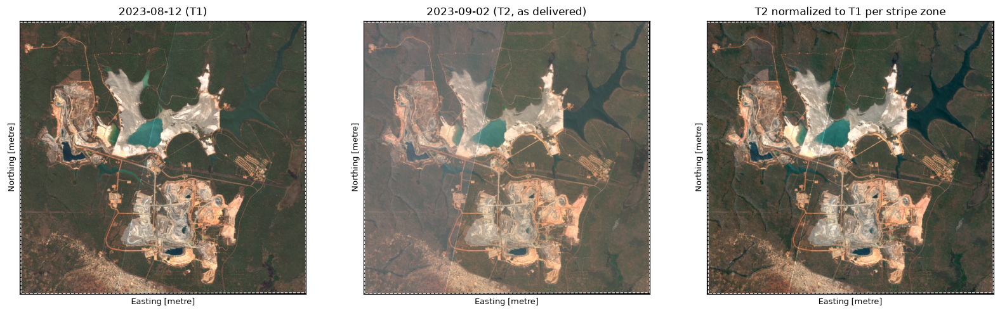
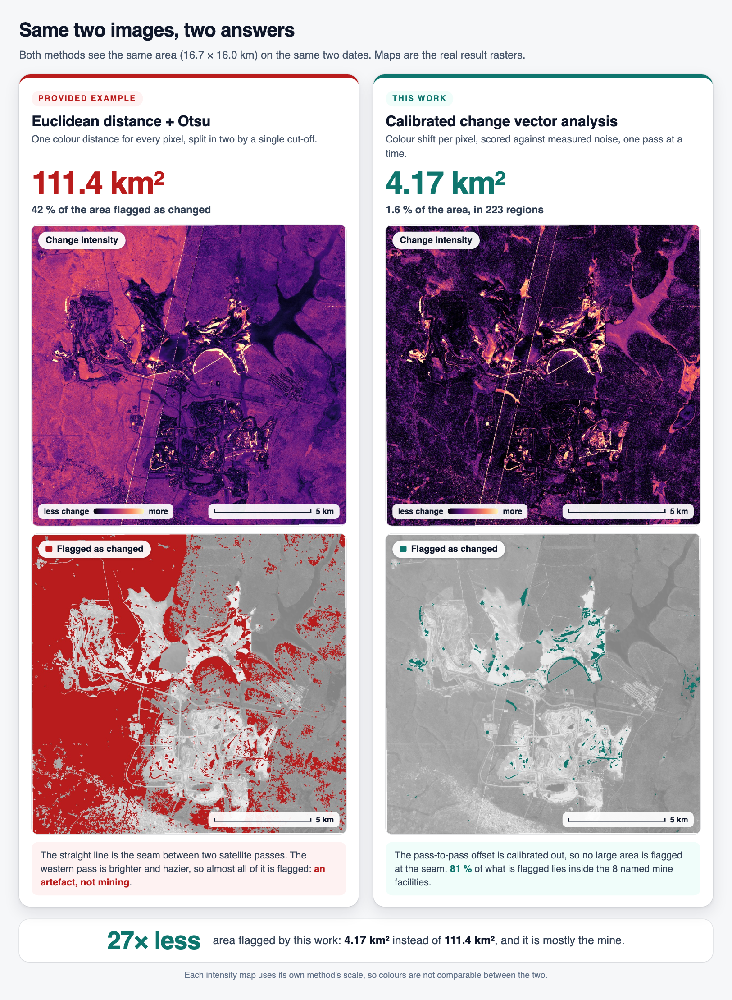
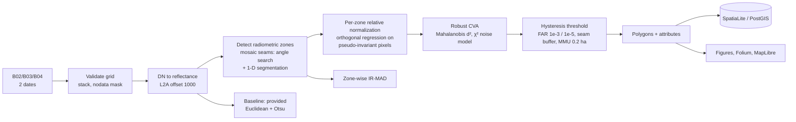

# Sentinel-2 change detection: open-pit mine, Zambia (2023-08-12 → 2023-09-02)

A small geospatial analytics pipeline: it loads two Sentinel-2 scenes, detects change, stores the change polygons in a spatial database (SpatiaLite file or PostGIS) and visualizes and interprets the result.

**The finding that shapes the pipeline:** neither provided "date" is a single acquisition. I traced both back through STAC, pixel for pixel (100 % identical DN on 2.65 M pixels): each is a **mosaic of two Sentinel-2 scenes from different orbits**. The "before" mosaic combines 07-01 and 07-04, and the "after" mosaic combines 08-25 and 09-02. They are seamed along a slanted swath edge, and the after date is hazier. The pipeline detects these radiometric zones blind from the data, and they match the true seams at 99–100 %. It then normalizes each zone and scores change with a per-zone statistical noise model.

The provided Euclidean baseline flags **94 %** of one zone as "changed" and 11,078 ha in total. This method finds **1,345 ha**, at a similar 3–6 % in every zone, concentrated on the tailings facility, the waste dumps and the pits.

| | |
|---|---|
|  |  |

**Read next:** [`report.md`](report.md) (method, results, interpretation) · [interactive map](docs/change_map.html) · [TypeScript viewer](docs/viewer/index.html)

## How this maps to the brief

Everything the brief requires runs offline from the provided `inputs/` with one command (`uv run s2cd run`). The extensions in the second table are optional and separate.

| Brief | Where |
|---|---|
| **Part 1:** load B02/B03/B04 for both dates, verify CRS/transform/dimensions, stack | `src/s2cd/io.py` (`check_consistency` raises on any mismatch) → `data/processed/sentinel2_2023MMDD_stack.tif` |
| **Part 2:** apply the example algorithm *and* your own | Example run unchanged: `change_map_baseline.tif`, `change_binary_baseline.tif`. Mine (zone-aware normalization + robust CVA): `change_map.tif`, `change_binary.tif` |
| **Part 3:** vectorize, store in SQLite/SpatiaLite or PostGIS, `id, date_before, date_after, area_m2, confidence, geometry` | `data/change_detection.sqlite` (SpatiaLite, `MULTIPOLYGON` EPSG:32735 with R*Tree index). PostGIS: `sql/schema_postgis.sql`, `make db-up && make run-postgis` |
| **Part 4:** visualize the AOI + change raster/polygons (interactive is a plus) | `docs/figures/*.png`, `docs/change_map.html` (Folium), `docs/viewer/` (MapLibre) |
| **Part 5:** `report.md` with Method / Results / Interpretation | [`report.md`](report.md) sections 1–3. Section 0 covers the data finding and section 4 the limitations |
| README: how to run, approach, assumptions | This file |

| Beyond the brief (optional) | Command |
|---|---|
| Provenance + SWIR/NIR enrichment (source scenes, dNBR/dMNDWI, `likely_cause`) | `uv sync --extra stac && uv run s2cd enrich` |
| Monthly timeline Jan 2023 – Oct 2026 (footprint, water, change per month, timelapse) | `uv run --extra stac python -m s2cd.timeline` |
| Analyst agent (FastAPI + deepagents + Gemini over PostGIS, read-only, with evals) | [`app/README.md`](app/README.md) |
| Live demo: [s2change.dzaky.ai.id](https://s2change.dzaky.ai.id) | `deploy/` |

---

## Quick start

```bash
# Python 3.12 + uv (https://docs.astral.sh/uv/)
uv sync
uv run s2cd run          # ~40 s on a laptop: all rasters, SQLite DB, figures, maps
uv run pytest -q         # unit tests on synthetic data
```

Outputs:

| Path | What |
|---|---|
| `data/processed/sentinel2_2023MMDD_stack.tif` | Part 1: 3-band stacks (B02, B03, B04), original DN |
| `data/processed/sentinel2_20230902_stack_normalized.tif` | After-date normalized to before-date radiometry, per zone |
| `data/processed/radiometric_zones.tif` | Detected radiometric zones (mosaic seams) |
| `data/processed/change_map.tif` | Part 2: change intensity (log10 Mahalanobis d²), float32 |
| `data/processed/change_probability.tif` | Change probability (χ² CDF) scaled 0–254 |
| `data/processed/change_binary.tif` | Binary change, main method |
| `data/processed/change_map_baseline.tif`, `change_binary_baseline.tif` | Provided Euclidean algorithm + Otsu threshold |
| `data/processed/change_binary_irmad.tif` | Zone-wise IR-MAD (comparison) |
| `data/change_detection.sqlite` | Part 3: SpatiaLite DB, tables `change_features`, `change_runs` |
| `data/processed/change_features.geojson` | Same polygons, EPSG:4326 |
| `data/processed/run_summary.json` | All diagnostics (zone model, calibration, thresholds, areas) |
| `docs/figures/*.png`, `docs/change_map.html`, `docs/viewer/` | Part 4: figures, Folium map, MapLibre viewer |
| `report.md` | Part 5: interpretation |

### PostGIS (Docker)

```bash
make db-up                       # postgis/postgis:16-3.4 on localhost:5432
make run-postgis                 # same pipeline, also writes to PostGIS
docker compose up --build        # or everything in containers (db + pipeline)
```

The schema is in [`sql/schema_postgis.sql`](sql/schema_postgis.sql): `geometry(MultiPolygon, 32735)` with a GiST index, foreign key to `change_runs`, CHECK constraints, and a `change_features_wgs84` view for web clients. Writes are idempotent per `run_id`. Example queries: [`sql/queries_postgis.sql`](sql/queries_postgis.sql), [`sql/queries_spatialite.sql`](sql/queries_spatialite.sql).

### Optional: enrichment from Planetary Computer

```bash
uv sync --extra stac
uv run s2cd enrich      # source-scene provenance, B08/B11/B12/SCL/AOT, dNBR/dMNDWI/dNDVI, likely_cause
```

This step is optional. Everything else works offline on the provided data only. `s2cd run` rewrites the SQLite file, so run `enrich` again after it.

## Approach



1. **Load and validate.** Every band of both dates must share CRS, transform and shape (`check_consistency` raises with a precise message if not). Nodata is 0 in any band. All rasters are EPSG:32735 (UTM 35S), 10 m, 1673 × 1597 px.
2. **Radiometry.** The DN values follow the L2A processing-baseline ≥ 04.00 convention: no valid DN falls below 1000, so the pipeline treats them as `reflectance = (DN − 1000) / 10000`. It then finds the radiometric zones on the blue difference T2 − T1, the band most sensitive to haze. A grid search finds the seam angle that maximizes the variance explained by a 1-D profile, and binary segmentation finds the steps. Result: **12.6°, 4 zones, 56 % of variance explained**. STAC provenance confirms that these are mosaic seams.
3. **Normalization.** Per zone and band, an orthogonal-regression line maps T2 onto T1, iterated with 2.5 σ outlier rejection. The pixels that survive are the pseudo-invariant features (PIFs, 86 % of pixels).
4. **Change statistic.** The change vector is Δ = T2_norm − T1. The PIFs of each zone give the "no change" mean and covariance, and d² is each pixel's Mahalanobis distance from it. Under no change, d² ~ χ²(3), so thresholds are **false-alarm rates**, not magic numbers.
5. **Binary map and polygons.** Hysteresis thresholding grows regions at a false-alarm rate (FAR) of 1e-3 and keeps only regions containing a pixel at FAR 1e-5. It then drops pixels within 2 px of a zone seam, applies an opening, enforces a 0.2 ha minimum mapping unit and fills holes. Regions are vectorized with 8-connectivity. Each polygon gets area, perimeter, confidence, Δ per band, direction (brightening / darkening / spectral shift), and an `in_disturbed_area` flag (a heuristic footprint of bright bare surfaces at T1).
6. **Comparison methods.** The provided `compute_change_distance` is imported from `inputs/` and run unchanged, with an Otsu threshold. Zone-wise IR-MAD (Nielsen 2007) is also run. `report.md` explains why both over-detect here.

### Assumptions

- The inputs are L2A surface reflectance with the +1000 offset. The code infers the offset from the data rather than hard-coding it.
- The two dates are co-registered at the sub-pixel level. Residual edge effects are handled by the opening and the MMU, not modelled.
- Most of the AOI did not change between the two mosaics (52–60 days apart in practice). This is what makes PIF selection and the per-zone noise model valid.
- `date_before` / `date_after` in the database are the **nominal** dates from the folder names, as the brief's table expects. The true per-pixel acquisition dates are in `change_context.source_before` / `source_after` after `s2cd enrich`, and in report section 0.
- "Confidence" is a 0–1 magnitude score: the polygon mean of `clip(log10(d² / d²_low) / 2, 0, 1)`. It reaches 1 at 100× the detection threshold. It is not a calibrated accuracy, because there is no reference data. `mean_p_change` and `strong_fraction` are stored alongside it.

## Repository layout

```
inputs/                 provided data, unchanged (aoi.geojson, example script, B02-B04 per date)
src/s2cd/
  io.py                 load, validate, stack, write tiled GeoTIFFs with overviews
  radiometry.py         DN->reflectance, zone (seam) detection, per-zone normalization
  methods.py            provided baseline (wrapped), robust CVA, zone-wise IR-MAD
  vectorize.py          hysteresis thresholds, morphology, polygons + attributes
  db.py                 SpatiaLite + PostGIS writers (idempotent per run)
  viz.py                figures, WebP overlays, Folium map
  stac_context.py       optional Planetary Computer enrichment (dNBR, dMNDWI, SCL, AOT)
  pipeline.py, cli.py   orchestration, `s2cd` CLI
configs/default.yaml    every threshold, with its meaning
sql/                    PostGIS schema + example queries (PostGIS and SpatiaLite)
tests/                  pytest suite on synthetic rasters
viewer/                 TypeScript + MapLibre viewer (built into docs/viewer)
docs/                   figures, Folium map, web assets
```

## Tooling

uv · ruff · pytest · GitHub Actions CI · Docker / docker-compose (PostGIS 16) · Vite + TypeScript + MapLibre.
