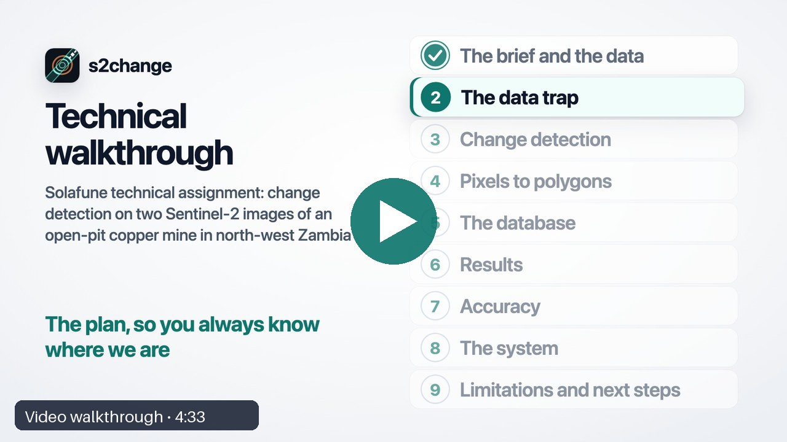
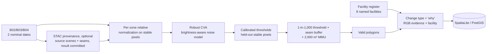
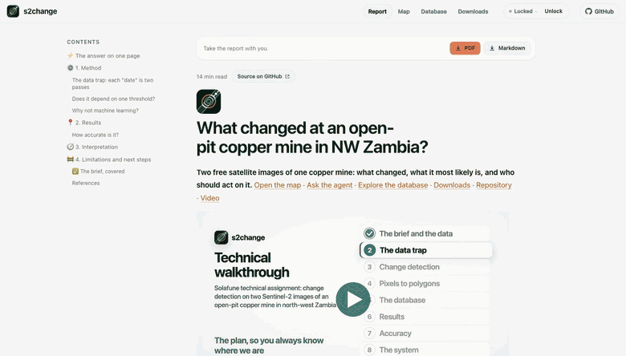
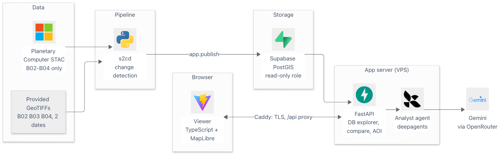

<p align="center"></p>

<h1 align="center">s2change</h1>

<p align="center"><b>What changed at an open-pit copper mine in Zambia?</b><br>Free satellite images, two dates: what changed, what it means, who should act.</p>

**In one paragraph.** Between the two 2023 dates the mine was working normally: 4.2 km² changed, four fifths inside known facilities (tailings spread on the tailings dam, waste rock dumped, pits dug), with no new clearing outside it. The supplied images hide a trap: each is stitched from two satellite passes, so the provided example method reports 27× more "change", mostly stitching. Over three years, same season, the mine keeps growing: change typed as waste dumping rises from 5.7 to 20.2 km² (exploratory, not validated).

**Read:** [report.md](report.md) (Method · Results · Interpretation · Limitations). **Run:** the three commands below. **Look:** the optional [live app](https://s2change.dzaky.ai.id). **Watch:** the [4.5-minute walkthrough](https://youtu.be/MBTmg62P2ew).

<p align="center"><a href="https://youtu.be/MBTmg62P2ew"></a></p>

## Reproduce it (offline, about 30 seconds)

```bash
uv sync                  # Python 3.12 environment from the lockfile
uv run s2cd run          # Parts 1-3 + figures: stacks, change maps, polygons, SQLite DB
uv run pytest -q -m "not slow"   # optional: the test suite
```

Inputs are the provided files in `inputs/`, unchanged. Outputs (already committed, so they can be inspected without running anything):

| Output | Path |
|---|---|
| Stacked images (Part 1) | `data/processed/sentinel2_20230812_stack.tif`, `sentinel2_20230902_stack.tif` |
| Provided example method (Part 2) | `data/processed/change_map_baseline.tif`, `change_binary_baseline.tif` |
| My method (Part 2) | `data/processed/change_map.tif`, `change_binary.tif` (+ `change_significance.tif`) |
| Change polygons in a spatial DB (Part 3) | `data/change_detection.sqlite` (SpatiaLite, table `change_features`) and `data/processed/change_features.geojson` |
| Figures (Part 4) | `docs/figures/` |
| Run parameters and numbers | `data/processed/run_summary.json`, `sensitivity.csv` |

## Findings (nominal 2023-08-12 → 2023-09-02)

> [!IMPORTANT]
> **The provided "dates" are mosaics.** Each combines two Sentinel-2 scenes from different orbits, verified pixel-exact against STAC (100 % identical DN). The scenes actually compared are **52–60 days** apart, and radiometry steps along the seams. The provided Euclidean baseline maps those seams and haze: **111.4 km² (42 % of the AOI)**.

- **Calibrated change: 4.17 km²** in 223 polygons (1.6 % of the AOI). Realised false-alarm rate on held-out stable pixels is **0.10 %**, at the 0.1 % target.
- **It is mining, not expansion.** **81 %** of the change lies inside the named facilities: the tailings facility (2.19 km², including fresh fill on the dam walls, consistent with a raise), the waste dumps and pit edges (0.75 km² of dumping), and pit benches. Each change comes with a plain sentence: what it is, where, how big, the evidence and what to check. Outside the mine, only 0.02 km² (6 polygons) is typed as land clearing.
- **So what (multi-year, same season, exploratory):** from August 2023 to August 2024 / 2025 / 2026, change typed as waste dumping grows 2.3 → 5.5 → 11.3 km² and change outside the named facilities 3.3 → 9.2 → 14.3 km²: a mine in sustained development with a spreading footprint, the signal a regulator or investor would want. See [who acts on it](report.md#-3-interpretation).
- **Checked on 200 random points:** precision 0.67 ± 0.11 against the provided method's 0.12 ± 0.08; overall accuracy 0.94 against 0.62. It is conservative: recall 0.17 ± 0.11, so 4.17 km² is the confident core of an estimated 16.6 ± 10.9 km² of real change.
- **Robust:** the result holds across 16 threshold settings (2.10–6.95 km², 67–88 % inside the 5 mining facilities of the register).

## How this maps to the brief

| Brief | Where |
|---|---|
| **1 · Data preparation:** load B02–B04, verify CRS/transform/shape, stack | `s2cd/io.py` → `data/processed/sentinel2_2023MMDD_stack.tif` |
| **2 · Change detection:** the example algorithm *and* your own | Example, unchanged: `change_map_baseline.tif`, `change_binary_baseline.tif`. Mine: `change_map.tif` (log10 d²), `change_significance.tif` (−log10 p), `change_binary.tif` |
| **3 · Features in a geospatial DB** (`id, date_before, date_after, area_m2, confidence, geometry`) | `data/change_detection.sqlite` (SpatiaLite) and **PostGIS on Supabase**: `change_features` + `change_runs` + `facilities` + `facility_changes`, MultiPolygon EPSG:32735, GiST index, validity check. Query it live in the app's **Database** tab |
| **4 · Visualization:** AOI + change raster/polygons, interactive a plus | The app: swipe, change types, facility register, intensity, other-date comparison. Static figures in `docs/figures/` |
| **5 · `report.md`:** Method / Results / Interpretation | [report.md](report.md): 1 Method (with the data trap and sensitivity), 2 Results, 3 Interpretation, 4 Limitations |

## More commands

```bash
uv run s2cd provenance          # optional, online: STAC source scenes per pixel (B02-B04 only)
make figures                    # re-render the report figures (HTML + Playwright)
uv run python -m s2cd.sensitivity   # threshold sweep
```

PostGIS locally: `make db-up && make run-postgis` (docker compose, PostGIS 16). Production publishing: `python -m app.publish` (see `app/README.md`).

## Approach in one picture



**Assumptions:**
- Inputs are L2A surface reflectance with the −1000 BOA offset. It is detected robustly, with a warning if it falls back.
- The dates are nominal, and the database stores them as given. The true acquisitions per zone are in `data/processed/run_summary.json` under `acquisition`.
- Most of the AOI is unchanged, so stable pixels can be found per zone.
- Facility regions are analyst-defined (human-in-the-loop), but their outlines come from the imagery.
- "Confidence" is a change-magnitude score, not an accuracy: per pixel log10(d² / threshold) / 2 clipped to 0–1 (0 at the threshold, 1 at 100× it), averaged over the polygon. Baseline rows have none. Accuracy is measured on 200 stratified random points labelled by two independent AI vision labellers (not field truth); see [report, how accurate](report.md#how-accurate-is-it).

## The app (optional)

Everything the brief asks for is in the repository and runs offline. The app is an extra way to check the results without installing anything: [s2change.dzaky.ai.id](https://s2change.dzaky.ai.id).

<p align="center">

[](pyproject.toml)
[](viewer/)
[](sql/)
[](app/)
[](viewer/)
[](https://s2change.dzaky.ai.id)

</p>

| Open to everyone | Needs the access code |
|---|---|
| Report, map with swipe and change types, facility register, database explorer, SQL dumps, downloads, every precomputed comparison | The agent (LLM cost), the full database connection URI, and new date comparisons not yet cached |

The access code is shared with the reviewers on request. Running the app yourself needs a PostGIS database and an LLM key (`app/.env.example`, `app/README.md`); the pipeline above needs neither.

<p align="center"></p>

<p align="center"><i>The report; changes on high-res imagery with the plain-language "What changed" list; the dam-wall change explained; the Sentinel-2 before/after swipe; the facility register; a 2023 → 2026 comparison; the PostGIS explorer. Recorded from the live site by <code>scripts/demo_gif.py</code>. The agent is shown in the <a href="https://youtu.be/MBTmg62P2ew">video</a>.</i></p>

## Architecture

<p align="center"></p>

| | Technology |
|---|---|
| **Pipeline** |  Python 3.12,  uv,  numpy,  scipy, rasterio, scikit-image,  geopandas, shapely, pyogrio |
| **Storage** |  PostGIS (GiST index) on  Supabase,  SpatiaLite file,  SQLAlchemy and psycopg;  Docker Compose for a local PostGIS |
| **API** |  FastAPI, slowapi rate limits, sqlglot SQL guard, read-only DB role |
| **Agent** |  LangChain deepagents on  Gemini (direct or via  OpenRouter), typed tools and knowledge notes |
| **Viewer** |  Vite,  TypeScript,  MapLibre GL |
| **Delivery** |  Caddy (TLS, static) +  PM2 on a VPS;  GitHub Actions runs  ruff,  pytest and the builds |

The agent sequence diagram, the stack table with reasons and the security controls are in [docs/system.md](docs/system.md).

## Repository

Core (what the brief asks for): `inputs/`, `src/s2cd/`, `configs/`, `sql/`, `data/`, `report.md`. Optional extras: `app/`, `viewer/`, `scripts/`, `deploy/`.

```
inputs/                  provided data, unchanged
src/s2cd/
  io.py                  load, validate, stack, write GeoTIFF/COG
  provenance.py          STAC source scenes behind each provided date (B02-B04 only)
  radiometry.py          reflectance, zones (seams), per-zone normalization
  methods.py             provided baseline, robust CVA (calibrated)
  vectorize.py           threshold, cleanup, valid polygons
  rgb.py                 visible-band indices and rules (greenness, redness, water, bare)
  register.py            facility register: outlines from imagery, change per facility
  interpret.py           change type + brief category + explanation per polygon
  scenes.py, catalog.py, compare.py   other dates: monthly clear-scene catalogue + comparisons (multi-year figure)
  sensitivity.py
  pipeline.py, cli.py, viz.py, db.py, site.py
configs/                 thresholds (default.yaml), facility register
sql/                     PostGIS schema + example queries
app/                     FastAPI: results, DB explorer, agent (+ knowledge/)
viewer/                  TypeScript + MapLibre app (built into docs/viewer and the live site)
scripts/                 report figures (HTML + Playwright), accuracy sample, AnyChange test, demo GIF
docs/                    figures, web assets, api.md
```
