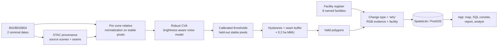

# s2change: what changed at an open-pit copper mine in Zambia?

Sentinel-2 change detection for one mine, using **only B02/B03/B04** and **two dates**, as the brief provides. The pipeline finds the change, types it ("tailings deposition", "waste dumping"…), stores it in PostGIS and explains it.

**Open the app: [s2change.dzaky.ai.id](https://s2change.dzaky.ai.id).** It has the map, a live read-only SQL console on the database, the report and the downloads. No setup is needed.


## Findings (nominal 2023-08-12 → 2023-09-02)

- **The provided "dates" are mosaics.** Each combines two Sentinel-2 scenes from different orbits, verified pixel-exact against STAC (100 % identical DN). The scenes actually compared are **52–60 days** apart, and radiometry steps along the seams. The provided Euclidean baseline maps those seams and haze: **11,143 ha (42 % of the AOI)**.
- **Calibrated change: 413 ha** in 215 polygons (1.6 % of the AOI). Realised false-alarm rate on held-out stable pixels is **0.10 %**, at the 0.1 % target.
- **It is mining, not expansion.** **74 %** of the change lies inside the named facilities: the tailings facility (194 ha), the waste dumps and pit edges (129 ha of dumping), and pit benches. There is no clearing beyond the mine footprint at the 0.2 ha scale.
- **Robust:** the result holds across 16 threshold settings (210–682 ha, 61–77 % inside the mine).

Full write-up: **[report.md](report.md)**: method, results, interpretation with RGB-only confounders, sensitivity, limitations.

## How this maps to the brief

| Brief | Where |
|---|---|
| **1 · Data preparation:** load B02–B04, verify CRS/transform/shape, stack | `s2cd/io.py` → `data/processed/sentinel2_2023MMDD_stack.tif` |
| **2 · Change detection:** the example algorithm *and* your own | Example, unchanged: `change_map_baseline.tif`, `change_binary_baseline.tif`. Mine: `change_map.tif` (log10 d²), `change_significance.tif` (−log10 p), `change_binary.tif` |
| **3 · Features in a geospatial DB** (`id, date_before, date_after, area_m2, confidence, geometry`) | `data/change_detection.sqlite` (SpatiaLite) and **PostGIS on Supabase**: `change_features` + `change_runs` + `facilities` + `facility_changes`, MultiPolygon EPSG:32735, GiST index, validity check. Query it live in the app's **Database** tab |
| **4 · Visualization:** AOI + change raster/polygons, interactive a plus | The app: swipe, change types, facility register, intensity, oblique view, draw-an-area stats, other-date comparison. Static figures in `docs/figures/` |
| **5 · `report.md`:** Method / Results / Interpretation | [report.md](report.md) sections 1–3; the data finding, sensitivity and limitations sit around them |

## Run it

```bash
uv sync && uv run s2cd run      # ~30 s, offline: stacks, change maps, polygons, SQLite DB, figures
uv run s2cd provenance          # optional, online: STAC source scenes + seam map (B02-B04 only)
uv run python -m s2cd.sensitivity   # threshold sweep
uv run --extra stac python -m s2cd.catalog   # optional, online: one clear scene per month for the date picker
```

PostGIS locally: `make db-up && make run-postgis` (docker compose, PostGIS 16). Production publishing: `python -m app.publish` (see `app/README.md`).

## Approach in one picture



**Assumptions:**
- Inputs are L2A surface reflectance with the −1000 BOA offset. It is detected robustly, with a warning if it falls back.
- The dates are nominal. The true acquisitions are stored in the run metadata.
- Most of the AOI is unchanged, so stable pixels can be found per zone.
- Facility regions are analyst-defined (human-in-the-loop), but their outlines come from the imagery.
- "Confidence" is a change-magnitude score, not an accuracy. There is no reference data, so accuracy is not assessed (report section 5).

## Repository

```
inputs/                  provided data, unchanged
src/s2cd/
  io.py                  load, validate, stack, write GeoTIFF/COG
  provenance.py          STAC source scenes behind each provided date (B02-B04 only)
  radiometry.py          reflectance, zones (seams), per-zone normalization
  methods.py             provided baseline, robust CVA (calibrated), IR-MAD for comparison
  vectorize.py           hysteresis, cleanup, valid polygons
  rgb.py                 visible-band indices and rules (greenness, redness, water, bare)
  register.py            facility register: outlines from imagery, change per facility
  interpret.py           change type + brief category + explanation per polygon
  scenes.py, catalog.py, compare.py   other dates: monthly clear-scene catalogue + precomputed comparisons
  sensitivity.py
  pipeline.py, cli.py, viz.py, db.py, site.py
configs/                 thresholds (default.yaml), facility register
sql/                     PostGIS schema + example queries
app/                     FastAPI: results, DB explorer, AOI stats, compare jobs, analyst agent (+ knowledge/)
viewer/                  TypeScript + MapLibre app (built into docs/viewer and the live site)
docs/                    figures, web assets, api.md
```

**Tooling:** uv · ruff · pytest · GitHub Actions · Docker Compose (PostGIS) · Supabase PostGIS · FastAPI · Vite + TypeScript + MapLibre.
