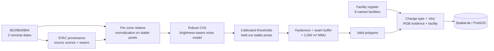

<p align="center"></p>

<h1 align="center">s2change</h1>

<p align="center"><b>What changed at an open-pit copper mine in Zambia?</b><br>Free satellite images, two dates: what changed, what it means, who should act.</p>

<p align="center">

[](pyproject.toml)
[](viewer/)
[](sql/)
[](app/)
[](viewer/)
[](https://s2change.dzaky.ai.id)
[](report.md)

</p>

**In one paragraph.** Between the two 2023 dates the mine was working normally: 4.1 km² changed, three quarters inside known facilities (tailings spread on the tailings dam, waste rock dumped, pits dug), with no new clearing outside it. Over three years, same season, it is growing: waste moved rises from 5.7 to 20.2 km² and change outside the known facilities from 5.6 to 18.2 km², which a regulator would check against the licence and an investor reads as an active operation. The supplied images hide a trap (each is stitched from two satellite passes); a standard method reports 27× more "change", mostly stitching. Data is free; one run takes about 30 seconds.

*How:* Sentinel-2 **B02/B03/B04 only**, two dates, as the brief provides. The pipeline finds the change, types it ("tailings deposition", "waste dumping"…), stores it in PostGIS and explains it.

> [!TIP]
> **Open the app: [s2change.dzaky.ai.id](https://s2change.dzaky.ai.id).** It has the map, a live read-only SQL console on the database, the report and the downloads. No setup is needed.

<p align="center"></p>

<p align="center"><i>Overview with facility thumbnails, before/after swipe with the plain-language "What changed" list, a 2023 → 2026 comparison, and the analyst opening a facility on the map.</i></p>

## Findings (nominal 2023-08-12 → 2023-09-02)

> [!IMPORTANT]
> **The provided "dates" are mosaics.** Each combines two Sentinel-2 scenes from different orbits, verified pixel-exact against STAC (100 % identical DN). The scenes actually compared are **52–60 days** apart, and radiometry steps along the seams. The provided Euclidean baseline maps those seams and haze: **111.4 km² (42 % of the AOI)**.

- **Calibrated change: 4.13 km²** in 215 polygons (1.6 % of the AOI). Realised false-alarm rate on held-out stable pixels is **0.10 %**, at the 0.1 % target.
- **It is mining, not expansion.** **74 %** of the change lies inside the named facilities: the tailings facility (1.94 km², including a likely dam-wall raise of 0.39 km²), the waste dumps and pit edges (0.90 km² of dumping), and pit benches. Each change comes with a plain sentence: what it is, where, how big, the evidence and what to check. There is no clearing beyond the mine footprint at the 2,000 m² scale.
- **So what (multi-year, same season):** from August 2023 to August 2024 / 2025 / 2026, waste movement grows 5.7 → 14.5 → 20.2 km² and change outside the named facilities 5.6 → 12.9 → 18.2 km²: a mine in sustained development with a spreading footprint, the signal a regulator or investor would want. See [who acts on it](report.md#what-it-means-and-who-acts-on-it).
- **Robust:** the result holds across 16 threshold settings (2.10–6.82 km², 61–77 % inside the mine).

Full write-up: **[report.md](report.md)**: method, results, interpretation with RGB-only confounders, sensitivity, limitations.

## How this maps to the brief

| Brief | Where |
|---|---|
| **1 · Data preparation:** load B02–B04, verify CRS/transform/shape, stack | `s2cd/io.py` → `data/processed/sentinel2_2023MMDD_stack.tif` |
| **2 · Change detection:** the example algorithm *and* your own | Example, unchanged: `change_map_baseline.tif`, `change_binary_baseline.tif`. Mine: `change_map.tif` (log10 d²), `change_significance.tif` (−log10 p), `change_binary.tif` |
| **3 · Features in a geospatial DB** (`id, date_before, date_after, area_m2, confidence, geometry`) | `data/change_detection.sqlite` (SpatiaLite) and **PostGIS on Supabase**: `change_features` + `change_runs` + `facilities` + `facility_changes`, MultiPolygon EPSG:32735, GiST index, validity check. Query it live in the app's **Database** tab |
| **4 · Visualization:** AOI + change raster/polygons, interactive a plus | The app: swipe, change types, facility register, intensity, other-date comparison. Static figures in `docs/figures/` |
| **5 · `report.md`:** Method / Results / Interpretation | [report.md](report.md) sections 1–3; the data finding, sensitivity and limitations sit around them |

## Run it

```bash
uv sync && uv run s2cd run      # ~30 s, offline: stacks, change maps, polygons, SQLite DB, figures
uv run s2cd provenance          # optional, online: STAC source scenes + seam map (B02-B04 only)
uv run python -m s2cd.sensitivity   # threshold sweep
uv run --extra stac python -m s2cd.catalog   # optional, online: one clear scene per month for the date picker
```

PostGIS locally: `make db-up && make run-postgis` (docker compose, PostGIS 16). Production publishing: `python -m app.publish` (see `app/README.md`).

## Approach in one picture



**Assumptions:**
- Inputs are L2A surface reflectance with the −1000 BOA offset. It is detected robustly, with a warning if it falls back.
- The dates are nominal. The true acquisitions are stored in the run metadata.
- Most of the AOI is unchanged, so stable pixels can be found per zone.
- Facility regions are analyst-defined (human-in-the-loop), but their outlines come from the imagery.
- "Confidence" is a change-magnitude score, not an accuracy. There is no reference data, so accuracy is not assessed (report section 6).

## Architecture

<p align="center"></p>

| | Technology |
|---|---|
| **Pipeline** |  Python 3.12,  uv,  numpy,  scipy, rasterio, scikit-image,  geopandas, shapely, pyogrio |
| **Storage** |  PostGIS (GiST index) on  Supabase,  SpatiaLite file,  SQLAlchemy and psycopg;  Docker Compose for a local PostGIS |
| **API** |  FastAPI, slowapi rate limits, sqlglot SQL guard, read-only DB role |
| **Analyst** |  LangChain deepagents on  Gemini (direct or via  OpenRouter), typed tools and knowledge notes |
| **Viewer** |  Vite,  TypeScript,  MapLibre GL |
| **Delivery** |  Caddy (TLS, static) +  PM2 on a VPS;  GitHub Actions runs  ruff,  pytest and the builds |

The analyst sequence diagram and the stack table with reasons are in [report.md, section 5](report.md#5-system-and-stack).

## Repository

```
inputs/                  provided data, unchanged
src/s2cd/
  io.py                  load, validate, stack, write GeoTIFF/COG
  provenance.py          STAC source scenes behind each provided date (B02-B04 only)
  radiometry.py          reflectance, zones (seams), per-zone normalization
  methods.py             provided baseline, robust CVA (calibrated)
  vectorize.py           hysteresis, cleanup, valid polygons
  rgb.py                 visible-band indices and rules (greenness, redness, water, bare)
  register.py            facility register: outlines from imagery, change per facility
  interpret.py           change type + brief category + explanation per polygon
  scenes.py, catalog.py, compare.py   other dates: monthly clear-scene catalogue + precomputed comparisons
  sensitivity.py
  pipeline.py, cli.py, viz.py, db.py, site.py
configs/                 thresholds (default.yaml), facility register
sql/                     PostGIS schema + example queries
app/                     FastAPI: results, DB explorer, compare jobs, analyst agent (+ knowledge/)
viewer/                  TypeScript + MapLibre app (built into docs/viewer and the live site)
docs/                    figures, web assets, api.md
```
