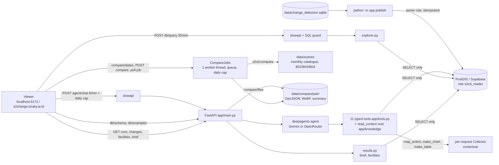

# s2cd app: results, database explorer, date comparison and the analyst

The single place to inspect the solution, so evaluators never need a database client. A FastAPI service over the PostGIS results (the provided pair), a database explorer, a date picker that runs the same pipeline on any two Sentinel-2 dates, and a small grounded analyst agent (in the spirit of Solafune's ShigenBot) that answers with numbers taken from tools and returns **map actions, charts and tables**. The endpoint contract is `docs/api.md`; the evidence is RGB only (B02, B03, B04) and two dates.



## Run locally

```bash
uv sync --all-extras
docker compose up -d db                     # or docker-compose; PostGIS on :5432
cp app/.env.example .env                    # fill GEMINI_API_KEY and the passwords
set -a; source .env; set +a                 # or export the variables yourself
uv run --all-extras python -m app.publish   # loads data/change_detection.sqlite, creates s2cd_reader; safe to rerun
uv run --all-extras uvicorn app.main:app --port 8000
uv run --all-extras python -m app.evals     # needs the API running; writes app/evals/results.{md,json}
```

Run the API from the repository root: the comparison worker reads `inputs/` and writes `data/compare/` and `data/scenes/` (both git-ignored). Other dates come from the catalogue in `data/scenes/` (built once with `uv run --extra stac python -m s2cd.catalog`, which needs network access to Planetary Computer); comparisons themselves run offline.

Production data lives in Supabase PostGIS. Publish runs from a workstation with the owner URL (pooler, session mode, port 5432); the VPS only gets the read-only `s2cd_reader` URL. On Supabase, `schema_app.sql` also revokes the auto-exposed REST roles (`anon`, `authenticated`) on every table and grants the reader `USAGE` on the `extensions` schema where PostGIS lives.

`publish` runs `sql/schema_postgis.sql` then `sql/schema_app.sql` (facility tables and the read-only role; it drops the retired `change_context`, `timeline_months` and `likely_cause`), makes the database hold exactly the runs in the SQLite file, loads `facilities` and `facility_changes`, then sets the reader password.

| Variable | Used by | Default / note |
|---|---|---|
| `GEMINI_API_KEY` | agent | required for chat with `LLM_PROVIDER=google` (default); read from the environment, never stored |
| `GEMINI_MODEL` | agent, `/api/health` | `gemini-3.5-flash` |
| `LLM_PROVIDER` | agent | `google` (default) or `openrouter` (same model, for hosts where Google's API refuses the region) |
| `OPENROUTER_API_KEY`, `AGENT_OPENROUTER_MODEL` | agent | only with `LLM_PROVIDER=openrouter`; model defaults to `google/<GEMINI_MODEL>` |
| `DATABASE_URL` | `app.publish` only | owner connection (SQLAlchemy URL) |
| `READER_PASSWORD` | `app.publish` | password given to `s2cd_reader` |
| `READER_DATABASE_URL` | API, agent, evals | connection as `s2cd_reader` |
| `AGENT_DAILY_CAP` | API | `300` chat calls per day, whole service |
| `AGENT_RATE` | API | `6/minute` per client IP |
| `DB_RATE` | API | `30/minute` per client IP for `POST /api/db/query` |
| `COMPARE_RATE` | API | `10/minute` per client IP for comparison submissions |
| `COMPARE_DAILY_CAP` | API | `12` new (uncached) comparisons per day, whole service |
| `ACCESS_CODE_HASH` | API | PBKDF2 hash of the access code (see Access code). Unset: no gate, everything open |
| `SESSION_SECRET` | API | 32+ random characters signing the session cookie; required when `ACCESS_CODE_HASH` is set |
| `LOGIN_RATE` | API | `5/minute` per client IP for `POST /api/auth/login` |
| `EVAL_API_URL` | evals | `http://127.0.0.1:8000`; start the API with a high `AGENT_RATE` for evals |

## API

See `docs/api.md` for every endpoint and its shape. By module:

- `app/results.py` (shared by the endpoints and the agent tools): `resolve_run`, `change_type_summary`, `facility_rows`, `facilities_geojson`, and `brief`, a deterministic markdown monitoring brief (headline, top facilities, change types, caveats, follow-up list) built from the database with no LLM.
- `app/explorer.py`: `/api/db/schema` (tables, row counts, columns, geometry SRID), `/api/db/examples` (the titled blocks of `sql/queries_postgis.sql` with `:'run_id'` filled in) and `/api/db/query` (guarded SELECT, 500 rows max, `elapsed_ms`; a geometry column comes back as a GeoJSON FeatureCollection converted to EPSG:4326, and the table shows the cell as `geometry`).
- `app/compare_jobs.py` + `src/s2cd/compare.py`: `POST /api/compare` validates both dates (`provided-before`/`provided-after` or a catalogue date; after later than before), returns a cached result at once, otherwise queues one job. One worker thread runs `pipeline.run` on the stored scenes (no figures), then writes `changes.geojson`, `summary.json` and the WebP overlays to `data/compare/<pair>/`. At most 5 jobs wait, and new uncached jobs are capped per day. Dates outside the catalogue are rejected with a 422. Compare results live on disk, not in the database, so the analyst cannot query them.
- Chat: `POST /api/agent/chat` with `{"messages":[{"role","content"}]}` returning `{answer, actions, charts, tables, tool_calls}`. Action types: `fly_to {bbox}`, `highlight {run_id, ids}`, `show_run {run_id}`.

## Agent design

- **Framework:** `create_deep_agent` on `ChatGoogleGenerativeAI`, or on `ChatOpenAI` through OpenRouter (`LLM_PROVIDER=openrouter`). deepagents also injects planning (`write_todos`), filesystem, shell and sub-agent (`task`) tools. They are **switched off** with a harness profile (`excluded_tools`), because a question takes 1 to 4 tool calls, there is nothing to plan, delegate or write, and every extra tool is attack surface. The model only sees the 12 tools below.
- **Tools** (`app/tools.py`, typed, docstrings are what the model reads, each returns compact JSON or `{"error": ...}`): `list_runs`, `area_summary(group_by)`, `change_type_summary(run_id?)` (ha and count per change_type and brief_category), `facility_summary(facility_id?)` (register plus change per facility), `top_changes(n, order_by, filters)` (ids + bbox), `explain_change(id)`, `read_context(topic)` (background notes from `app/knowledge/*.md`, topics listed in `00_index.md`), `readonly_sql(query)`, `map_action`, `make_chart`, `make_table`. Runs default to the provided pair (robust CVA, nominal 2023-08-12 to 2023-09-02).
- **Explainability:** the response includes `tool_calls` (name + args, including the SQL), so the UI can show how a number was obtained. `highlight` ids are checked against the database before they reach the map.
- **Honesty:** the system prompt (`app/agent.py`) makes the agent a mine-monitoring analyst with RGB-only, two-date evidence. It cites numbers from tools, uses `read_context` for background, leads with the finding, then the number, then the caveat, and states the caveats: the dates are nominal mosaic dates (true acquisitions 2023-07-01/07-04 and 2023-08-25/09-02, an effective gap of 52 to 60 days), confidence is a magnitude score and not accuracy, and `change_type` is a rule-based hypothesis.

## Security model

| Layer | What it does |
|---|---|
| Read-only role | `s2cd_reader`: `SELECT` on 5 relations only (`change_runs`, `change_features`, `change_features_wgs84`, `facilities`, `facility_changes`), `statement_timeout=5s`, `default_transaction_read_only=on`. Writes and `pg_sleep(6)` fail. This is the real boundary. |
| REST roles | On Supabase, `anon` and `authenticated` have no privileges on these tables, so the auto-generated REST API answers 401/permission denied. |
| SQL guard (`app/guard.py`) | Shared by the agent and the explorer. sqlglot parse: exactly one `SELECT` (CTEs ok), no INTO/locking/DDL/DML anywhere in the tree, tables must be in the allow-list (no schema-qualified names, so no `pg_catalog`/`information_schema`), `pg_*`, `lo_*`, `dblink`, `set_config`, `current_setting` functions refused, `LIMIT` forced to at most 200 (agent) or 500 (explorer). |
| Input limits | Chat: 2,000 chars per message, last 20 messages, tool inputs validated. Explorer: 5,000 chars of SQL. AOI: valid lon/lat polygon, at most 2,000 vertices. Compare: dates parsed strictly, files served from a fixed list under `data/compare/<pair>/` with the pair matched against `\d{8}_\d{8}`. |
| Access code | Chat, SQL console and new comparisons need a signed `HttpOnly; Secure; SameSite=Strict` session cookie earned with the access code (PBKDF2-SHA256 hash in the server `.env`, login limited to 5/min per IP). Public reads stay open. See Access code. |
| Rate limits | slowapi per client IP keyed on the **last** `X-Forwarded-For` entry (the one Caddy appends, which a client cannot forge): chat 6/min plus a daily cap (`AGENT_DAILY_CAP`), explorer 30/min, compare 10/min, login 5/min. New uncached comparisons are capped per day (`COMPARE_DAILY_CAP`) and at most 5 wait in the queue; identical pairs share one job. Caps are in memory: they reset on restart and are per process (run one worker). |
| Compare cost | One job at a time; scenes are cached in `data/scenes/`, results in `data/compare/` (both git-ignored). Only B02/B03/B04 are fetched. |
| Prompt injection | The agent has no write or file tools, so a successful injection can at worst produce a wrong read-only answer. Prompt tells it to treat user and tool text as data. |
| Secrets | Keys and passwords come from the environment only; `.env.example` has placeholders; errors returned to clients are generic (details go to the server log). |
| CORS | `http://localhost:5173` and `https://s2change.dzaky.ai.id` only. |

## Access code

Reading is public: the overview, the map (the provided pair and every already computed date pair), the report, downloads, the database schema and examples, and every other `GET`. Three things cost compute, LLM budget or database time and need the access code: the analyst chat (`POST /api/agent/chat`), the SQL console (`POST /api/db/query`) and starting a **new** (uncached) comparison (`POST /api/compare`; a pair that is already cached is served without the code). The code goes to evaluators with the submission.

How it works (`app/auth.py`, standard library only): `POST /api/auth/login {code}` checks the code in constant time against `ACCESS_CODE_HASH` and sets the cookie `s2c_session` = `<issued-at>.<HMAC-SHA256>` (signed with `SESSION_SECRET`; `HttpOnly; Secure; SameSite=Strict; Path=/api`, 7 days). A gated endpoint without a valid cookie answers `401 {"detail": "This feature needs the access code."}`. Logins are limited to `LOGIN_RATE` per IP; a wrong code returns one generic 401. `POST /api/auth/logout` clears the cookie and `GET /api/auth/status` returns `{enabled, authenticated}`. The cookie is `Secure`, so use HTTPS (browsers also accept it on `http://localhost`).

```bash
uv run python -m app.auth hash      # asks twice for the code (never echoed), prints ACCESS_CODE_HASH='pbkdf2_sha256$600000$<salt>$<hash>'
uv run python -m app.auth secret    # prints SESSION_SECRET=<random>
```

Put both lines in the server `.env` (keep the single quotes around the hash: it contains `$`), then restart the API. Rotating `SESSION_SECRET` signs everyone out; changing the hash changes the code. With `ACCESS_CODE_HASH` unset the API logs a warning at start-up and leaves everything open, which is what local development and the tests use. A set hash with a missing or short `SESSION_SECRET` (or a malformed hash) stops the API at start-up.

## Evals

`app/evals/cases.yaml`: 17 cases. Expected values come from ground-truth SQL run at eval time against the same database, never hard-coded. Checks: numbers within 2 %, required tool called, required action type present (and highlighted ids equal the truth top-5), chart/table returned, refusal or "cannot answer" wording, and unchanged row counts after destructive requests. Refusal detection is a keyword regex, so it is a coarse check.

Results: the evals were not re-run after the move to `change_type` and the facility register, so no results file is committed. Run them with the command above to produce `app/evals/results.md`.

## Tests

`uv run --all-extras pytest tests/test_app.py -q`: SQL guard accept/reject lists, collector validation and per-request isolation, the chat contract with a fake agent, input limits, per-IP rate limit, daily cap, CORS, friendly 502s, and the access code (hash round trip, login and cookie flags, the four gated endpoints with and without the cookie, tampered/expired/future cookies, cached compare pairs staying public, login rate limit, start-up configuration checks). No network, LLM or database needed. The explorer, AOI, brief and compare endpoints have no automated tests; they were exercised by hand against Supabase.
