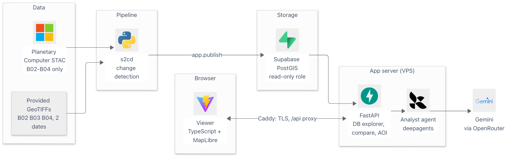
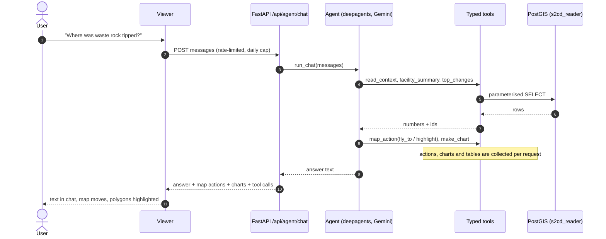

# s2change: system, stack and security

This is optional reading. The analysis the brief asks for is one Python package (`s2cd`) writing to PostGIS; see the [README](../README.md) and the [report](../report.md). Everything below lets a reader check the results without installing anything: the pipeline writes files, `app.publish` loads them into PostGIS, a read-only API serves them, and a static viewer shows them.

## One agent question, end to end

Every number comes from a typed tool running as the read-only role, and map changes come back as data for the viewer to apply.

## Stack, and why each part

| Layer | Technology | Why |
|---|---|---|
| Environment and quality | Python 3.12, uv, ruff, pytest | One lockfile, one command to run, one linter; tests run in CI |
| Raster and numerics | rasterio, numpy, scipy, scikit-image | Windowed GeoTIFF/COG I/O, the robust covariance and statistics and morphology |
| Vector | geopandas, shapely, pyogrio, pyproj | Polygons, validity repair, EPSG:32735 areas in m² |
| Source scenes | pystac-client, planetary-computer | Optional extra: recovers the true acquisitions behind each mosaic, B02-B04 only |
| Storage | PostGIS 16 with a GiST index, Supabase, SQLAlchemy, psycopg | A geospatial DB as the brief asks; the app reads through a `SELECT`-only role |
| API | FastAPI, uvicorn, slowapi, sqlglot | Typed endpoints, per-route rate limits, SQL parsed and checked before it runs |
| Agent | LangChain deepagents, langchain-google-genai, langchain-openai (OpenRouter) | An agent restricted to typed tools plus knowledge notes, on Gemini (directly or via OpenRouter) |
| Viewer | Vite, TypeScript, MapLibre GL, marked, DOMPurify, Mermaid | Static bundle, no server rendering; the report is rendered in the app from the same markdown |
| Delivery | Caddy, PM2, GitHub Actions, Docker Compose, Dockerfile | TLS and static files from one binary; CI runs ruff, pytest, the viewer build and the image; Compose gives a local PostGIS |

## Security

The public site is read-only by construction; the features that cost compute or LLM budget sit behind an access code.

| Control | What it does |
|---|---|
| Read-only database role | The API and the agent connect as `s2cd_reader`: `SELECT` on five relations, `default_transaction_read_only`, 5 s statement timeout. Writes fail in the database itself, whatever the application does |
| SQL guard | The agent's `readonly_sql` tool passes a sqlglot check (the database explorer runs no free-form SQL): one `SELECT`, an allow-list of tables, no DDL/DML, no `pg_*`/`dblink`/`set_config` functions, `LIMIT` forced to at most 200 |
| Rate limits and caps | Per client IP (the proxy-appended address): chat 6/min, explorer pages 60/min, SQL dumps 6/min, login 5/min. Whole-service daily cap: 300 chat calls |
| Access code | Chat and the full database URI need a code. It is checked against a salted PBKDF2-SHA256 hash and earns a signed `HttpOnly; Secure; SameSite=Strict` session cookie (7 days). The report, map, downloads, database explorer and SQL dumps stay public |
| Secrets | API keys, database passwords, the code hash and the cookie-signing secret live only in the server's `.env`, never in git; error responses are generic and details go to the server log |
| Transport and headers | TLS at Caddy, plus HSTS, a Content-Security-Policy limited to this site, the Esri tile host and the logo CDN, `nosniff`, `X-Frame-Options: DENY`, a strict referrer policy, and no `Server` banner. API request bodies are capped at 64 KB |
| LLM hardening | The model sees only 12 typed tools; deepagents' built-in planning, file, shell and sub-agent tools are switched off; the prompt tells it to treat user and tool text as data; no tool writes anything, so an injection can at worst yield a wrong read-only answer |
| CORS and input limits | CORS allows only the site origin and the local dev server. Chat messages 2,000 characters, 20 turns kept; explorer tables, columns and page sizes come from a fixed catalogue |
