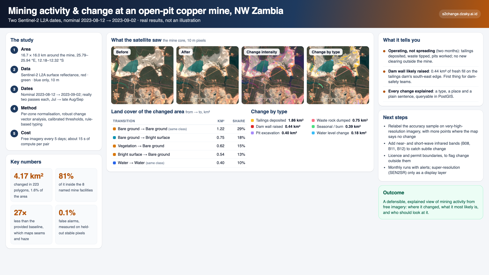
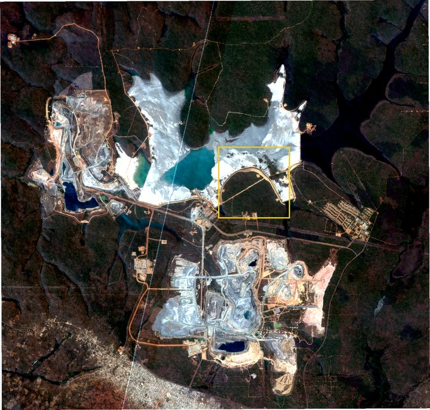
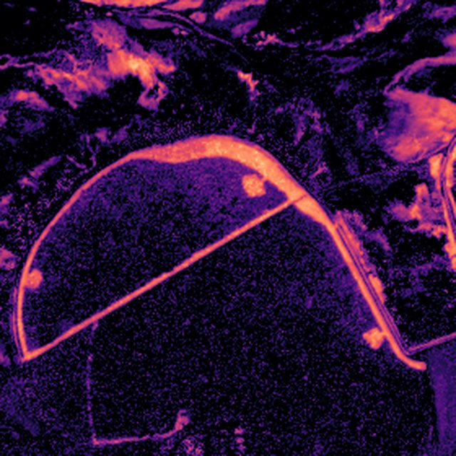
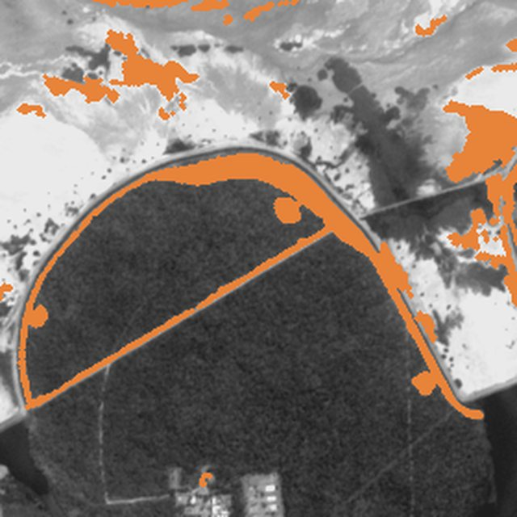
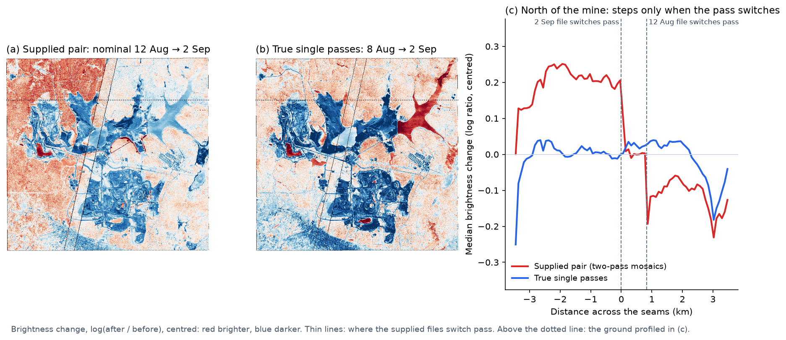
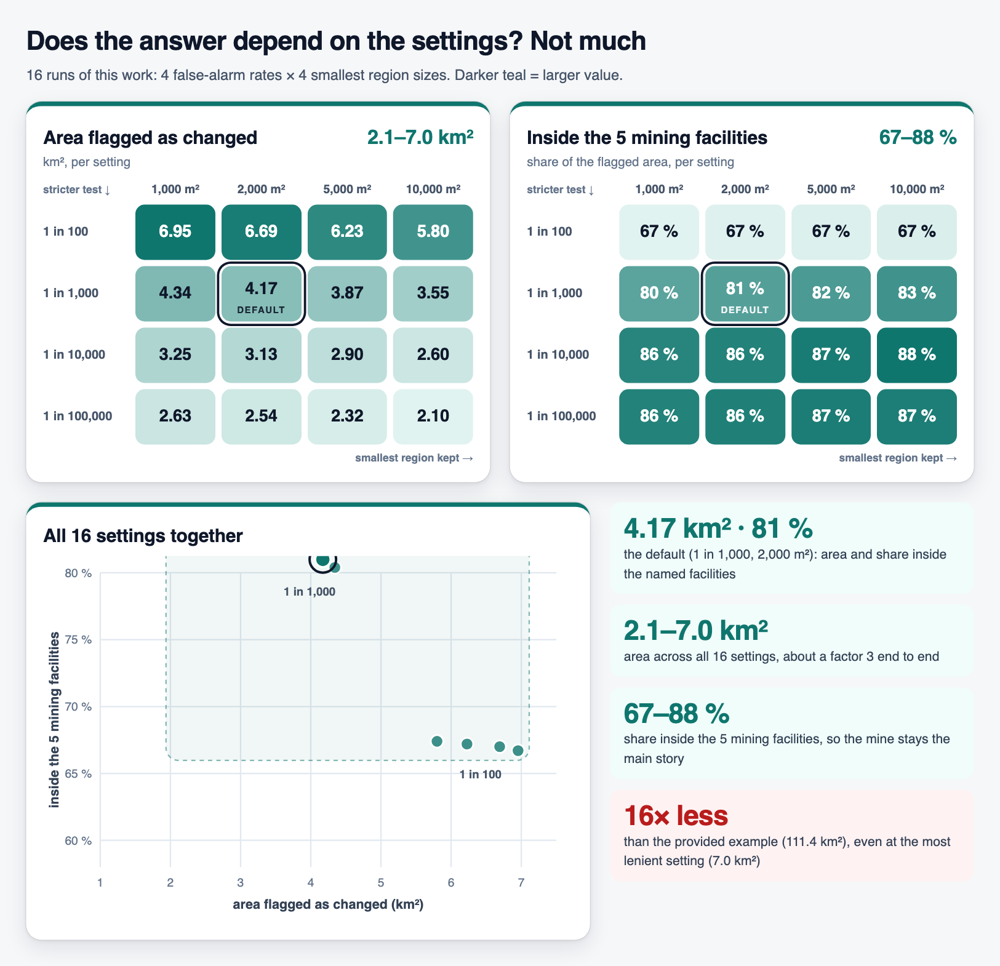
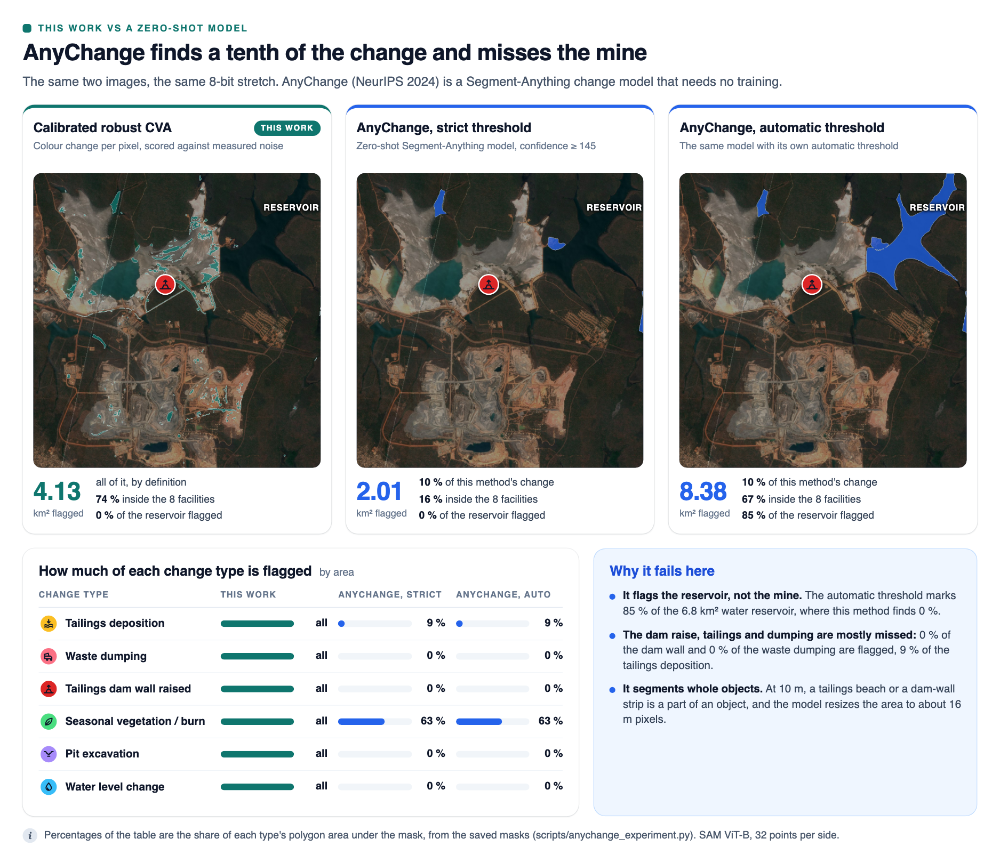
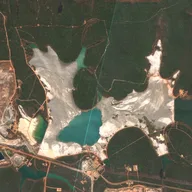
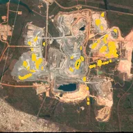
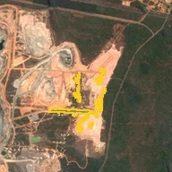

# What changed at an open-pit copper mine in NW Zambia?

**Two free satellite images of one copper mine: what changed, what it most likely is, and who should act on it.** [Open the map](https://s2change.dzaky.ai.id/#/map) · [Ask the agent](https://s2change.dzaky.ai.id/#/map?agent=1) · [Explore the database](https://s2change.dzaky.ai.id/#/database) · [Downloads](https://s2change.dzaky.ai.id/#/downloads) · [Repository](https://github.com/dzakybd/s2change) · [Video](https://youtu.be/MBTmg62P2ew)

*Prefer watching? A 4.5-minute [technical walkthrough](https://youtu.be/MBTmg62P2ew): the data, the data trap, the method, the database, results, accuracy and the system.*

> [!NOTE]
> **RGB only.** The brief provides Sentinel-2 L2A bands B02, B03 and B04, and nothing else is used: no NIR or SWIR, no cloud mask, no elevation. The layout matches the Lumwana copper mine; the brief only says "an open-pit mining site in Zambia", so the name is an inference.

The report follows the brief: **[1. Method](#-1-method)** (which algorithm, and why), **[2. Results](#-2-results)** (where change occurs, and its pattern) and **[3. Interpretation](#-3-interpretation)** (what the changes most likely represent). Limitations follow in section 4.

## ⚡ The answer on one page

| 🛰️ Changed | 🏭 Inside the mine | 🪤 Versus the provided method | 🎯 Precision |
|:-:|:-:|:-:|:-:|
| **4.13 km²** in 215 polygons | **82 %** in the 8 named facilities | **27× less** it maps seams as change | **0.67** on 200 random points |

- ⛏️ **The mine was working, not spreading.** 4.13 km² changed in 215 polygons, 82 % of it inside the eight named mine facilities. Tailings were spread on the tailings storage facility, waste rock was tipped and pits were worked. Outside the mine, only 0.02 km² qualifies as clearing.
- 🧱 **Fresh fill on the tailings dam's south-east wall, consistent with a wall raise:** 0.39 km² of rust-coloured fill where vegetation was. Single-pass scenes date it to between 4 July and 8 August. This is the change a dam-safety team would want first.
- 📈 **Over three years the footprint grows (exploratory, not validated).** Comparing the same season each year, change typed as waste dumping rises from 2.3 to 11.3 km² and change outside the named facilities from 3.3 to 14.3 km².
- 🪤 **The data had a trap.** Each supplied "date" is stitched from two satellite passes. The provided method maps the stitching as change (111 km², 27× too much). It was found, proved and corrected.
- 🎯 **Checked on 200 random points:** when this map says "changed", it is right 2 times in 3; the provided method is right 1 time in 8. It is conservative: it finds roughly a fifth of all real change, missing subtle tailings and burn edges ([how accurate](#how-accurate-is-it)).

## ⚙️ 1. Method

**Algorithm.** Both methods were run on the same stacks and stored in the same database, so they can be compared directly:

- **The provided example, unchanged** (Euclidean distance across the three bands); the example has no threshold, so an Otsu threshold is added to make its binary map: `change_map_baseline.tif`, `change_binary_baseline.tif`.
- **My method: a calibrated change vector analysis** (Malila 1980). For each pixel, measure how far its colour moved between the dates, and compare that with how far colour "moves" on ground that did not change. Output: `change_map.tif`, `change_binary.tif`.

**Why this method.** The example gets two things wrong on this data, and each step below fixes one of them:

1. **The images are mosaics.** Each "date" is stitched from two satellite passes (shown below), so brightness jumps at the seams. The example reads those jumps as change: 111 km², 42 % of the area. Here each seam-bounded zone is corrected on its own.
2. **Noise is not the same everywhere.** Bright mine ground varies more between passes than dark forest. One noise level for the whole image gave 22× more false alarms than intended overall, and up to 66× on the brightest ground, so noise is measured per zone and per brightness level.

There is a third reason too: with no labels, a threshold is only meaningful if it says how often noise passes it. So the rule is "noise may pass 1 pixel in 1,000", and that rate was checked on held-out stable pixels: it came out at 0.09–0.11 %. This is a per-pixel rate on ground already screened as unchanged, the design target; how often a flagged polygon is real is measured separately ([how accurate](#how-accurate-is-it)).

Co-registration was checked per zone by phase correlation in 8 windows: the shift is at most 0.05 px (worst window 0.25 px), so no resampling was applied. The whole run takes 13.6 s on a laptop.

*Both methods on the same input. The maps are the real data: source pass per pixel, the three zones, and each method's change mask. Editable source: [`docs/figures/04_method_overview.drawio`](https://github.com/dzakybd/s2change/blob/main/docs/figures/04_method_overview.drawio).*

*Every layer is the real data around the same place, the tailings dam's south-east wall. The output is a typed polygon with a plain sentence, stored and shown on the [map](https://s2change.dzaky.ai.id/#/map).*

**Each step in detail, close-up and whole site.**

| Step | Close-up: the tailings dam wall | Whole site | What we do, and why |
|---|---|---|---|
| 📥 Input **Before** |  |  | The provided image for the nominal **12 Aug 2023**, as true colour (bands B04, B03, B02). Pixel numbers are turned into reflectance with the L2A scale and offset. |
| 📥 Input **After, as delivered** |  |  | The provided image for **2 Sep 2023**. It looks brighter and hazier, partly because it is stitched from different satellite passes than the before image. |
| 🔬 Analysis **1. Find the seams** |  |  | Each date is stitched from two passes. Matching each pixel to its source scene splits the site into **3 zones** (tinted), with a seam strip between them. Each zone is then corrected on its own ([the data trap](#the-data-trap-each-date-is-two-passes), [on the map](https://s2change.dzaky.ai.id/#/map?layer=baseline&oblique=0)). |
| 🔬 Analysis **2. Normalise** |  |  | In each zone and band, the after image is fitted to the before image on ground that did not change, ignoring outliers (after Canty & Nielsen 2008). Haze and brightness differences go; real change stays. |
| 🔬 Analysis **3. Measure change** |  |  | For each pixel, measure how much its colour changed, then compare that with how much colour changes on stable ground in the same zone and at the same brightness. Brighter means less likely to be noise. [Change intensity on the map](https://s2change.dzaky.ai.id/#/map?layer=intensity) |
| 🔬 Analysis **4. Threshold** |  |  | Keep the pixels that noise would produce only **1 time in 1,000**, with the threshold calibrated on held-out stable pixels. Result: 6.74 km² in 4,479 specks, including thin lines along the seams. |
| 🔬 Analysis **5. Clean** |  |  | Keep a region only if part of it is very strong (noise would produce it 1 time in 100,000), so faint seam lines drop out (hysteresis, Canny 1986). Then smooth edges by one pixel and drop regions under 2,000 m². Result: **4.13 km² in 215 regions**. |
| 📤 Output **Outline, type and explain** |  |  | Each region becomes a polygon. Its type comes from the colour change and the facility it sits in, and it gets one plain sentence. Here: **Tailings dam wall likely raised**, 0.39 km² in the south-east of the tailings storage facility, where green vegetation became bright, rust-coloured bare ground. *Check the dam-raise plan and inspect the embankment.* |

*The provided example (Euclidean distance + Otsu) maps 111.4 km², mostly seams and haze. The calibrated method maps 4.13 km², concentrated in the mine.*

### The data trap: each "date" is two passes

**The claim.** Neither supplied "date" is one image. Each file is stitched from two Sentinel-2 passes taken days apart, so the supplied pair holds brightness jumps that are not on the ground. Three independent checks support it.

**1. The jumps are straight lines that ignore the landscape.** The before/after brightness ratio steps along straight lines at 12.6° that cut through bush, roads and pits alike (a). The same ground seen in single passes has no such lines (b). Across the seams, on natural ground north of the mine, the supplied pair jumps by about −0.21 and −0.12 in log brightness (about 19 % and 11 %) exactly where a file switches pass; the single passes stay within ±0.03 (c).

*`scripts/fig_trap_proof.py`. Red brighter, blue darker after; thin lines: where the supplied files switch pass.*

**2. The pixels match four catalogue scenes exactly.** Matching every pixel against the Planetary Computer catalogue (`s2cd provenance`) found all three bands **identical, pixel for pixel**, to two scenes per date, with no pixel left unexplained:

*Source scene of each pixel on both dates. The seams follow the swath edge of one orbit.*

| Nominal date | Really made of (tile 35LLG, baseline 05.09) |
|---|---|
| 2023-08-12 | 2023-07-04 (west, 44 %) + 2023-07-01 (east, 56 %) |
| 2023-09-02 | 2023-09-02 (west, 39 %) + 2023-08-25 (east, 61 %) |

So the gap between dates is 52–60 days, not 21. The pipeline splits the area into three zones, each a single before→after scene pair, normalises each zone on its own, and excludes 90 m around seams (2.4 % of the area). [See the trap on the map](https://s2change.dzaky.ai.id/#/map?layer=baseline&oblique=0): the provided method's 111 km² in red, the western pass almost entirely flagged.

**3. Re-running on true single passes changes the answer.** The catalogue also holds single-pass scenes that cover the whole site, so the same pipeline was re-run on them (`scripts/real_dates.py`; on the map: Result → "Ours, true passes"; the scenes are in Downloads):

| Pair | Provided method | This method | Dam-wall fill |
|---|---:|---:|---:|
| The provided mosaics (nominal 12 Aug → 2 Sep) | 111 km² | 4.13 km² | 0.44 km² |
| Single pass, 8 Aug → 2 Sep 2023 (the clear dates closest to the nominal ones) | 194 km² | 2.25 km² | 0.10 km² |
| Single pass, 4 Jul → 8 Aug 2023 | 4.6 km² | 12.1 km² | 0.44 km² |

Two lessons. Without seams the provided method gets *worse* (194 km²): its real weakness is the brightness and haze difference between dates, which the normalisation removes; the seams only add to it. And the dam-wall fill happened **between 4 July and 8 August**, before the nominal before date: the mosaics catch it only because their "12 August" is really early July. Over the true 25 days (8 Aug → 2 Sep) the mine shows about half as much change. The provided pair stays the main result, because it is what the brief supplies.

**Was the data already corrected?** Yes. It is ESA's Level-2A product, bit for bit: calibrated, orthorectified and atmospherically corrected to surface reflectance. The files carry no level tag, so this was established by the match above and by the −1000 offset visible in the darkest pixels. Reflectance is `(DN − 1000) / 10000`.

| Correction | In the supplied data | Added here |
|---|---|---|
| Calibration, orthorectification, atmosphere | Done by ESA | Nothing redone; L2A scale and offset applied |
| Haze and scene-to-scene differences, seams | **Not corrected** | Per-zone normalisation on stable pixels, seam buffer |
| Sun and view angle (BRDF) | Not corrected | Treated as a confounder on slopes |

### Does it depend on one threshold?

No. Over 16 settings (false-alarm rates from 1 in 100 to 1 in 100,000, minimum areas 1,000–10,000 m²), changed area stays within 2.1–6.8 km² and the share inside the 5 mining facilities of the register within 68–88 %. The share is lowest at the most lenient setting (68 %) and 82–88 % at the stricter ones: the strongest changes are the mining ones.

### Why not machine learning?

There are no labels, three bands and two dates. The open toolboxes were checked:
- **rschange** and most of **torchange** are trained on 0.3–1 m building imagery. At 10 m a building is a pixel or two, so the weights do not transfer.
- **torchgeo** is the right framework once mining labels exist; its Sentinel-2 foundation weights would be the encoder.
- **AnyChange**, the one zero-shot model, was tested on this pair (`scripts/anychange_experiment.py`). It finds 10 % of the change found here, flags the whole reservoir, and misses the dam raise, tailings and dumping. It segments whole objects, and at 10 m these changes are parts of objects.

*This method (left) against AnyChange at its strict and automatic thresholds, on the same images.*

## 📍 2. Results

**Where.** Change concentrates in the mine: 82 % of the 4.13 km² lies inside the eight named facilities, and more than half of all change is on the tailings storage facility. Outside the mine, change is scattered and small.

**Pattern.** Change comes as patches moving on the tailings facility, brighter and redder faces at dumps and pit edges, bench changes inside the pits, and a long strip of fresh fill on the tailings dam's south-east wall. There are no straight seam lines left.

*Change polygons by type, and the area of each type.*

| | Change type | Brief category | Polygons | Area | What we see |
|---|---|---|---:|---:|---|
|  | Tailings deposition | mining activity | 63 | 1.86 km² | Wet slurry and drying beaches moving on the tailings facility |
|  | Waste dumping | mining activity | 47 | 0.75 km² | Brighter, redder faces at dumps and pit edges: fresh oxidised rock |
|  | Tailings dam wall raised | mining activity | 4 | 0.44 km² | Fresh fill on the embankment where vegetation was |
|  | Seasonal vegetation or burn | seasonal / vegetation | 18 | 0.36 km² | Dry-season browning or burn scars outside the mine |
|  | Pit excavation | mining activity | 33 | 0.40 km² | Bench and pit-floor changes |
|  | Water level change | water change | 8 | 0.18 km² | Pond and pit-lake edges moving |
|  | Noise, unexplained, infrastructure, clearing | other | 42 | 0.15 km² | Seams, haze, small builds; 0.02 km² of clearing |

**Per facility.** The tailings storage facility holds more than half of all change. The last row combines the three facilities with almost no change: the settlement, the camp and the fresh-water dam.

| Before → after (change in yellow) | Facility | Area | Changed | Mostly |
|---|---|---:|---:|---|
|   |  Tailings storage facility (TSF) | 21.84 km² | **2.19 km² (10 %)** | tailings deposition, dam-wall fill |
|   |  South pit complex | 24.84 km² | 0.55 km² (2 %) | pit / bench activity |
|   |  North-west pit complex | 13.16 km² | 0.41 km² (3 %) | waste dumping |
|   |  Eastern waste dumps | 3.30 km² | 0.21 km² (6 %) | waste dumping |
|   |  Process plant | 0.95 km² | 0.01 km² | infrastructure |
|   |  Settlement, camp, fresh-water dam | 15.24 km² | 0 km² | — |

Each facility outline is one analyst-drawn polygon traced on very-high-resolution imagery and checked against the 2023 image; facilities do not overlap (`configs/facility_register.yaml`). [Open them on the map](https://s2change.dzaky.ai.id/#/map?layer=facilities).

**Land cover before → after.** A check that needs no facility register: simple RGB rules sort the changed pixels into water, bright surface, bare ground and vegetation. Vegetation → bare ground (0.62 km², 15 %) is the new disturbance; much of it is along the dam wall. Most of the rest is bare ground re-worked (30 %) or turned to bright tailings (18 %).

**Over three years (exploratory, not validated).** Comparing the supplied before date with later August scenes, so the season matches, the footprint grows. These later scenes are beyond the brief and have no accuracy check.

*"Outside" means outside all 8 register facilities. Area of change counts re-worked ground too, so it is not all new disturbance.*

Compare in the app: [Aug 2023 → Aug 2024](https://s2change.dzaky.ai.id/#/map?before=provided-before&after=2024-08-27) · [→ Aug 2025](https://s2change.dzaky.ai.id/#/map?before=provided-before&after=2025-08-07) · [→ Aug 2026](https://s2change.dzaky.ai.id/#/map?before=provided-before&after=2026-08-14)

### How accurate is it?

200 points were drawn at random, 50 in each of four groups (both maps say change, only this map, only the provided method, neither), so one sample scores both maps without bias (Olofsson et al. 2014). Each point was labelled from before/after image chips by **two independent AI vision labellers** that saw neither map; they agreed on 80 % of points (Cohen's κ 0.46, moderate), and the 40 disagreements were settled by a third look with a wider view. These are careful visual labels from the same 10 m imagery, not field truth. Script and labels: `scripts/validation.py`, `data/validation/`.

| 95 % intervals | This method | Provided method |
|---|---:|---:|
| Pixels labelled correctly (overall accuracy) | **0.94 ± 0.04** | 0.62 ± 0.04 |
| When it says "changed", it is right (precision) | **0.67 ± 0.11** | 0.12 ± 0.08 |
| Share of all real change it finds (recall) | 0.17 ± 0.11 | 0.80 ± 0.31 |

**What this means.** The map is precise but conservative. Where both maps agree, 72 % of points really changed; of this map's own extra detections, 16 of the 21 real ones are fresh burn scars at the east edge that the provided method misses. Real change the map misses is mostly subtle: tailings beaches wetting and drying, burn edges, small waste tips. Estimated real change is 16.6 ± 10.9 km², so the 4.13 km² is the confident core, not the total. The wide intervals on recall come from rare change inside the large "no change" groups; more points there would tighten them.

## 🧭 3. Interpretation

**What the changes represent.** Over the two dates the mine is operating normally: **mining activity** (tailings deposition, waste dumping, pit work and a likely dam-wall raise) is 3.4 km² of the 4.13 km². **Seasonal vegetation change** (dry-season browning or burns outside the mine) is 0.36 km². **Land clearing** outside the mine is only 0.02 km², and there is no urban expansion. **Noise and artifacts** were mostly removed by the seam correction; the remaining 0.15 km² (with unexplained and small builds) is labelled as such. Over three years, comparing the same dry season, the mine is growing, and more of the change sits outside the named facilities.

**How to read each pattern.** Every type is a hypothesis, with what could fake it in RGB and what would confirm it:

| Pattern | Likely meaning | Could also be | Confirm with |
|---|---|---|---|
| Bright/dark patches moving on the TSF | Tailings deposition | Beaches drying with the season | Later dates: outline stays, patches move |
| Brighter and redder faces at dumps | Fresh waste rock | Sun 10° higher on slopes, dust | A same-season date; very-high-resolution imagery |
| Bench changes inside pits | Excavation | Shadows shifting with the sun | Sun-matched pairs; elevation data |
| Browner patches outside the mine | Grass drying or burning | Wet ground (RGB cannot separate them) | Fire records; recovery after rain |

> [!WARNING]
> **Confidence is not accuracy.** "Confidence" is a change-magnitude score. Precision and recall are measured on a random sample ([how accurate](#how-accurate-is-it)); a polygon's confidence is not its probability of being right.

**Who acts on it.**

| Who | Their question | What this gives them | What it cannot say |
|---|---|---|---|
| 🏛️ Regulator | Is the mine within its licence? | Footprint growth outside known facilities, located and sized monthly at no data cost | Legality: there are no licence boundaries here |
| 🛡️ Dam-safety oversight | Is the tailings facility run as planned? | Where deposition, ponding and wall raises happen | Stability, freeboard, seepage |
| 💼 Investors, lenders, insurers | Is the operation running and growing? | Independent activity signals: waste moved, tailings deposited, pits worked | Production, grade or tonnes |
| 🌱 ESG and community teams | Is clearing or water change spreading? | Clearing and water change outside the register | Social or health impacts |

**As a service**, the same pipeline runs every month on a new clear scene, compared with last month and the same month last year. Changes outside a facility or above a size limit become alerts for an analyst to confirm. Each comparison is one more run in the database, which is already keyed by run.

## 🚧 4. Limitations and next steps

> [!WARNING]
> **The map misses most subtle change.** Recall is 0.17 ± 0.11: it is built to avoid false alarms, so faint tailings and burn changes fall below the threshold.

**Next validation step.** Relabel the same 200 points, and about 200 more in the "no change" groups, on very-high-resolution imagery from the same weeks (Planet or Esri Wayback), by a human analyst. That tightens the recall interval and replaces AI labels with independent ones. Those labels would also be the first training set for a learned model, and a per-type threshold would recover the missed tailings changes.

| | Gap | Why it matters | Next step |
|---|---|---|---|
| 🎨 | RGB only | Water, shadow and dark wet soil look alike; burns look like wet ground | Add NIR (B08) for NDVI at the same 10 m, and the L2A cloud and shadow mask |
| ⛰️ | No elevation | No volumes; pits versus dumps rest on context | Stereo very-high-resolution imagery or LiDAR |
| ✏️ | Hand-drawn facility regions | Facility edges are an analyst's call | Licence boundaries or a maintained facility database |
| 🔍 | Super-resolution | Models like SEN2SR invent detail that differs between dates, creating false change | Display only: the map's 2.5 m layer is SEN2SR on the analysed dates; detection stays on the 10 m bands |
| 📆 | Two mosaicked dates | Sun angle and pass mixes differ | Per-pixel acquisition dates, same-season pairs, per-pair calibration (as here) |

### ✅ The brief, covered

| # | Task | Done | See it |
|---|---|---|---|
| 1 ✅ | Data preparation | B02–B04 loaded, CRS, transform and shape checked, stacked | `src/s2cd/io.py` → `data/processed/sentinel2_*_stack.tif` |
| 2 ✅ | Change detection | The provided example, unchanged, and a calibrated change vector analysis | [Section 1](#-1-method) · [Change intensity map](https://s2change.dzaky.ai.id/#/map?layer=intensity) |
| 3 ✅ | Store in a geospatial DB | SpatiaLite file in the repo; PostGIS with spatial indexes, explorer, SQL dump, API | `data/change_detection.sqlite` · [Database](https://s2change.dzaky.ai.id/#/database) · [Example queries](https://github.com/dzakybd/s2change/blob/main/sql/queries_postgis.sql) |
| 4 ✅ | Visualise | Static figures here; interactive map with swipe, types and facilities | [Map](https://s2change.dzaky.ai.id/#/map) |
| 5 ✅ | Interpret | Typed polygons with a sentence each, facility register, confounders | [Section 2](#-2-results) · [Section 3](#-3-interpretation) |

The app's system, stack and security are described separately in [docs/system.md](https://github.com/dzakybd/s2change/blob/main/docs/system.md).

### References

Malila (1980) change vector analysis; Otsu (1979); Canny (1986) hysteresis; Canty & Nielsen (2008) *Remote Sens. Environ.* 112:1025 (automatic radiometric normalization); Olofsson et al. (2014) *Remote Sens. Environ.* 148:42.

---

*Contains modified Copernicus Sentinel-2 data (2023–2026). Map imagery in the app: the analysed scenes super-resolved with SEN2SR (ESA OpenSR, display only), over Esri World Imagery and Bing Aerial basemaps. Built by Dzaky Zakiyal Fawwaz for the Solafune geospatial take-home.*
