# What changed at an open-pit copper mine in NW Zambia?

**Two free satellite images of one copper mine: what changed, what it most likely is, and who should act on it.** [Open the map](https://s2change.dzaky.ai.id/#/map) · [Ask the agent](https://s2change.dzaky.ai.id/#/map?agent=1) · [Explore the database](https://s2change.dzaky.ai.id/#/database) · [Downloads](https://s2change.dzaky.ai.id/#/downloads) · [Repository](https://github.com/dzakybd/s2change) · [Video](https://youtu.be/MBTmg62P2ew)

<a href="https://youtu.be/MBTmg62P2ew">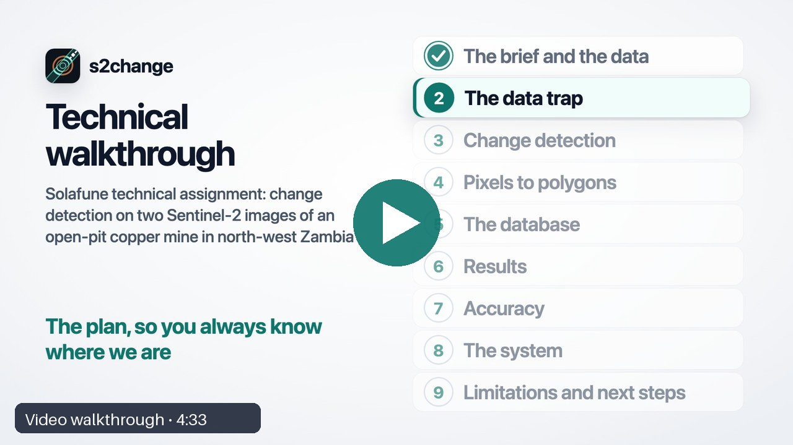</a>

*Prefer watching? A 4.5-minute [technical walkthrough](https://youtu.be/MBTmg62P2ew). It was recorded before one cleanup step was simplified, so it shows 4.13 km² in 215 polygons where this report has 4.17 km² in 223.*

🧭 **The story, in order:** 📦 [the data](#-1-the-data) → 🪤 [a trap hidden in it](#-2-the-data-trap-each-date-is-two-passes) → ⚙️ [a method built around the trap](#-3-the-method) → 📍 [what changed](#-4-what-changed) → 🎯 [how accurate it is](#-5-how-accurate-is-it) → 🧭 [what it means](#-6-what-it-means) → 🏗️ [the system](#-7-the-system-stack-agent-and-database) → 🚧 [limits](#-8-limitations-and-next-steps).

## 📦 1. The data

The brief supplies two Sentinel-2 images of an open-pit copper mine in Zambia and asks what changed between them.

| | What we got |
|---|---|
| 🛰️ Images | Two folders of GeoTIFFs, one per date: bands **B02, B03, B04** (blue, green, red), 10 m pixels |
| 📅 Dates | Nominal **12 Aug 2023** (before) and **2 Sep 2023** (after): *21 days apart, on paper* |
| 🗺️ Area | 16.7 × 16.0 km, 1,673 × 1,597 pixels, UTM 35S (EPSG:32735) |
| 🧪 Processing | ESA Level-2A surface reflectance (proved bit for bit in section 2); reflectance = `(DN − 1000) / 10000` |

> [!NOTE]
> **RGB only.** Nothing else is used: no near-infrared, no cloud mask, no elevation. The layout matches the Lumwana copper mine; the brief only says "an open-pit mining site in Zambia", so the name is an inference.

🏭 **What is on the ground.** To say *where* change happens, the mine was mapped into 8 named facilities, drawn on very-high-resolution imagery and checked against the 2023 image (`configs/facility_register.yaml`, [on the map](https://s2change.dzaky.ai.id/#/map?layer=facilities)):

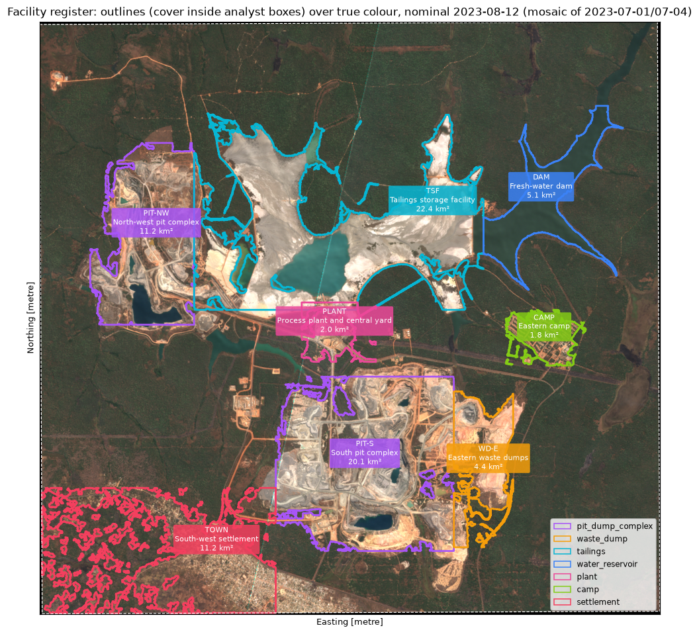

🧪 **Was the data already corrected?** Mostly yes, but not for everything that matters here:

| Correction | In the supplied data | Added here |
|---|---|---|
| Calibration, orthorectification, atmosphere | ✅ Done by ESA | Nothing redone; L2A scale and offset applied |
| Haze and scene-to-scene differences, seams | ❌ **Not corrected** | Per-zone matching on stable ground, seam buffer (section 3) |
| Sun and view angle | ❌ Not corrected | Treated as a confounder on slopes |

*The second row is where the story turns.*

## 🪤 2. The data trap: each "date" is two passes

Looking at the two images side by side, a straight diagonal line runs through both: on one side the image is brighter, on the other darker, through forest, roads and ponds alike. Ground does not change in straight lines, so the cause had to be in the data.

> **Claim.** Neither supplied "date" is one image. Each file is stitched from two Sentinel-2 passes taken days apart, so the pair holds brightness jumps that are not on the ground, and before and after are really 52–60 days apart, not 21.

<table class="kpi">
<tr>
<td align="center"><b class="bad">0</b> scenes on 12 Aug 2023 passes on 8, 10 and 13 Aug only</td>
<td align="center"><b>2</b> passes in each file joined at a straight 12.6° seam</td>
<td align="center"><b class="good">100 %</b> identical to one pass, west of the seam and 0 % east of it</td>
<td align="center"><b class="bad">52–60</b> days between the real passes in three zones, not 21</td>
</tr>
</table>

🔎 **Proof 1. One side is a known pass, the other is not.** There is no satellite scene on 12 Aug, so each file was set beside the single pass that covers the whole site and is found inside it: before with *4 Jul*, after with *2 Sep*. West of the seam <b class="good">every pixel is identical</b> in all three bands; east of it, <b class="bad">none is</b>. The brightness steps exactly at the seam (e): an orbit edge, not the ground.

*Before with before, after with after: identical on one side of the yellow line, different on the other (`scripts/fig_trap_proof.py`).*

🧬 **Proof 2. Every pixel traced to its scene.** All 55–56 catalogue scenes of the site in the 75 days before each date were read onto the same grid and matched on exact stored values (`s2cd provenance`). Two scenes per date reproduce every pixel, bit for bit, and their catalogue records give the true dates. The two files switch pass at slightly different lines, so laid over each other they cut the site into **three zones**:

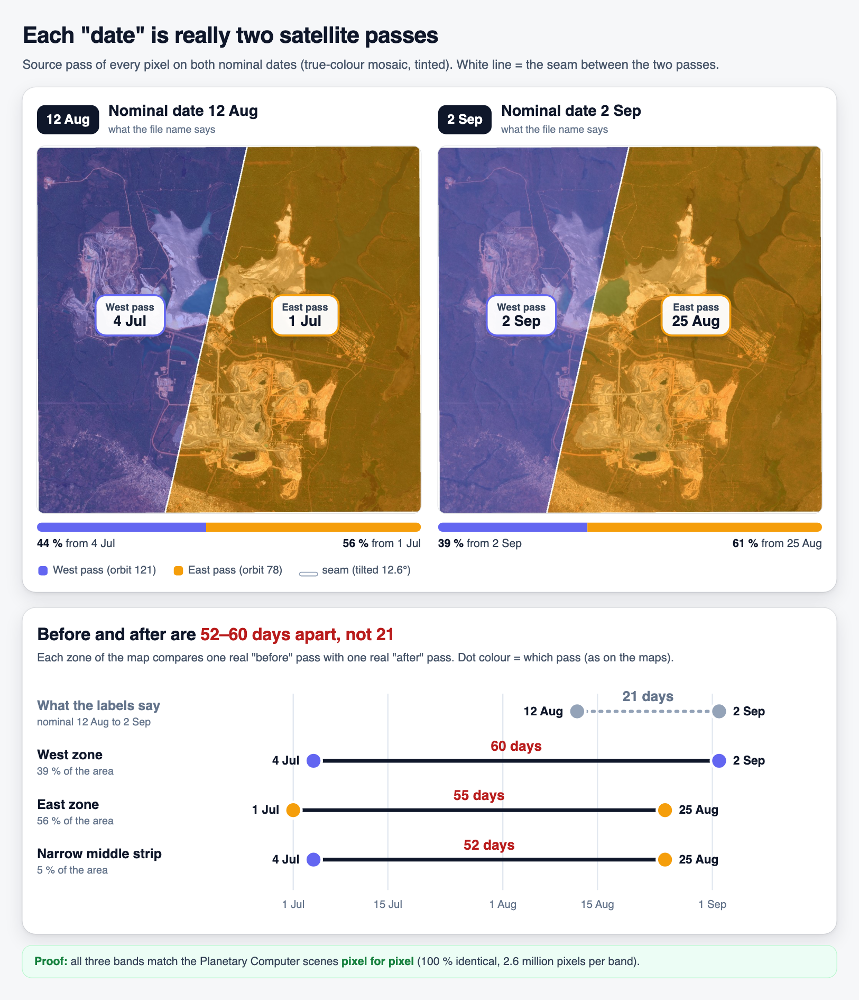

*The seams follow the swath edge of orbit 78, which covers only the east of the site.*

📅 **So the site holds three real before → after pairs.** They are *not chosen*; the files fix them:

| Zone | Before → after (true dates) | Gap | Share of the site |
|---|---|---:|---:|
| 🟦 West | 4 Jul → 2 Sep | 60 days | 38.9 % |
| ▨ Middle strip | 4 Jul → 25 Aug | 52 days | 5.1 % |
| 🟧 East | 1 Jul → 25 Aug | 55 days | 56 % |

⚠️ **Why it matters.** The provided example method compares the files as if each were one image, so it maps the pass difference as change: <b class="bad">111 km²</b>, 42 % of the site ([see it on the map](https://s2change.dzaky.ai.id/#/map?layer=baseline&oblique=0)). Any method for this data has to handle the zones first.

## ⚙️ 3. The method

Two methods run on the same images and are stored in the same database:

- **The provided example, unchanged:** the colour distance between the dates, cut with one automatic (Otsu) threshold (`change_map_baseline.tif`, `change_binary_baseline.tif`).
- **This work: a calibrated change vector analysis** (Malila 1980). The question per pixel: *how far did its colour move, compared with how far colour moves on ground that did not change?* (`change_map.tif`, `change_binary.tif`)

### 🪜 Six steps, and why each is needed

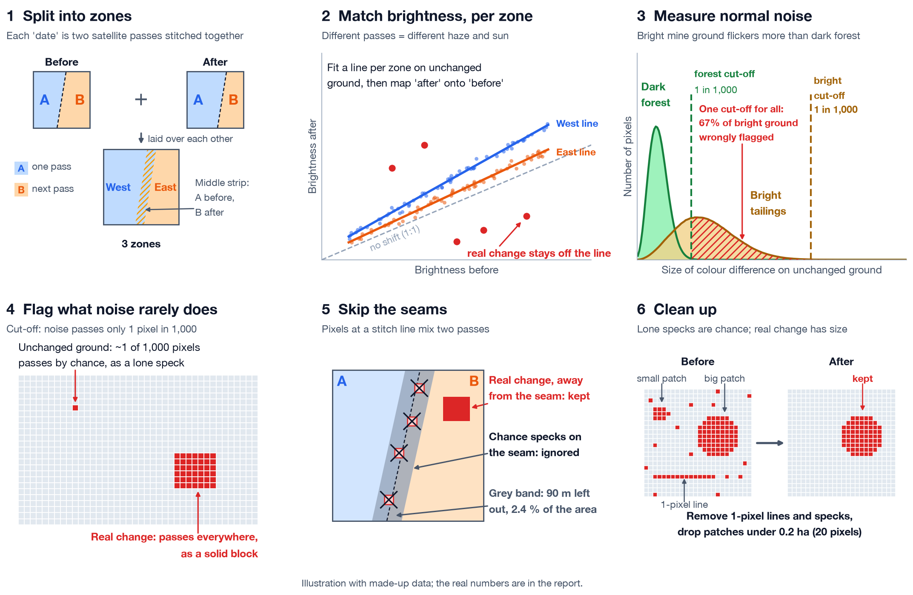

*An illustration with made-up data. The table below gives what each step does on the real data.*

Each step was **switched off once** and the run repeated; "without it" is what changed:

| Step | What it does | Without it | Verdict |
|---|---|---|---|
| 1️⃣ **Split into zones** | Uses the three pass pairs from section 2 and treats each on its own | One ruler for three different pairs: it finds <b class="bad">a third</b> as much real change (1.57 km², recall 0.17 → 0.06) | ✅ Needed |
| 2️⃣ **Match brightness, per zone** | Fits the after image to the before image on ground that did not change, one line per zone and band (Canty & Nielsen 2008) | Haze and sun differences read as change, as in the provided method (<b class="bad">111 km²</b>) | ✅ Needed |
| 3️⃣ **Measure normal noise** | Learns how much colour flickers on unchanged ground, per zone and per brightness level | Bright mine ground looks "changed": <b class="bad">22×</b> too many false alarms (<b class="bad">66×</b> on the brightest ground), 13.2 km² | ✅ Needed |
| 4️⃣ **Flag what noise rarely does** | Keeps a pixel only if noise would move it that far **1 time in 1,000** or less | — (this is the decision itself) | ✅ The core |
| 5️⃣ **Skip the seams** | Ignores 90 m on each side of a seam (2.4 % of the site), where pixels mix two passes | 29 false polygons along the seams; precision <b class="bad">0.67 → 0.44</b> | ✅ Needed |
| 6️⃣ **Clean up** | Removes 1-pixel lines and specks, drops patches under 2,000 m² (20 pixels), fills small holes | Thousands of lone specks, see below | ✅ Needed |

💡 **What "1 in 1,000" means.** On ground that did not change, colour still flickers a little between dates. Step 3 measures how much; step 4 sets the cut-off so that pure flicker passes it only **1 pixel in 1,000**. The site has 2.6 million pixels, so about *2,600 pixels* (0.26 km²) pass by chance, scattered as **lone specks**, while real change passes as **solid patches**. Checked on stable pixels held out from fitting: the real rate is <b class="good">0.09–0.11 %</b>, on target.

🧹 **Why clean up, in numbers:**

| After step | Changed area | Patches | Of which smaller than 2,000 m² |
|---|---:|---:|---:|
| 4️⃣ Flag (1 in 1,000) | 6.74 km² | 4,479 | 4,189 |
| 5️⃣ Skip the seams | 5.93 km² | 4,258 | 3,989 |
| 6️⃣ Clean up | <b class="good">4.17 km²</b> | <b class="good">223</b> | 0 |

*Most patches are specks: chance hits and the edges of real change. Real change is what is left: 223 polygons.*

Co-registration was checked per zone (8 windows): shifts are at most 0.05 px, so nothing is resampled. A full run takes about 14 s on a laptop.

### 🔬 On the real data

*Both methods on the same input: source pass per pixel, the three zones, and each method's change mask. Editable source: [`docs/figures/04_method_overview.drawio`](https://github.com/dzakybd/s2change/blob/main/docs/figures/04_method_overview.drawio).*

**Each step at the tailings dam wall (close-up) and over the whole site:**

| Step | Close-up | Whole site | What you see |
|---|---|---|---|
| 📥 **Before** | 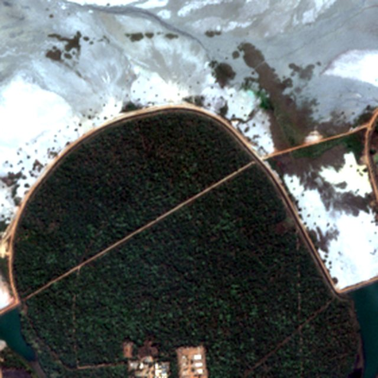 |  | The "12 Aug" file in true colour |
| 📥 **After, as delivered** | 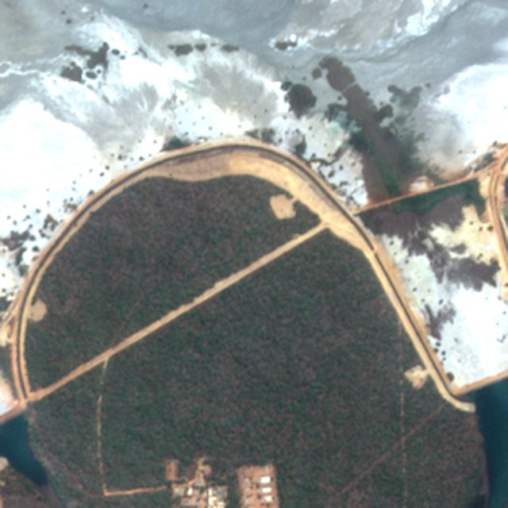 | 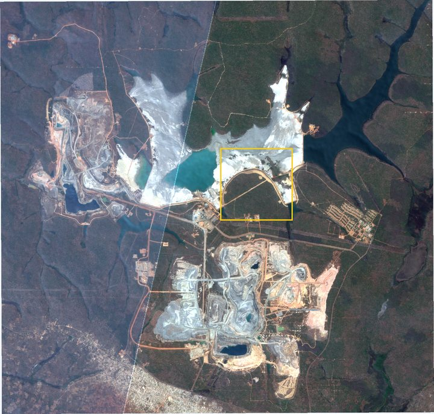 | The "2 Sep" file: brighter and hazier, partly because it holds other passes |
| 1️⃣ **Zones** | 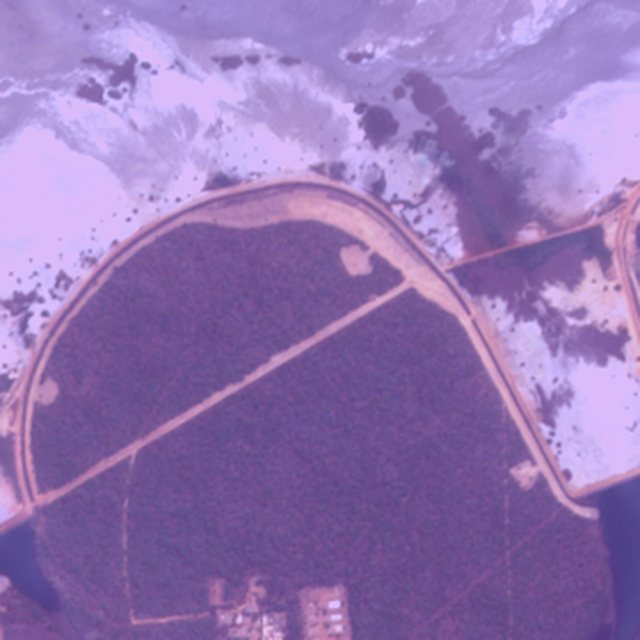 |  | The 3 zones (tinted) and the seam strip between them |
| 2️⃣ **Matched** | 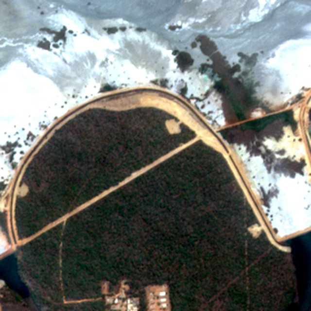 |  | The after image matched to the before, zone by zone: haze gone, real change stays |
| 3️⃣ **Change vs noise** |  | 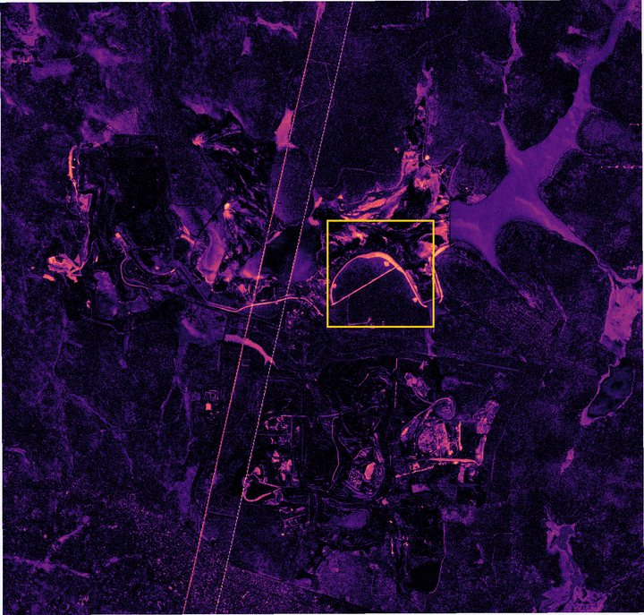 | How unusual each pixel's colour change is for its zone and brightness; brighter = less likely noise ([on the map](https://s2change.dzaky.ai.id/#/map?layer=intensity)) |
| 4️⃣ **Flagged** |  | 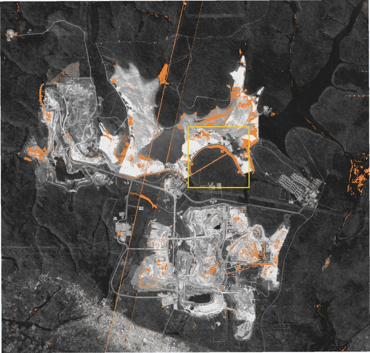 | Pixels past the 1-in-1,000 cut-off: 6.74 km² in 4,479 patches |
| 5️⃣6️⃣ **Seams skipped, cleaned** |  |  | <b class="good">4.17 km² in 223 polygons</b> |
| 📤 **Typed and explained** | 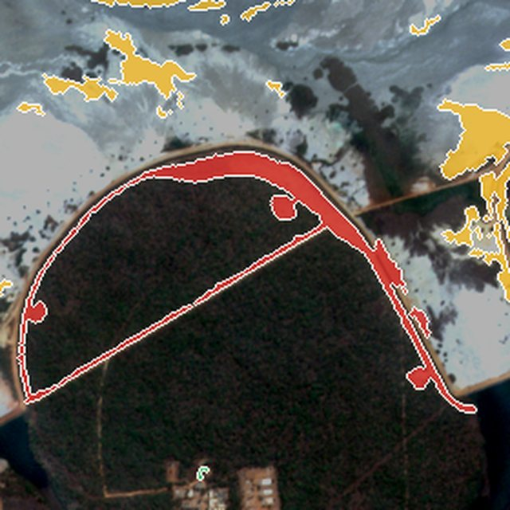 | 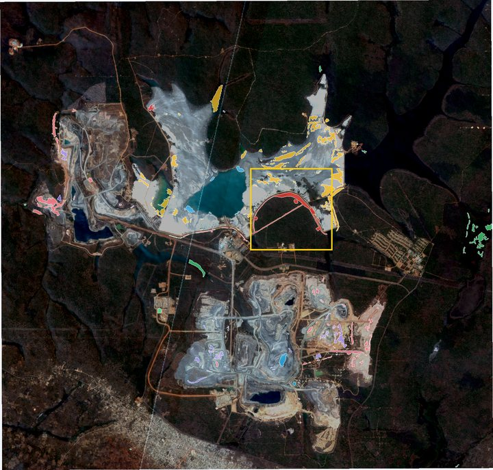 | Each polygon gets a likely type from its colour change and facility, and one plain sentence. Here: **Tailings dam wall likely raised**, 0.39 km². *Check the dam-raise plan and inspect the embankment.* |

### 🎚️ Would other settings give a different answer?

Two numbers in the method are choices, not facts: **how strict the cut-off is** (step 4, 1 in 1,000) and **the smallest patch kept** (step 6, 2,000 m²). So the whole run was repeated with both made looser and stricter, 16 combinations in all. The extremes and our choice:

| Setting | Changed area | Share inside the mine |
|---|---:|---:|
| 🔓 Loosest (1 in 100, patches from 1,000 m²) | 6.95 km² | 67 % |
| ⭐ **Ours** (1 in 1,000, patches from 2,000 m²) | **4.17 km²** | **81 %** |
| 🔒 Strictest (1 in 100,000, patches from 10,000 m²) | 2.10 km² | 87 % |

💡 **What it means.** The exact area depends on how strict one is, so read 4.17 km² as "a few km²", not as a precise figure. The *conclusion* does not move: in every run most change is in the mine, and the stricter the test, the larger that share. The strongest changes are the mining ones.

### 🧰 Other tools behind the result

The change itself is measured on the three 10 m bands only. Other tools helped to find the trap, to show and to check the result:

| Tool | Used for | Changes the detection? |
|---|---|---|
| 🛰️ [Microsoft Planetary Computer](https://planetarycomputer.microsoft.com/dataset/sentinel-2-l2a) Sentinel-2 catalogue (STAC) | Tracing every pixel to its satellite pass (section 2); the true single passes and the multi-year dates (section 4) | ✅ Yes: it gives the three zones |
| 🔍 [SEN2SR](https://github.com/ESAOpenSR/SEN2SR) super-resolution (ESA OpenSR) | A sharper 2.5 m true-colour layer of the analysed dates on the map, so changes are easier to read | ❌ No, display only: the model invents fine detail that differs between dates and would look like change |
| 🗺️ Esri World Imagery and Bing Aerial basemaps | Very-high-resolution background on the map; context for drawing the facility register | Only through the facility names, not the change mask |
| 🤖 AI vision labellers | Labelling the 200 accuracy points (section 5) | ❌ No, accuracy only |
| 🧪 [AnyChange](https://arxiv.org/abs/2402.01188) (Segment Any Change, NeurIPS 2024) | A zero-shot foundation-model alternative, tried as a comparison | ❌ Not used: it resizes the site to ~16 m pixels and found only about 1 in 10 of the changes found here (tested on the earlier version of the map) |
| 💬 Gemini agent | Answering questions about the results in the app (section 7) | ❌ No, it reads the stored results |

## 📍 4. What changed

<table class="kpi">
<tr>
<td align="center"><b>4.17 km²</b> 🛰️ changed in 223 polygons, 1.6 % of the site</td>
<td align="center"><b>81 %</b> 🏭 inside the mine in the 8 named facilities</td>
<td align="center"><b>3.4 km²</b> ⛏️ mining activity tailings, dumps, pits, dam wall</td>
<td align="center"><b class="good">27× less</b> 🪤 than the provided method which maps seams as change</td>
</tr>
</table>

📍 **Where.** Change concentrates in the mine: 81 % lies inside the eight named facilities, more than half on the tailings storage facility. Outside, change is scattered and small.

🔍 **Pattern.** Patches moving on the tailings facility, brighter and redder faces at dumps and pit edges, bench changes in the pits, and a long strip of fresh fill on the dam's south-east wall. No straight seam lines are left.

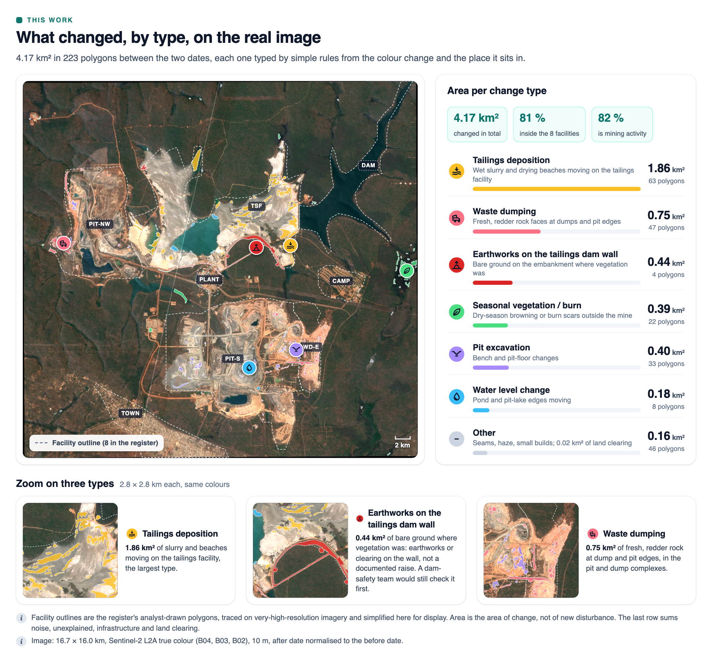

*Change polygons by type, and the area of each type.*

| | Change type | Brief category | Polygons | Area | What we see |
|---|---|---|---:|---:|---|
|  | Tailings deposition | mining activity | 63 | 1.86 km² | Wet slurry and drying beaches moving on the tailings facility |
|  | Waste dumping | mining activity | 47 | 0.75 km² | Brighter, redder faces at dumps and pit edges: fresh oxidised rock |
|  | Tailings dam wall raised | mining activity | 4 | 0.44 km² | Fresh fill on the embankment where vegetation was |
|  | Seasonal vegetation or burn | seasonal / vegetation | 22 | 0.39 km² | Dry-season browning or burn scars outside the mine |
|  | Pit excavation | mining activity | 33 | 0.40 km² | Bench and pit-floor changes |
|  | Water level change | water change | 8 | 0.18 km² | Pond and pit-lake edges moving |
|  | Noise, unexplained, infrastructure, clearing | other | 46 | 0.16 km² | Seams, haze, small builds; 0.02 km² of clearing |

🏭 **Per facility.** The last row combines the three facilities with almost no change.

| Before → after (change in yellow) | Facility | Area | Changed | Mostly |
|---|---|---:|---:|---|
|  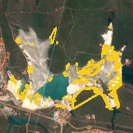 |  Tailings storage facility (TSF) | 21.84 km² | <b class="hl">2.19 km² (10 %)</b> | tailings deposition, dam-wall fill |
|   |  South pit complex | 24.84 km² | 0.55 km² (2 %) | pit / bench activity |
| 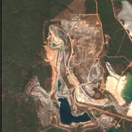 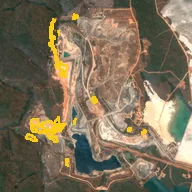 |  North-west pit complex | 13.16 km² | 0.41 km² (3 %) | waste dumping |
| 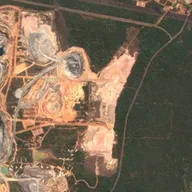  |  Eastern waste dumps | 3.30 km² | 0.21 km² (6 %) | waste dumping |
| 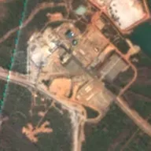 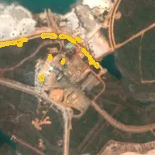 |  Process plant | 0.95 km² | 0.01 km² | infrastructure |
| 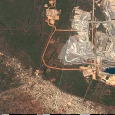 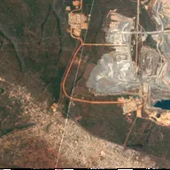 |  Settlement, camp, fresh-water dam | 15.24 km² | 0 km² | — |

🌿 **Land cover before → after**, a check without the register: simple RGB rules sort changed pixels into water, bright surface, bare ground and vegetation. Vegetation → bare ground (0.62 km², 15 %) is the new disturbance, much of it along the dam wall; most of the rest is bare ground re-worked (29 %) or turned to bright tailings (18 %).

🧱 **The dam wall, dated.** Every polygon stores its zone, so its true dates are known: 0.40 of the 0.44 km² dam-wall fill lies in the east zone, *1 Jul → 25 Aug*.

🔁 **What if we use true single passes instead?** The same pipeline on single passes that cover the whole site (`scripts/real_dates.py`; on the map: Result → "Ours, true passes"):

| Pair | Provided method | This method | Dam-wall fill |
|---|---:|---:|---:|
| The supplied mosaics (nominal 12 Aug → 2 Sep) | <b class="bad">111 km²</b> | <b class="good">4.17 km²</b> | 0.44 km² |
| Single pass, 8 Aug → 2 Sep 2023 (the clear dates closest to the nominal ones) | <b class="bad">194 km²</b> | 2.26 km² | 0.10 km² |
| Single pass, 4 Jul → 8 Aug 2023 | 4.6 km² | 12.1 km² | 0.44 km² |

- Without seams the provided method gets *worse* (<b class="bad">194 km²</b>): its real weakness is the haze and brightness difference between dates, which step 2 removes.
- The dam-wall fill happened <b class="hl">between 4 Jul and 8 Aug</b>, before the nominal before date; the mosaics catch it only because their "12 Aug" is really early July. The supplied pair stays the main result, because it is what the brief supplies.

📈 **Over three years** *(exploratory, not validated)*. The supplied before date against later August scenes, so the season matches. Beyond the brief; no accuracy check.

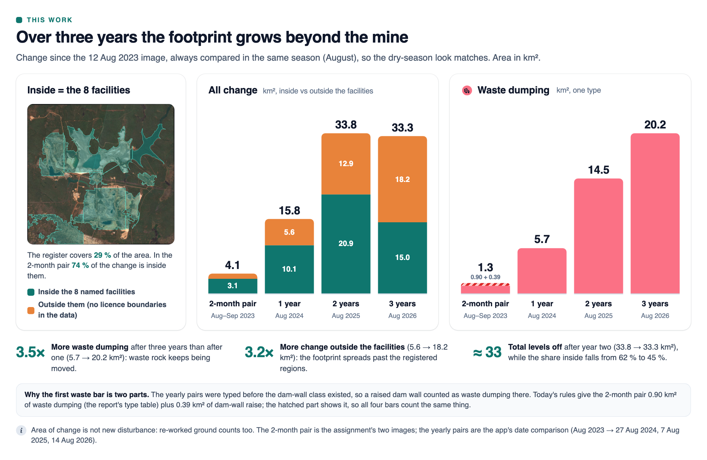

*"Outside" means outside all 8 register facilities. Area of change counts re-worked ground too, so it is not all new disturbance.*

Compare in the app: [Aug 2023 → Aug 2024](https://s2change.dzaky.ai.id/#/map?before=provided-before&after=2024-08-27) · [→ Aug 2025](https://s2change.dzaky.ai.id/#/map?before=provided-before&after=2025-08-07) · [→ Aug 2026](https://s2change.dzaky.ai.id/#/map?before=provided-before&after=2026-08-14)

## 🎯 5. How accurate is it?

<table class="kpi">
<tr>
<td align="center"><b class="good">0.67</b> precision right 2 times in 3 when it says "changed"</td>
<td align="center"><b class="bad">0.17</b> recall an estimate that rests on 6 disputed points, see below</td>
<td align="center"><b>0.94</b> overall accuracy provided method: 0.62</td>
<td align="center"><b>16.6 km²</b> estimated real change ± 10.9; the 4.17 km² is its core</td>
</tr>
</table>

200 random points, 50 in each of four groups (both maps say change, only this map, only the provided method, neither), so one sample scores both maps without bias (Olofsson et al. 2014).

🏷️ **How the points were labelled:**

- **Two independent AI vision labellers**, from before/after image chips, blind to both maps.
- Agreement 80 % (Cohen's κ 0.46, moderate); the 40 disagreements settled by a third look with a wider view.
- Visual labels from the same 10 m imagery, not field truth (`scripts/validation.py`, `data/validation/`).

| 95 % intervals | This method | Provided method |
|---|---:|---:|
| Pixels labelled correctly (overall accuracy) | <b class="good">0.94 ± 0.04</b> | 0.62 ± 0.04 |
| When it says "changed", it is right (precision) | <b class="good">0.67 ± 0.11</b> | <b class="bad">0.12 ± 0.08</b> |
| Share of all real change it finds (recall) | <b class="bad">0.17 ± 0.11</b> | 0.80 ± 0.31 |

💡 **What this means.** *Precise, and the recall figure is weaker than it looks.* Where both maps agree, 72 % of points really changed; 16 of the 21 real extra detections of this map are fresh burn scars the provided method misses.

🔎 **Why recall is 0.17, and can it be raised?** Of the 63 sample points labelled "changed", this map catches **57**. The 6 it misses all lie in the two big groups where this map says "no change" (2.6 million pixels), so each of them stands for **2–3 km²** of change, about 14 km² in total. That is where the "16.6 km² of real change" and the low recall come from. All 6 are points where the two labellers **disagreed**, mostly with low confidence ("tone shift", "tailings band now pale", "burn along a drainage line").

Re-scoring the same points with looser settings shows that tuning does not fix it:

| Setting | Changed area | Precision | Recall | Missed points caught |
|---|---:|---:|---:|---:|
| ⭐ Ours (1 in 1,000) | 4.17 km² | <b class="good">0.67 ± 0.11</b> | 0.17 ± 0.11 | 57 of 63 |
| Looser (1 in 100) | 6.69 km² | 0.58 ± 0.37 | 0.30 ± 0.26 | 58 of 63 |
| Much looser (1 in 10) | 14.5 km² | <b class="bad">0.34 ± 0.29</b> | 0.30 ± 0.26 | 58 of 63 |

*Loosening catches one more point and adds mostly false alarms.* The real fix is **more and better labels** in the "no change" groups, on very-high-resolution imagery, so a few uncertain points no longer decide the number (see [next steps](#-8-limitations-and-next-steps)). After that, a per-type threshold for tailings could recover the subtle changes the labellers argued about.

## 🧭 6. What it means

**In short:**

- ⛏️ **The mine was working, not spreading.** Tailings spread, waste tipped, pits worked; outside the mine only 0.02 km² is clearing.
- 🧱 **Fresh fill on the tailings dam's south-east wall, likely a wall raise:** <b class="hl">0.39 km²</b> where vegetation was. The first thing a dam-safety team would want to see.
- 🪤 **The data had a trap**, and the provided method maps it as change (<b class="bad">111 km²</b>); found, proved and corrected.
- 🎯 **Precise:** right <b class="good">2 times in 3</b> when it says "changed" (the provided method: <b class="bad">1 in 8</b>), and it catches <b class="good">57 of 63</b> sampled changes; the low recall estimate (0.17) rests on 6 disputed points and needs more labels.
- 📈 **Over three years the footprint grows** (exploratory): change outside the named facilities rises from 3.3 to <b class="hl">14.3 km²</b>.

🧭 **In the brief's categories**, the mine is operating normally:

| Category | Area | What it is |
|---|---:|---|
| ⛏️ Mining activity | <b class="hl">3.4 km²</b> | Tailings deposition, waste dumping, pit work, a likely dam-wall raise |
| 🌾 Seasonal vegetation | 0.39 km² | Dry-season browning or burns outside the mine |
| 🪓 Land clearing | 0.02 km² | Outside the mine; no urban expansion |
| 〰️ Noise and artifacts | 0.14 km² | Mostly removed by the seam handling; the rest labelled, with unexplained and small builds |

📖 **How to read each pattern.** Every type is a hypothesis, with what could fake it in RGB and what would confirm it:

| Pattern | Likely meaning | Could also be | Confirm with |
|---|---|---|---|
| Bright/dark patches moving on the TSF | Tailings deposition | Beaches drying with the season | Later dates: outline stays, patches move |
| Brighter and redder faces at dumps | Fresh waste rock | Sun 10° higher on slopes, dust | A same-season date; very-high-resolution imagery |
| Bench changes inside pits | Excavation | Shadows shifting with the sun | Sun-matched pairs; elevation data |
| Browner patches outside the mine | Grass drying or burning | Wet ground (RGB cannot separate them) | Fire records; recovery after rain |

> [!WARNING]
> **Confidence is not accuracy.** "Confidence" is a change-magnitude score. Precision and recall are measured on a random sample ([how accurate](#-5-how-accurate-is-it)); a polygon's confidence is not its probability of being right.

👥 **Who acts on it.**

| Who | Their question | What this gives them | What it cannot say |
|---|---|---|---|
| 🏛️ Regulator | Is the mine within its licence? | Footprint growth outside known facilities, located and sized monthly at no data cost | Legality: there are no licence boundaries here |
| 🛡️ Dam-safety oversight | Is the tailings facility run as planned? | Where deposition, ponding and wall raises happen | Stability, freeboard, seepage |
| 💼 Investors, lenders, insurers | Is the operation running and growing? | Independent activity signals: waste moved, tailings deposited, pits worked | Production, grade or tonnes |
| 🌱 ESG and community teams | Is clearing or water change spreading? | Clearing and water change outside the register | Social or health impacts |

🔔 **As a service**, the pipeline runs monthly on a new clear scene, against last month and the same month last year; changes outside a facility or above a size limit become alerts for an analyst. Each comparison is one more run in the database, already keyed by run.

## 🏗️ 7. The system: stack, agent and database

One Python package (`s2cd`) does the analysis. Everything else lets a reader check the results without installing anything.

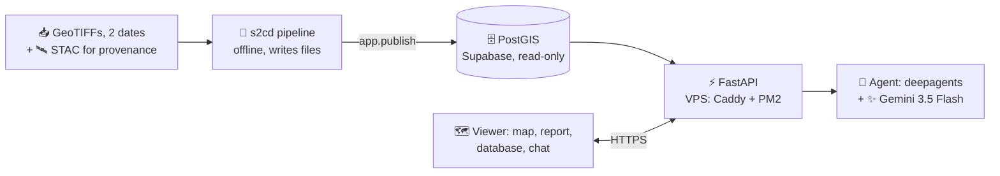

| | Layer | Stack | Why |
|---|---|---|---|
| 🐍 | Pipeline | Python 3.12, uv, numpy, scipy, rasterio, scikit-image, geopandas, shapely | Windowed GeoTIFF I/O, robust statistics, morphology, valid polygons in metres (EPSG:32735) |
| 🛰️ | Provenance | pystac-client, Planetary Computer | Finds the true pass behind every pixel (optional extra) |
| 🗄️ | Database | **PostGIS 16** with GiST indexes on Supabase; **SpatiaLite** file offline | The geospatial DB the brief asks for; the app reads through a `SELECT`-only role |
| ⚡ | API | FastAPI, uvicorn, slowapi, sqlglot | Typed endpoints, rate limits, SQL parsed and checked before it runs |
| 🤖 | Agent | LangChain **deepagents** on **Gemini** | Answers questions about the results with typed tools only |
| 🗺️ | Viewer | Vite, TypeScript, MapLibre GL, marked, Mermaid | Static bundle; this report is rendered from the same markdown |
| 🚀 | Delivery | Caddy (TLS), PM2, GitHub Actions | One small VPS; CI runs ruff, pytest and the builds |

### 🤖 The analyst agent

*Ask in plain words; it answers with numbers from the database and moves the map.*

- 🧰 **Tools only, no free hand:** 12 typed tools. deepagents' own planning, file, shell and sub-agent tools are switched off: a question needs a few calls, and each extra tool is attack surface.
- 🔒 **Read-only by construction:** every query runs as `s2cd_reader` (`SELECT` only, 5 s timeout); free SQL passes a sqlglot guard (one `SELECT`, allow-listed tables, `LIMIT` ≤ 200).
- 🧾 **Shows its work:** each answer returns the tool calls, including the SQL, so a number can be checked.
- 🎯 **Honest framing:** the prompt states RGB-only evidence, the true pass dates, that confidence is signal strength (not accuracy) and that a change type is a hypothesis.
- 💸 **Cheap to run:** the starter questions are answered once and kept on disk; the LLM libraries load only when a new question comes in.

| Kind | Tools |
|---|---|
| 📊 Numbers | `list_runs`, `area_summary`, `change_type_summary`, `facility_summary`, `top_changes`, `explain_change` |
| 📚 Background | `read_context` (notes on the site, seasons, method, business use) |
| 🔎 Ad-hoc | `readonly_sql` (guarded) |
| 🗺️ Output | `map_action` (fly to, highlight), `make_chart`, `make_table` |

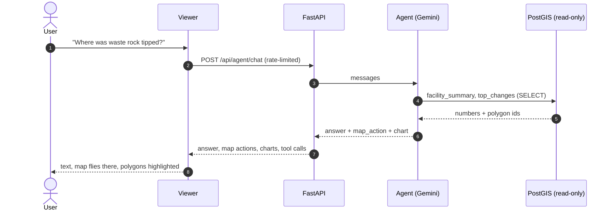

### 🗃️ The database

*Two runs (this method and the provided one) share one table; facilities are the analyst's register.*

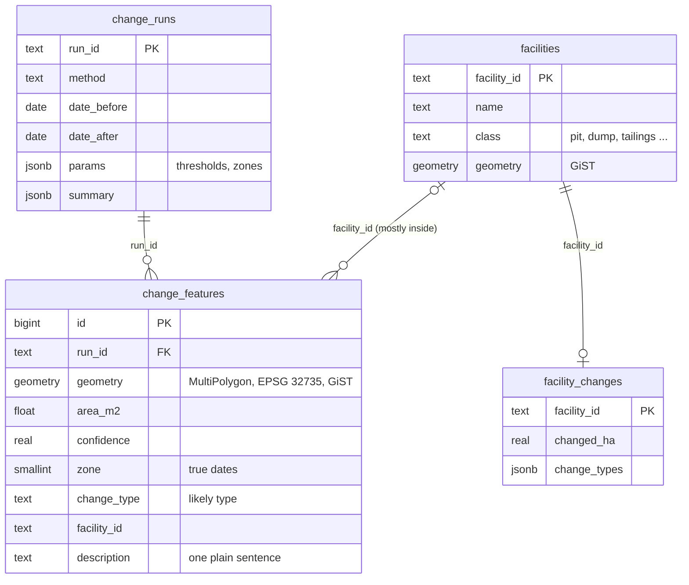

| Table | Holds | Typical question |
|---|---|---|
| `change_runs` | One row per method and date pair, with its parameters and totals | *Which runs exist, and with which thresholds?* |
| `change_features` | One row per change polygon: geometry, size, confidence, zone, likely type, facility, a sentence | *What changed inside the tailings facility?* |
| `facilities` | The 8 named mine facilities, drawn on very-high-resolution imagery | *Where are the pits and dumps?* |
| `facility_changes` | Change per facility, by type | *Which facility changed most?* |

`change_features_wgs84` is a view in lon/lat for web maps. Example queries: [PostGIS](https://github.com/dzakybd/s2change/blob/main/sql/queries_postgis.sql) · [SpatiaLite](https://github.com/dzakybd/s2change/blob/main/sql/queries_spatialite.sql) · [explore it live](https://s2change.dzaky.ai.id/#/database).

## 🚧 8. Limitations and next steps

> [!WARNING]
> **The map misses most subtle change.** Recall is <b class="bad">0.17 ± 0.11</b>: it is built to avoid false alarms, so faint tailings and burn changes fall below the threshold.

🔬 **Next validation step.** A human analyst relabels the 200 points, plus about 200 more in the "no change" groups, on very-high-resolution imagery from the same weeks (Planet or Esri Wayback). That tightens recall, replaces AI labels, and gives the first training set for a learned model; a per-type threshold would recover the missed tailings changes.

| | Gap | Why it matters | Next step |
|---|---|---|---|
| 🎨 | RGB only | Water, shadow and dark wet soil look alike; burns look like wet ground | Add NIR (B08) for NDVI at the same 10 m, and the L2A cloud and shadow mask |
| ⛰️ | No elevation | No volumes; pits versus dumps rest on context | Stereo very-high-resolution imagery or LiDAR |
| ✏️ | Hand-drawn facility regions | Facility edges are an analyst's call | Licence boundaries or a maintained facility database |
| 🔍 | Super-resolution | Models like SEN2SR invent detail that differs between dates, creating false change | Display only: the map's 2.5 m layer is SEN2SR on the analysed dates; detection stays on the 10 m bands |
| 📆 | Two mosaicked dates | Sun angle and pass mixes differ | Per-pixel acquisition dates, same-season pairs, per-pair calibration (as here) |

### ✅ The brief, covered

| # | Task | Done | See it |
|---|---|---|---|
| 1 ✅ | Data preparation | B02–B04 loaded, CRS, transform and shape checked, stacked | [Section 1](#-1-the-data) · `src/s2cd/io.py` → `data/processed/sentinel2_*_stack.tif` |
| 2 ✅ | Change detection | The provided example, unchanged, and a calibrated change vector analysis | [Section 3](#-3-the-method) · [Change intensity map](https://s2change.dzaky.ai.id/#/map?layer=intensity) |
| 3 ✅ | Store in a geospatial DB | SpatiaLite file in the repo; PostGIS with spatial indexes, explorer, SQL dump, API | [Section 7](#-7-the-system-stack-agent-and-database) · `data/change_detection.sqlite` · [Database](https://s2change.dzaky.ai.id/#/database) |
| 4 ✅ | Visualise | Static figures here; interactive map with swipe, types and facilities | [Map](https://s2change.dzaky.ai.id/#/map) |
| 5 ✅ | Interpret | Typed polygons with a sentence each, facility register, confounders | [Section 4](#-4-what-changed) · [Section 6](#-6-what-it-means) |

Security controls of the app are in [docs/system.md](https://github.com/dzakybd/s2change/blob/main/docs/system.md).

### References

- Malila (1980). [Change vector analysis: an approach for detecting forest changes with Landsat](https://docs.lib.purdue.edu/lars_symp/385/). LARS Symposia, paper 385.
- Otsu (1979). [A threshold selection method from gray-level histograms](https://doi.org/10.1109/TSMC.1979.4310076). *IEEE Trans. SMC* 9(1):62–66. *The provided example's threshold.*
- Canty & Nielsen (2008). [Automatic radiometric normalization of multitemporal satellite imagery with the iteratively re-weighted MAD transformation](https://doi.org/10.1016/j.rse.2007.07.013). *Remote Sens. Environ.* 112:1025–1036. *Step 2.*
- Olofsson et al. (2014). [Good practices for estimating area and assessing accuracy of land change](https://doi.org/10.1016/j.rse.2014.02.015). *Remote Sens. Environ.* 148:42–57. *Section 5.*
- Stehman (2014). [Estimating area and map accuracy for stratified random sampling when the strata are different from the map classes](https://doi.org/10.1080/01431161.2014.930207). *Int. J. Remote Sens.* 35(13):4923–4939. *Scoring both maps with one sample.*
- Cohen (1960). [A coefficient of agreement for nominal scales](https://doi.org/10.1177/001316446002000104). *Educ. Psychol. Meas.* 20(1):37–46. *Labeller agreement (κ).*
- Zheng et al. (2024). [Segment Any Change](https://arxiv.org/abs/2402.01188). NeurIPS 2024. *AnyChange comparison.*
- ESA OpenSR. [SEN2SR: Sentinel-2 super-resolution to 2.5 m](https://github.com/ESAOpenSR/SEN2SR). *Map display layer.*

---

*Contains modified Copernicus Sentinel-2 data (2023–2026). Map imagery in the app: the analysed scenes super-resolved with SEN2SR (ESA OpenSR, display only), over Esri World Imagery and Bing Aerial basemaps. Built by Dzaky Zakiyal Fawwaz for the Solafune geospatial take-home.*
