# What changed at an open-pit copper mine in NW Zambia?

**Two free satellite images of one copper mine: what changed, what it most likely is, and who should act on it.** [Open the map](https://s2change.dzaky.ai.id/#/map) · [Ask the agent](https://s2change.dzaky.ai.id/#/map?agent=1) · [Explore the database](https://s2change.dzaky.ai.id/#/database) · [Downloads](https://s2change.dzaky.ai.id/#/downloads) · [Repository](https://github.com/dzakybd/s2change) · [Video](https://youtu.be/MBTmg62P2ew)

*Prefer watching? A 4.5-minute [technical walkthrough](https://youtu.be/MBTmg62P2ew). We recorded it before simplifying one cleanup step, so it shows 4.13 km² in 215 polygons where this report has 4.17 km² in 223.*

🧭 **The story, in order:** 📦 [the data](#-1-the-data) → 🪤 [a trap hidden in it](#-2-the-data-trap-each-date-is-two-passes) → ⚙️ [a method built around the trap](#-3-the-method) → 📍 [what changed](#-4-what-changed) → 🎯 [how accurate it is](#-5-how-accurate-is-it) → 🧭 [what it means](#-6-what-it-means) → 🏗️ [the system](#-7-the-system-stack-agent-and-database) → 🚧 [limits](#-8-limitations-and-next-steps).

> [!TIP]
> **Words used in this report**
> - **Pixel:** one 10 × 10 m square of ground. **Band:** one colour channel of the image (here blue, green, red).
> - **Pass:** one flight of the satellite over the site, which gives an image of one day.
> - **Seam:** the straight line where an image file switches from one pass to another. **Zone:** the part of the site that has the same pair of passes (before and after).
> - **Reflectance:** the share of sunlight the ground reflects, from 0 (black) to 1 (white).
> - **Stable ground:** ground that did not change between the dates, used as the reference.
> - **Tailings:** the wet ground-up rock left after the copper is taken out, pumped into a large walled pond (the *tailings storage facility*, TSF).
> - **Polygon:** one outlined patch of change. **False alarm:** a place flagged as changed that did not change.
> - **Precision:** how often a "changed" flag is right. **Recall:** the share of all real change that is found.
> - **Area:** 1 km² = 100 ha; 1 ha (10,000 m²) is about 1.4 football pitches.

## 📦 1. The data

The brief supplies two Sentinel-2 images of an open-pit copper mine in Zambia and asks what changed between them.

| | What we got |
|---|---|
| 🛰️ Images | One image per date from the European Sentinel-2 satellite (GeoTIFF files), three colour bands: **B02, B03, B04** (blue, green, red); one pixel is 10 × 10 m |
| 📅 Dates | Labelled **12 Aug 2023** (before) and **2 Sep 2023** (after): *21 days apart, on paper* |
| 🗺️ Area | 16.7 × 16.0 km (1,673 × 1,597 pixels); map projection UTM 35S (EPSG:32735) |
| 🧪 Processing | Already corrected for the atmosphere by ESA (Level-2A, proved in section 2); stored numbers become reflectance with `(DN − 1000) / 10000` |

> [!NOTE]
> **Colour only (RGB).** We use only the three colour bands: no infrared, no cloud mask, no elevation. The layout matches the Lumwana copper mine; the brief only says "an open-pit mining site in Zambia", so the name is our inference.

🏭 **What is on the ground.** To say *where* change happens, we outlined the mine's 8 facilities (pits, waste dumps, tailings, plant, town) on sharp aerial imagery and checked them against the 2023 image (`configs/facility_register.yaml`, [on the map](https://s2change.dzaky.ai.id/#/map?layer=facilities)):

🧪 **Was the data already corrected?** Mostly yes, but not for everything that matters here:

| Correction | In the supplied data | Added here |
|---|---|---|
| Sensor calibration, terrain geometry, atmosphere | ✅ Done by ESA | Nothing redone; stored numbers converted to reflectance |
| Brightness differences between passes, seams | ❌ **Not corrected** | Brightness matched zone by zone; seams skipped (section 3) |
| Sun and viewing angle | ❌ Not corrected | Kept in mind when reading slopes (section 6) |

*The second row is where the story turns.*

## 🪤 2. The data trap: each "date" is two passes

Looking at the two images side by side, a straight diagonal line runs through both: on one side the image is brighter, on the other darker, through forest, roads and ponds alike. Ground does not change in straight lines, so the cause had to be in the data.

> **Claim.** Neither supplied "date" is one image. Each file is stitched from two Sentinel-2 passes taken days apart, so the pair holds brightness jumps that are not on the ground, and before and after are really 52–60 days apart, not 21.

<table class="kpi">
<tr>
<td align="center"><b class="bad">0</b> scenes on 12 Aug 2023 passes on 8, 10 and 13 Aug only</td>
<td align="center"><b>2</b> passes in each file joined at a straight 12.6° seam</td>
<td align="center"><b class="good">100 %</b> identical to one pass, west of the seam and 0 % east of it</td>
<td align="center"><b class="bad">52–60</b> days between the real passes in three zones, not 21</td>
</tr>
</table>

🔎 **Proof 1. One side is a known pass, the other is not.** The satellite took no image of the site on 12 Aug. So we compared each file with a real single pass that covers the whole site: before with *4 Jul*, after with *2 Sep*. West of the seam <b class="good">every pixel is identical</b> in all three bands; east of it, <b class="bad">none is</b>. The brightness jumps exactly at the seam (e): the edge of a pass, not something on the ground.

*Before with before, after with after: identical on one side of the yellow line, different on the other (`scripts/fig_trap_proof.py`).*

🧬 **Proof 2. Every pixel traced to its pass.** We compared all 55–56 archived images of the site from the 75 days before each date with the files, pixel by pixel (`s2cd provenance`). Two images per date match every pixel exactly, and their records give the true dates. The two files switch pass at slightly different lines, so together they split the site into **three zones**:

*The seams are the edge of one satellite track (orbit 78), which covers only the east of the site.*

📅 **So the site has three real before → after pairs,** set by the files, not chosen:

| Zone | Before → after (true dates) | Gap | Share of the site |
|---|---|---:|---:|
| 🟦 West | 4 Jul → 2 Sep | 60 days | 38.9 % |
| ▨ Middle strip | 4 Jul → 25 Aug | 52 days | 5.1 % |
| 🟧 East | 1 Jul → 25 Aug | 55 days | 56 % |

⚠️ **Why it matters.** The provided example method compares the files as if each were one image, so it maps the brightness jump between passes as change: <b class="bad">111 km²</b>, 42 % of the site ([see it on the map](https://s2change.dzaky.ai.id/#/map?layer=baseline&oblique=0)). Any method for this data has to handle the zones first.

## ⚙️ 3. The method

Two methods run on the same images and are stored in the same database:

- **The provided example, unchanged:** how much the colour differs between the dates, cut with one automatic threshold ([Otsu 1979](#ref-otsu-1979)) (`change_map_baseline.tif`, `change_binary_baseline.tif`).
- **This work: a calibrated change vector analysis** ([Malila 1980](#ref-malila-1980)). The question per pixel: *how far did its colour move, compared with how far colour moves on ground that did not change?* (`change_map.tif`, `change_binary.tif`)

### 🔬 Both methods side by side

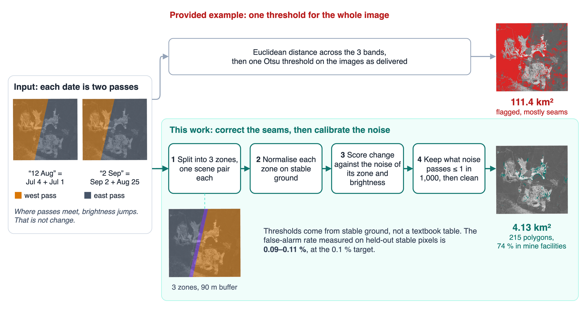

*Both methods on the same input: source pass per pixel, the three zones, and each method's change mask. Editable source: [`docs/figures/04_method_overview.drawio`](https://github.com/dzakybd/s2change/blob/main/docs/figures/04_method_overview.drawio).*

### 🪜 The six steps, with the equations

Each step gives what it does in plain words, its equation and source, the result on the real images (whole site and a close-up of the tailings dam wall), and what happens without it (❌, measured by re-running without the step).

#### 0️⃣ Pixel values to reflectance

The files store whole numbers ($DN$). ESA's rule turns each band $b$ into reflectance; images processed since January 2022 carry an offset of 1,000 ([ESA 2021](#ref-esa-2021)):

$$
\rho_b = \frac{DN_b - 1000}{10\,000}
$$

| | Whole site | Close-up: tailings dam wall |
|---|---|---|
| 📥 **Before** ("12 Aug") | 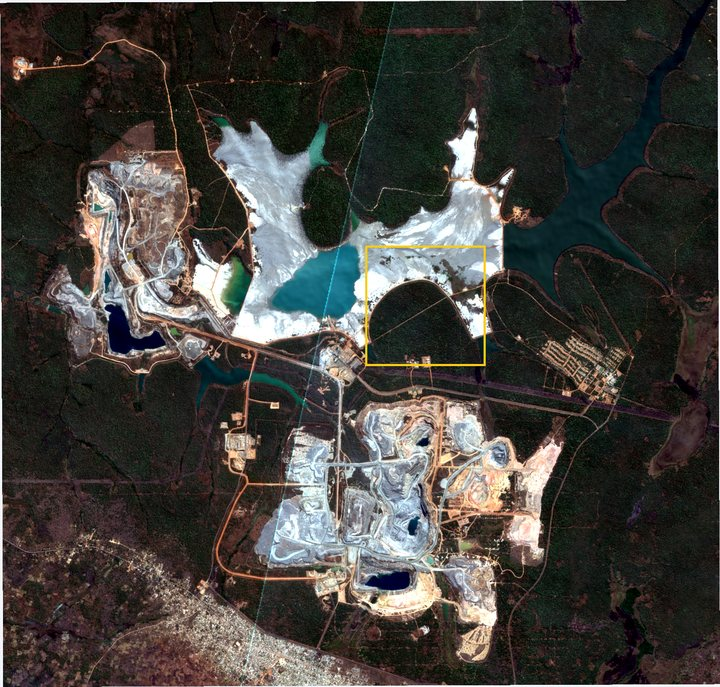 |  |
| 📥 **After, as delivered** ("2 Sep") |  |  |

*The two files in true colour. The after file looks brighter and hazier, partly because it holds other passes.*

#### 1️⃣ Split into zones

A zone is a group of pixels that share the same *pair* of satellite passes.

**1.1** For every pixel, find which pass it came from, in the before file and in the after file (section 2, proof 2).

**1.2** Each file switches pass at one straight seam, so each file has two parts.

**1.3** Lay the two files over each other. Their seams are at slightly different places, so the site falls into **three** pass pairs: west, a thin middle strip and east.

$$
z(p) = \big(\,s_{\text{before}}(p),\; s_{\text{after}}(p)\,\big)
$$

Here $s(p)$ is the pass that pixel $p$ came from; each different pair is one zone. This grouping is our own; the passes and their dates come from the Sentinel-2 archive on Microsoft Planetary Computer. Nothing is tuned: the files decide the zones. A second check that uses only the images, by finding the straight brightness jumps, draws the same borders (99 % agreement).

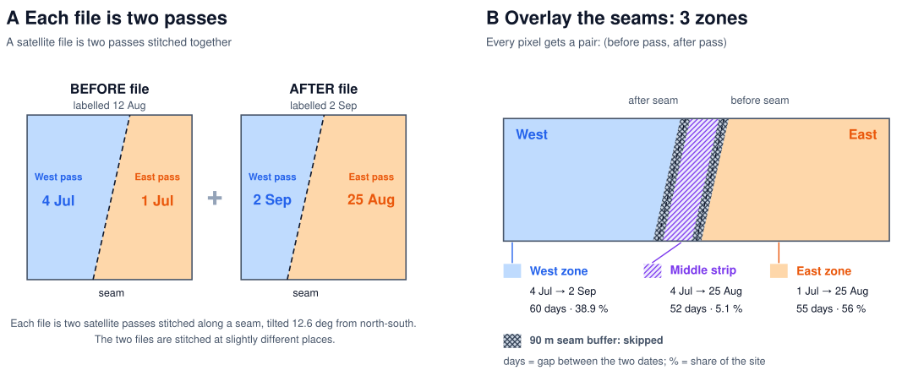

*Step 1 as a sketch (`scripts/fig_method_steps.py`). The dates, day gaps and shares are the real ones.*

| Whole site | Close-up: tailings dam wall |
|---|---|
| 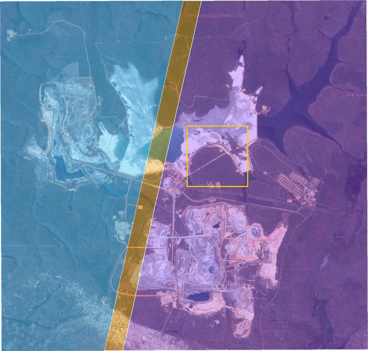 |  |

*The 3 zones on the real data (tinted) and the seam strip between them.*

❌ **Without it:** one rule for three different pass pairs. It finds only <b class="bad">a third</b> as much real change (1.57 km², recall 0.17 → 0.06).

#### 2️⃣ Match brightness, one line per zone and band

Inside one zone, each image is one pass, so the haze and light difference between the dates is about the same across the zone, but different from zone to zone (figure below, A). On ground that did not change, the before and after brightness then lie on a straight line. That line converts the after image to the before image's brightness. This is called relative normalisation on stable ground ([Schott et al. 1988](#ref-schott-1988)), fitted as in [Canty & Nielsen (2008)](#ref-canty-2008):

$$
\hat\rho^{\,\text{after}}_{b}(p) = a_{z,b} + c_{z,b}\,\rho^{\,\text{after}}_{b}(p)
\qquad \text{for every pixel } p \text{ in zone } z
$$

Here $c$ is the slope and $a$ the offset of the line, one pair per zone $z$ and band $b$. The method finds them in four steps:

**2.1 Fit a line through all pixels of the zone.** Both images have noise, so the fit measures each pixel's distance straight across to the line (orthogonal regression), not only up and down; the usual least-squares fit would make the line too flat.

**2.2 Drop pixels far from the line.** Each pixel's distance from the line, $r$, becomes a score $z_r$: how many typical distances away it is. The typical distance is 1.4826 × MAD (median absolute deviation), which, unlike the standard deviation, is not inflated by the changed pixels themselves ([Rousseeuw & Croux 1993](#ref-rousseeuw-1993)):

$$
z_r = \frac{|\,r - \operatorname{median}(r)\,|}{1.4826\,\operatorname{MAD}(r)}
$$

A pixel with $z_r > 2.5$ in any band is probably real change, so it is left out.

**2.3 Refit without them, and repeat** (5 rounds). What is left is the *stable ground*: 84–89 % of each zone. Changed pixels never shape the line (B).

**2.4 Apply the line to every pixel of the zone,** changed or not. Stable ground now sits on the "no difference" line; real change stays off it (D).

*Step 2 on real pixels of the blue band (`scripts/fig_method_steps.py`). The lines are the fitted ones in the table below.*

The fitted lines differ a lot between zones, which is why one line for the whole site fails:

| Zone | Slope $c$ (blue / green / red) | Offset $a$ (blue / green / red) | Stable ground |
|---|---|---|---:|
| 🟦 West | 1.84 / 1.63 / 1.50 | −0.114 / −0.092 / −0.086 | 88.6 % |
| ▨ Middle strip | 1.26 / 1.19 / 1.08 | −0.044 / −0.043 / −0.037 | 84.8 % |
| 🟧 East | 1.32 / 1.25 / 1.19 | −0.040 / −0.041 / −0.043 | 83.7 % |

*A slope above 1 with a negative offset means the after file is hazier: haze adds light and flattens contrast, and the line stretches it back. The west zone, whose after pass is 2 Sep, needs the most.*

| Whole site | Close-up: tailings dam wall |
|---|---|
|  |  |

*The after image matched to the before, zone by zone: the haze is gone, real change stays.*

❌ **Without it:** haze and sun differences read as change, as in the provided method (<b class="bad">111 km²</b>).

#### 3️⃣ Measure normal noise

After matching, each pixel's colour change is three numbers, one per band: the change vector ([Malila 1980](#ref-malila-1980)):

$$
\Delta(p) = \hat\rho^{\,\text{after}}(p) - \rho^{\,\text{before}}(p)
\in \mathbb{R}^{3}
$$

On stable ground $\Delta$ is not exactly zero. Sensor noise, tiny shifts and growing plants make it *flicker*, and bright ground flickers more than dark ground (figure below, A and B). So each zone $z$ is split into 6 brightness classes $k$, darkest to brightest, with equal pixel counts (our design). In each class, the flicker of stable pixels is summed up by its centre $\mu_{z,k}$ (the median) and its spread $\Sigma_{z,k}$ (how much each band varies and how the bands vary together, a 3 × 3 covariance). Here stable ground is defined more loosely ($z_r < 4$ instead of 2.5), so the rare large flickers are counted too.

*Steps 3 and 4 on real pixels (`scripts/fig_method_steps.py`). A and B show 2 of the 3 bands, so a few change pixels fall inside the ellipse there and are outside it in the third band. C: 0.10 % of held-out stable ground passes the cut-off, as intended; 99 % of the mapped pixels do (the rest are holes filled in step 6).*

❌ **Without it:** one noise level per zone, whatever the brightness. Bright mine ground then looks "changed": <b class="bad">22×</b> too many false alarms (<b class="bad">66×</b> on the brightest ground), 13.2 km².

#### 4️⃣ Flag what noise rarely does

Each pixel's score is how far its change lies from normal flicker, measured in units of that flicker, so a move in a band that flickers a lot counts less. This is the squared Mahalanobis distance ([Mahalanobis 1936](#ref-mahalanobis-1936)):

$$
d^{2}(p) = \big(\Delta(p) - \mu_{z,k}\big)^{\top}\,\Sigma_{z,k}^{-1}\,\big(\Delta(p) - \mu_{z,k}\big)
$$

If a pixel only flickers, statistics says how often its $d^2$ reaches any value: a chi-square distribution with 3 degrees of freedom, one per band. So the cut-off for a chosen false-alarm rate $\alpha$ is known in advance. Change detection has long used this test ([Nielsen et al. 1998](#ref-nielsen-1998); [Canty & Nielsen 2008](#ref-canty-2008)):

$$
\text{change}(p) \iff d^{2}(p) > \chi^{2}_{3}(1-\alpha) = 16.27
\qquad \text{with } \alpha = 10^{-3}
$$

**Checked, then corrected** (our own safeguard). The textbook cut-off assumes flicker follows a perfect bell curve, but real flicker has more extreme values. So we kept 30 % of the stable pixels (in blocks of 32 × 32 pixels) out of step 3 and used them as a test. With the textbook cut-off, 0.36–1.2 % of them passed instead of 0.1 %. So each brightness class gets its own cut-off: the score that only 1 in 1,000 of its test pixels exceed (19.9 to 33.0). Scores are rescaled so the map keeps one cut-off, 16.27. On the test pixels the rate is then 0.09–0.11 %, on target.

💡 **What "1 in 1,000" means.** Flicker alone passes the cut-off **1 pixel in 1,000**. The site has 2.6 million pixels, so about *2,600* (0.26 km²) pass by chance, as **lone specks**; real change passes as **solid patches**. Step 6 uses that difference.

| | Whole site | Close-up: tailings dam wall |
|---|---|---|
| **Score** $d^2$ |  |  |
| **Flagged** |  | 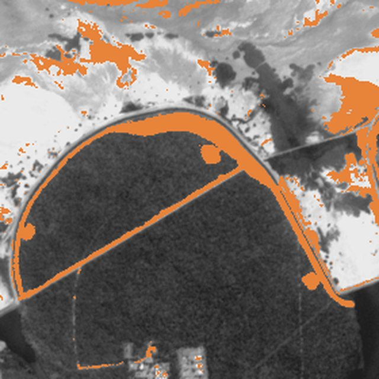 |

*Top: how unusual each pixel's colour change is for its zone and brightness, brighter = less likely noise ([on the map](https://s2change.dzaky.ai.id/#/map?layer=intensity)). Bottom: pixels past the cut-off, 6.74 km² in 4,479 patches.*

#### 5️⃣ Skip the seams

Pixels within 90 m of a seam are not scored (our rule): $\operatorname{dist}(p, \text{seam}) \le 90\ \text{m}$.

**Why skip them.** Steps 2–4 assume each zone behaves the same everywhere. Next to a seam it does not (figure below). In the first 10 m, 13 times as many pixels pass the cut-off as away from seams; 9 times at 10–20 m, 4 times at 20–30 m, and normal from about 40 m. The cause was not measured. Likely reasons: the seam is the edge of a pass, the 10 m pixel grid follows the slanted seam in steps, and the two passes are shifted very slightly. Either way, real change and seam errors cannot be told apart there, so the strip is left out rather than guessed.

**Why 90 m.** The noisy strip is 30–40 m wide on each side; 90 m (9 pixels) is about twice that, as a safety margin. It costs 2.4 % of the site, and none of the real changes missed in section 5 lie in it (the nearest is 340 m away).

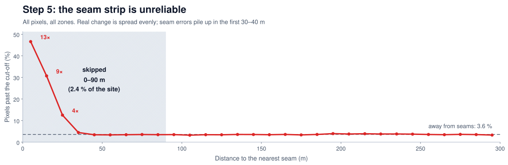

*Step 5 on real pixels (`scripts/fig_method_steps.py`): all pixels, before the seams are skipped. The level away from seams (3.6 %) is mostly real change in the mine.*

❌ **Without it:** 29 false polygons along the seams; precision <b class="bad">0.67 → 0.44</b>.

#### 6️⃣ Clean up

Like most maps, this one has a smallest patch it shows, the *minimum mapping unit*: 0.2 ha (2,000 m², 20 pixels), our choice, tested in the next subsection. Thin lines and specks are removed, smaller patches dropped and smaller holes filled.

❌ **Without it:** thousands of lone specks:

| After step | Changed area | Patches | Of which smaller than 2,000 m² |
|---|---:|---:|---:|
| 4️⃣ Flag (1 in 1,000) | 6.74 km² | 4,479 | 4,189 |
| 5️⃣ Skip the seams | 5.93 km² | 4,258 | 3,989 |
| 6️⃣ Clean up | <b class="good">4.17 km²</b> | <b class="good">223</b> | 0 |

*Most patches are specks: chance hits and the edges of real change. Real change is what is left: 223 polygons.*

| | Whole site | Close-up: tailings dam wall |
|---|---|---|
| **Seams skipped, cleaned** | 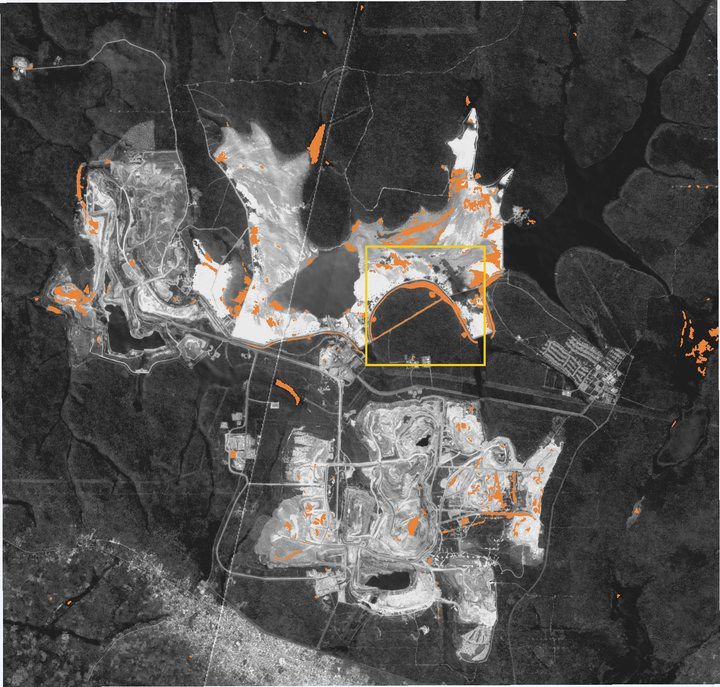 |  |
| 📤 **Typed and explained** |  |  |

*The result, <b class="good">4.17 km² in 223 polygons</b>. Each polygon then gets a likely type from its colour change and facility, and one plain sentence. Here: **Tailings dam wall likely raised**, 0.39 km², with the advice to check the dam-raise plan and inspect the embankment.*

The two images line up: checked in 8 windows per zone, they are offset by at most 0.05 pixel (50 cm), so nothing is shifted or resampled. A full run takes about 14 s on a laptop.

### 🎚️ Would other settings give a different answer?

Two numbers in the method are choices, not facts: **how strict the cut-off is** (step 4, 1 in 1,000) and **the smallest patch kept** (step 6, 2,000 m²). So we repeated the whole run with both looser and stricter, 16 combinations in all. The extremes and our choice:

| Setting | Changed area | Share inside the mine |
|---|---:|---:|
| 🔓 Loosest (1 in 100, patches from 1,000 m²) | 6.95 km² | 67 % |
| ⭐ **Ours** (1 in 1,000, patches from 2,000 m²) | **4.17 km²** | **81 %** |
| 🔒 Strictest (1 in 100,000, patches from 10,000 m²) | 2.10 km² | 87 % |

💡 **What it means.** The exact area depends on how strict one is, so read 4.17 km² as "a few km²", not as a precise figure. The *conclusion* does not move: in every run most change is in the mine, and the stricter the test, the larger that share. The strongest changes are the mining ones.

### 🧰 Other tools behind the result

The change itself is measured on the three 10 m bands only. Three more tools went into the result:

| Tool | Used for | Changes the detection? |
|---|---|---|
| 🛰️ [Microsoft Planetary Computer](https://planetarycomputer.microsoft.com/dataset/sentinel-2-l2a) Sentinel-2 archive | Tracing every pixel to its satellite pass (section 2); the true single passes (section 4) | ✅ Yes: it gives the three zones |
| 🔍 SEN2SR super-resolution ([Aybar et al. 2026](#ref-aybar-2026)) | A sharper 2.5 m true-colour layer of the analysed dates on the map, so changes are easier to read | ❌ No, display only: the model invents fine detail that differs between dates and would look like change |
| 🤖 AI vision labellers | Labelling the accuracy points (section 5) | ❌ No, accuracy only |

## 📍 4. What changed

<table class="kpi">
<tr>
<td align="center"><b>4.17 km²</b> 🛰️ changed in 223 polygons, 1.6 % of the site</td>
<td align="center"><b>81 %</b> 🏭 inside the mine in the 8 named facilities</td>
<td align="center"><b>3.4 km²</b> ⛏️ mining activity tailings, dumps, pits, dam wall</td>
<td align="center"><b class="good">27× less</b> 🪤 than the provided method which maps seams as change</td>
</tr>
</table>

📍 **Where.** Change concentrates in the mine: 81 % lies inside the eight named facilities, more than half on the tailings storage facility. Outside, change is scattered and small.

🔍 **Pattern.** Patches moving on the tailings facility, brighter and redder faces at dumps and pit edges, changes on the steps cut into pit walls (benches), and a long strip of fresh fill on the dam's south-east wall. No straight seam lines are left.

*Change polygons by type, and the area of each type.*

| | Change type | Brief category | Polygons | Area | What we see |
|---|---|---|---:|---:|---|
|  | Tailings deposition | mining activity | 63 | 1.86 km² | Wet slurry and drying beaches moving on the tailings facility |
|  | Waste dumping | mining activity | 47 | 0.75 km² | Brighter, redder faces at dumps and pit edges: fresh oxidised rock |
|  | Tailings dam wall raised | mining activity | 4 | 0.44 km² | Fresh fill on the embankment where vegetation was |
|  | Seasonal vegetation or burn | seasonal / vegetation | 22 | 0.39 km² | Dry-season browning or burn scars outside the mine |
|  | Pit excavation | mining activity | 33 | 0.40 km² | Changes on pit steps (benches) and floors |
|  | Water level change | water change | 8 | 0.18 km² | Pond and pit-lake edges moving |
|  | Noise, unexplained, infrastructure, clearing | other | 46 | 0.16 km² | Seams, haze, small builds; 0.02 km² of clearing |

🏭 **Per facility.** The last row combines the three facilities with almost no change.

| Before → after (change in yellow) | Facility | Area | Changed | Mostly |
|---|---|---:|---:|---|
|   |  Tailings storage facility (TSF) | 21.84 km² | <b class="hl">2.19 km² (10 %)</b> | tailings deposition, dam-wall fill |
| 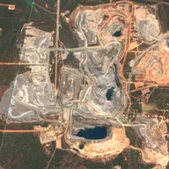  |  South pit complex | 24.84 km² | 0.55 km² (2 %) | pit / bench activity |
|   |  North-west pit complex | 13.16 km² | 0.41 km² (3 %) | waste dumping |
|   |  Eastern waste dumps | 3.30 km² | 0.21 km² (6 %) | waste dumping |
|   |  Process plant | 0.95 km² | 0.01 km² | infrastructure |
|   |  Settlement, camp, fresh-water dam | 15.24 km² | 0 km² | — |

🌿 **Land cover before → after**, a check without the register: simple RGB rules sort changed pixels into water, bright surface, bare ground and vegetation. Vegetation → bare ground (0.62 km², 15 %) is the new disturbance, much of it along the dam wall; most of the rest is bare ground re-worked (29 %) or turned to bright tailings (18 %).

🧱 **The dam wall, dated.** Every polygon stores its zone, so its true dates are known: 0.40 of the 0.44 km² dam-wall fill lies in the east zone, *1 Jul → 25 Aug*.

🔁 **What if we use true single passes instead?** The same pipeline on single passes that cover the whole site (`scripts/real_dates.py`; on the map: Result → "Ours, true passes"):

| Pair | Provided method | This method | Dam-wall fill |
|---|---:|---:|---:|
| The supplied files (labelled 12 Aug → 2 Sep) | <b class="bad">111 km²</b> | <b class="good">4.17 km²</b> | 0.44 km² |
| Single pass, 8 Aug → 2 Sep 2023 (the clear dates closest to the labelled ones) | <b class="bad">194 km²</b> | 2.26 km² | 0.10 km² |
| Single pass, 4 Jul → 8 Aug 2023 | 4.6 km² | 12.1 km² | 0.44 km² |

- Without seams the provided method gets *worse* (<b class="bad">194 km²</b>): its real weakness is the haze and brightness difference between dates, which step 2 removes.
- The dam-wall fill happened <b class="hl">between 4 Jul and 8 Aug</b>, before the labelled before date; the supplied files catch it only because their "12 Aug" is really early July. The supplied pair stays the main result, because it is what the brief supplies.

## 🎯 5. How accurate is it?

<table class="kpi">
<tr>
<td align="center"><b class="good">0.67</b> precision right 2 times in 3 when it says "changed"</td>
<td align="center"><b class="bad">0.17</b> recall subtle change hides in RGB noise; five reasons below</td>
<td align="center"><b>0.94</b> overall accuracy provided method: 0.62</td>
<td align="center"><b>16.6 km²</b> estimated real change ± 10.9; the 4.17 km² is its core</td>
</tr>
</table>

We drew 200 random points, 50 in each of four groups: both maps say change, only this map, only the provided method, neither. Each point is weighted by the size of its group, so one sample scores both maps fairly ([Olofsson et al. 2014](#ref-olofsson-2014); [Stehman 2014](#ref-stehman-2014)).

🏷️ **Who labelled the points:**

- **Two independent AI vision labellers**, from before/after image chips, blind to both maps.
- Agreement 80 % (Cohen's κ 0.46, moderate; [Cohen 1960](#ref-cohen-1960)); the 40 disagreements settled by a third look with a wider view.
- Visual labels from the same 10 m imagery, not field truth (`scripts/validation.py`, `data/validation/`).

| 95 % intervals | This method | Provided method |
|---|---:|---:|
| Pixels labelled correctly (overall accuracy) | <b class="good">0.94 ± 0.04</b> | 0.62 ± 0.04 |
| When it says "changed", it is right (precision) | <b class="good">0.67 ± 0.11</b> | <b class="bad">0.12 ± 0.08</b> |
| Share of all real change it finds (recall) | <b class="bad">0.17 ± 0.11</b> | 0.80 ± 0.31 |

💡 **What this means.** *Precise, and the recall figure is weaker than it looks.* Where both maps agree, 72 % of points really changed; 16 of the 21 real extra detections of this map are fresh burn scars the provided method misses.

🔎 **Why recall is 0.17, and can it be raised?** Of the 63 points judged "changed", this map catches **57**. But the 6 it misses come from the two large groups where this map says "no change" (2.6 million pixels, nearly the whole site). Each point there stands for a large area, **2–3 km²**, so the 6 add up to about 14 km² of estimated missed change. That is where both the "16.6 km² of real change" and the low recall come from. All 6 are points where the two labellers **disagreed**, mostly with low confidence ("tone shift", "tailings band now pale", "burn along a drainage line").

Re-scoring the same points with looser settings shows that tuning does not fix it:

| Setting | Changed area | Precision | Recall | Missed points caught |
|---|---:|---:|---:|---:|
| ⭐ Ours (1 in 1,000) | 4.17 km² | <b class="good">0.67 ± 0.11</b> | 0.17 ± 0.11 | 57 of 63 |
| Looser (1 in 100) | 6.69 km² | 0.58 ± 0.37 | 0.30 ± 0.26 | 58 of 63 |
| Much looser (1 in 10) | 14.5 km² | <b class="bad">0.34 ± 0.29</b> | 0.30 ± 0.26 | 58 of 63 |

*Loosening catches one more point and adds mostly false alarms.*

🪤 **Is the data trap to blame?** No. The 6 missed points lie 340–4,550 m from the nearest seam. The same check was also run on the **true single passes** (8 Aug → 2 Sep, no seams), with 200 new points and the same blind labelling:

| Pair | Labellers agree | Precision | Recall | Real change (estimate) |
|---|---:|---:|---:|---:|
| Supplied files (52–60 days) | 80 % | <b class="good">0.67 ± 0.11</b> | 0.17 ± 0.11 | 16.6 ± 10.9 km² |
| True single passes (25 days) | 96 % | 0.30 ± 0.12 | <b class="bad">0.03 ± 0.02</b> | 26 ± 16 km² |

Without the trap, recall is *not* higher. With only 25 days between passes there is little strong change: the method maps 2.26 km², and the labellers see many small, subtle changes it leaves out. *The labellers also agree much more on the true passes (96 % vs 80 %): the supplied files' longer, mixed gap makes changes harder to judge.*

🧩 **So why is recall low? Five reasons, in order of weight:**

| # | Reason | What it does to recall | What would fix it |
|---|---|---|---|
| 1 | 🎨 **Only three colour bands (RGB).** Sentinel-2 has 13 bands; the brief supplies B02, B03, B04 | Subtle real change looks like normal flicker in colour alone: wet vs dry tailings, a burn vs dark wet soil, grass drying vs ground. It stays under the cut-off | **More bands:** near-infrared (B08, 10 m) separates vegetation and burns; short-wave infrared (B11, B12, 20 m) separates wet from dry ground and fresh rock |
| 2 | 🎯 **Conservative by design.** A pixel must move more than noise does 999 times in 1,000 | Precision first: an alert should be worth checking. Faint change is left out on purpose | A looser cut-off only adds false alarms (table above); a per-type cut-off, e.g. for tailings, once labels allow it |
| 3 | 🔲 **10 m pixels.** One pixel is 100 m² | Small tips, narrow benches and patch edges mix changed and unchanged ground and dilute the signal | Higher-resolution imagery (commercial, 0.5–3 m) |
| 4 | 📆 **Only two dates.** | One pair cannot tell a real change from a one-off difference, so the noise allowance must be wide | A time series: a change that persists over several passes is real |
| 5 | 🏷️ **Uncertain labels, few points.** AI labels from the same 10 m RGB | 6 disputed points in the big "no change" groups decide the recall figure; intervals are wide | More points, labelled by an analyst on very-high-resolution imagery |

The real fix starts with **more and better labels**, so a few uncertain points no longer decide the number, then **more bands** (see [next steps](#-8-limitations-and-next-steps)).

## 🧭 6. What it means

**In short:**

- ⛏️ **The mine was working, not spreading.** Tailings spread, waste tipped, pits worked; outside the mine only 0.02 km² is clearing.
- 🧱 **Fresh fill on the tailings dam's south-east wall, likely a wall raise:** <b class="hl">0.39 km²</b> where vegetation was. The first thing a dam-safety team would want to see.
- 🪤 **The data had a trap**, and the provided method maps it as change (<b class="bad">111 km²</b>); found, proved and corrected.
- 🎯 **Precise, not complete:** right <b class="good">2 times in 3</b> when it says "changed" (the provided method: <b class="bad">1 in 8</b>), but it finds only part of the subtle change (recall 0.17), because three colour bands cannot tell it from flicker. More bands and better labels would raise it.

🧭 **In the brief's categories**, the mine is operating normally:

| Category | Area | What it is |
|---|---:|---|
| ⛏️ Mining activity | <b class="hl">3.4 km²</b> | Tailings deposition, waste dumping, pit work, a likely dam-wall raise |
| 🌾 Seasonal vegetation | 0.39 km² | Dry-season browning or burns outside the mine |
| 🪓 Land clearing | 0.02 km² | Outside the mine; no urban expansion |
| 〰️ Noise and artifacts | 0.14 km² | Mostly removed by the seam handling; the rest labelled, with unexplained and small builds |

📖 **How to read each pattern.** Every type is a hypothesis, with what could fake it in RGB and what would confirm it:

| Pattern | Likely meaning | Could also be | Confirm with |
|---|---|---|---|
| Bright/dark patches moving on the TSF | Tailings deposition | Beaches drying with the season | Later dates: outline stays, patches move |
| Brighter and redder faces at dumps | Fresh waste rock | Sun 10° higher on slopes, dust | A same-season date; very-high-resolution imagery |
| Bench changes inside pits | Excavation | Shadows shifting with the sun | Sun-matched pairs; elevation data |
| Browner patches outside the mine | Grass drying or burning | Wet ground (RGB cannot separate them) | Fire records; recovery after rain |

> [!WARNING]
> **Confidence is not accuracy.** "Confidence" is a change-magnitude score. Precision and recall are measured on a random sample ([how accurate](#-5-how-accurate-is-it)); a polygon's confidence is not its probability of being right.

👥 **Who acts on it.**

| Who | Their question | What this gives them | What it cannot say |
|---|---|---|---|
| 🏛️ Regulator | Is the mine within its licence? | Footprint growth outside known facilities, located and sized monthly at no data cost | Legality: there are no licence boundaries here |
| 🛡️ Dam-safety oversight | Is the tailings facility run as planned? | Where deposition, ponding and wall raises happen | Stability, freeboard, seepage |
| 💼 Investors, lenders, insurers | Is the operation running and growing? | Independent activity signals: waste moved, tailings deposited, pits worked | Production, grade or tonnes |
| 🌱 ESG and community teams | Is clearing or water change spreading? | Clearing and water change outside the register | Social or health impacts |

🔔 **As a service**, the pipeline runs monthly on a new clear scene, against last month and the same month last year; changes outside a facility or above a size limit become alerts for an analyst. Each comparison is one more run in the database, already keyed by run.

## 🏗️ 7. The system: stack, agent and database

One Python package (`s2cd`) does the analysis. Everything else lets a reader check the results without installing anything.

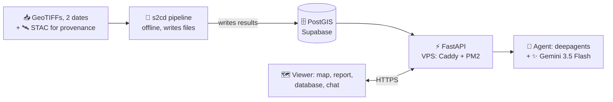

| | Layer | Stack | Why |
|---|---|---|---|
| 🐍 | Pipeline | Python 3.12, uv, numpy, scipy, rasterio, scikit-image, geopandas, shapely | Windowed GeoTIFF I/O, robust statistics, morphology, valid polygons in metres (EPSG:32735) |
| 🛰️ | Provenance | pystac-client, Planetary Computer | Finds the true pass behind every pixel (optional extra) |
| 🗄️ | Database | **PostGIS 16** with GiST indexes on Supabase; the pipeline writes to it directly | The geospatial DB the brief asks for; the app reads through a `SELECT`-only role |
| ⚡ | API | FastAPI, uvicorn, slowapi, sqlglot | Typed endpoints, rate limits, SQL parsed and checked before it runs |
| 🤖 | Agent | LangChain **deepagents** on **Gemini** | Answers questions about the results with typed tools only |
| 🗺️ | Viewer | Vite, TypeScript, MapLibre GL, marked, Mermaid | Static bundle; this report is rendered from the same markdown |
| 🚀 | Delivery | Caddy (TLS), PM2, GitHub Actions | One small VPS; CI runs ruff, pytest and the builds |

### 🤖 The analyst agent

*Ask in plain words; it answers with numbers from the database and moves the map.*

- 🧰 **Tools only, no free hand:** 12 typed tools. deepagents' own planning, file, shell and sub-agent tools are switched off: a question needs a few calls, and each extra tool is attack surface.
- 🔒 **Read-only by construction:** every query runs as `s2cd_reader` (`SELECT` only, 5 s timeout); free SQL passes a sqlglot guard (one `SELECT`, allow-listed tables, `LIMIT` ≤ 200).
- 🧾 **Shows its work:** each answer returns the tool calls, including the SQL, so a number can be checked.
- 🎯 **Honest framing:** the prompt states RGB-only evidence, the true pass dates, that confidence is signal strength (not accuracy) and that a change type is a hypothesis.
- 💸 **Cheap to run:** the starter questions are answered once and kept on disk; the LLM libraries load only when a new question comes in.

| Kind | Tools |
|---|---|
| 📊 Numbers | `list_runs`, `area_summary`, `change_type_summary`, `facility_summary`, `top_changes`, `explain_change` |
| 📚 Background | `read_context` (notes on the site, seasons, method, business use) |
| 🔎 Ad-hoc | `readonly_sql` (guarded) |
| 🗺️ Output | `map_action` (fly to, highlight), `make_chart`, `make_table` |

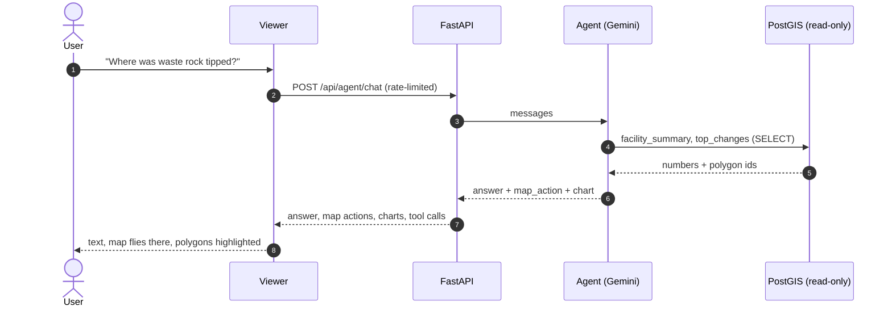

### 🗃️ The database

*Two runs (this method and the provided one) share one table; facilities are the analyst's register.*

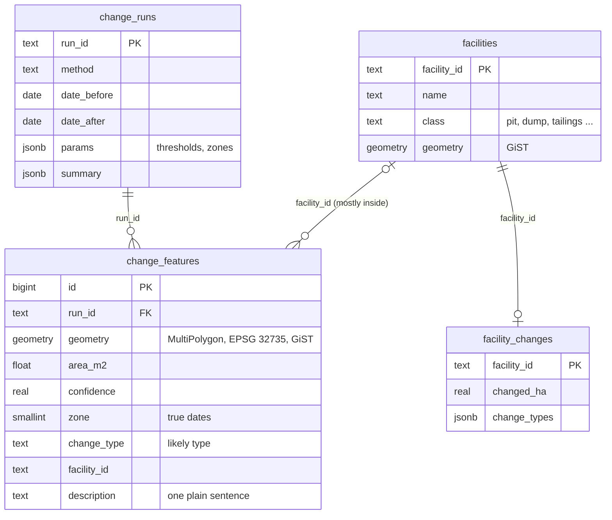

| Table | Holds | Typical question |
|---|---|---|
| `change_runs` | One row per method and date pair, with its parameters and totals | *Which runs exist, and with which thresholds?* |
| `change_features` | One row per change polygon: geometry, size, confidence, zone, likely type, facility, a sentence | *What changed inside the tailings facility?* |
| `facilities` | The 8 named mine facilities, drawn on very-high-resolution imagery | *Where are the pits and dumps?* |
| `facility_changes` | Change per facility, by type | *Which facility changed most?* |

`change_features_wgs84` is a view in lon/lat for web maps. Example queries: [PostGIS](https://github.com/dzakybd/s2change/blob/main/sql/queries_postgis.sql) · [explore it live](https://s2change.dzaky.ai.id/#/database).

## 🚧 8. Limitations and next steps

> [!WARNING]
> **The map misses most subtle change.** Recall is <b class="bad">0.17 ± 0.11</b>: we built it to avoid false alarms, and three colour bands cannot separate faint tailings and burn changes from noise (the [five reasons](#-5-how-accurate-is-it)).

🔬 **Next validation step.** A human analyst relabels the 200 points, plus about 200 more in the "no change" groups, on very-high-resolution imagery from the same weeks (Planet or Esri Wayback). That tightens recall, replaces AI labels, and gives the first training set for a learned model; a per-type threshold would recover the missed tailings changes.

| | Gap | Why it matters | Next step |
|---|---|---|---|
| 🎨 | RGB only | Water, shadow and dark wet soil look alike; burns look like wet ground; subtle change hides in noise, the main cause of low recall | Add NIR (B08, 10 m) for vegetation and burns, SWIR (B11, B12, 20 m) for moisture and fresh rock, and the L2A cloud and shadow mask |
| ⛰️ | No elevation | No volumes; pits versus dumps rest on context | Stereo very-high-resolution imagery or LiDAR |
| ✏️ | Hand-drawn facility regions | Facility edges are an analyst's call | Licence boundaries or a maintained facility database |
| 🔍 | Super-resolution | Models like SEN2SR invent detail that differs between dates, creating false change | Display only: the map's 2.5 m layer is SEN2SR on the analysed dates; detection stays on the 10 m bands |
| 📆 | Two stitched dates | Sun angle and pass mixes differ | Per-pixel acquisition dates, same-season pairs, per-pair calibration (as here) |

### ✅ The brief, covered

| # | Task | Done | See it |
|---|---|---|---|
| 1 ✅ | Data preparation | B02–B04 loaded, CRS, transform and shape checked, stacked | [Section 1](#-1-the-data) · `src/s2cd/io.py` → `data/processed/sentinel2_*_stack.tif` |
| 2 ✅ | Change detection | The provided example, unchanged, and a calibrated change vector analysis | [Section 3](#-3-the-method) · [Change intensity map](https://s2change.dzaky.ai.id/#/map?layer=intensity) |
| 3 ✅ | Store in a geospatial DB | PostGIS with spatial indexes, written by the pipeline; explorer, SQL dump, API | [Section 7](#-7-the-system-stack-agent-and-database) · [Database](https://s2change.dzaky.ai.id/#/database) |
| 4 ✅ | Visualise | Static figures here; interactive map with swipe, types and facilities | [Map](https://s2change.dzaky.ai.id/#/map) |
| 5 ✅ | Interpret | Typed polygons with a sentence each, facility register, confounders | [Section 4](#-4-what-changed) · [Section 6](#-6-what-it-means) |

Security controls of the app are in [docs/system.md](https://github.com/dzakybd/s2change/blob/main/docs/system.md).

### References

- Malila (1980). [Change vector analysis: an approach for detecting forest changes with Landsat](https://docs.lib.purdue.edu/lars_symp/385/). LARS Symposia, paper 385. *Change vector analysis: the method of section 3 and the change vector of step 3.*
- Mahalanobis (1936). [On the generalised distance in statistics](https://doi.org/10.1007/s13171-019-00164-5). *Proc. Natl. Inst. Sci. India* 2(1):49–55; reprinted in *Sankhyā A* 80:1–7 (2018). *The noise-scaled distance $d^2$, step 4.*
- Otsu (1979). [A threshold selection method from gray-level histograms](https://doi.org/10.1109/TSMC.1979.4310076). *IEEE Trans. SMC* 9(1):62–66. *The provided example's threshold, section 3.*
- ESA (2021). [Copernicus Sentinel-2: major products upgrade upcoming](https://sentinels.copernicus.eu/web/sentinel/-/copernicus-sentinel-2-major-products-upgrade-upcoming). Sentinel Online, 29 September 2021. *The L2A offset (BOA_ADD_OFFSET = −1000) in the reflectance formula, step 0.*
- Schott, Salvaggio & Volchok (1988). [Radiometric scene normalization using pseudoinvariant features](https://doi.org/10.1016/0034-4257(88)90116-2). *Remote Sens. Environ.* 26(1):1–16. *Step 2, the stable-ground (pseudo-invariant) idea behind matching brightness.*
- Rousseeuw & Croux (1993). [Alternatives to the median absolute deviation](https://doi.org/10.1080/01621459.1993.10476408). *J. Am. Stat. Assoc.* 88(424):1273–1283. *The robust score with 1.4826 × MAD, step 2.*
- Nielsen, Conradsen & Simpson (1998). [Multivariate alteration detection (MAD) and MAF postprocessing in multispectral, bitemporal image data: new approaches to change detection studies](https://doi.org/10.1016/S0034-4257(97)00162-4). *Remote Sens. Environ.* 64(1):1–19. *The chi-square no-change test, step 4.*
- Canty & Nielsen (2008). [Automatic radiometric normalization of multitemporal satellite imagery with the iteratively re-weighted MAD transformation](https://doi.org/10.1016/j.rse.2007.07.013). *Remote Sens. Environ.* 112:1025–1036. *Step 2, the iterative orthogonal-regression fit; step 4, the chi-square test.*
- Olofsson et al. (2014). [Good practices for estimating area and assessing accuracy of land change](https://doi.org/10.1016/j.rse.2014.02.015). *Remote Sens. Environ.* 148:42–57. *Section 5.*
- Stehman (2014). [Estimating area and map accuracy for stratified random sampling when the strata are different from the map classes](https://doi.org/10.1080/01431161.2014.930207). *Int. J. Remote Sens.* 35(13):4923–4939. *Scoring both maps with one sample, section 5.*
- Cohen (1960). [A coefficient of agreement for nominal scales](https://doi.org/10.1177/001316446002000104). *Educ. Psychol. Meas.* 20(1):37–46. *Labeller agreement (κ), section 5.*
- Aybar et al. (2026). [A radiometrically and spatially consistent super-resolution framework for Sentinel-2](https://doi.org/10.1016/j.rse.2025.115222). *Remote Sens. Environ.* 334:115222. *SEN2SR, the map's 2.5 m display layer.*

---

*Contains modified Copernicus Sentinel-2 data (2023–2026). Map imagery in the app: the analysed scenes super-resolved with SEN2SR (ESA OpenSR, display only), over Esri World Imagery and Bing Aerial basemaps. Built by Dzaky Zakiyal Fawwaz for the Solafune geospatial take-home.*
