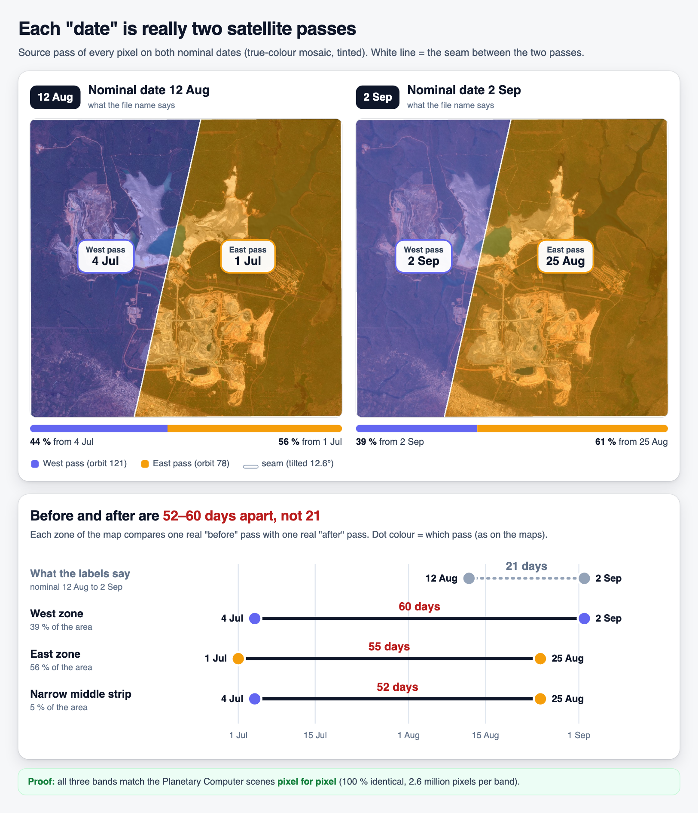
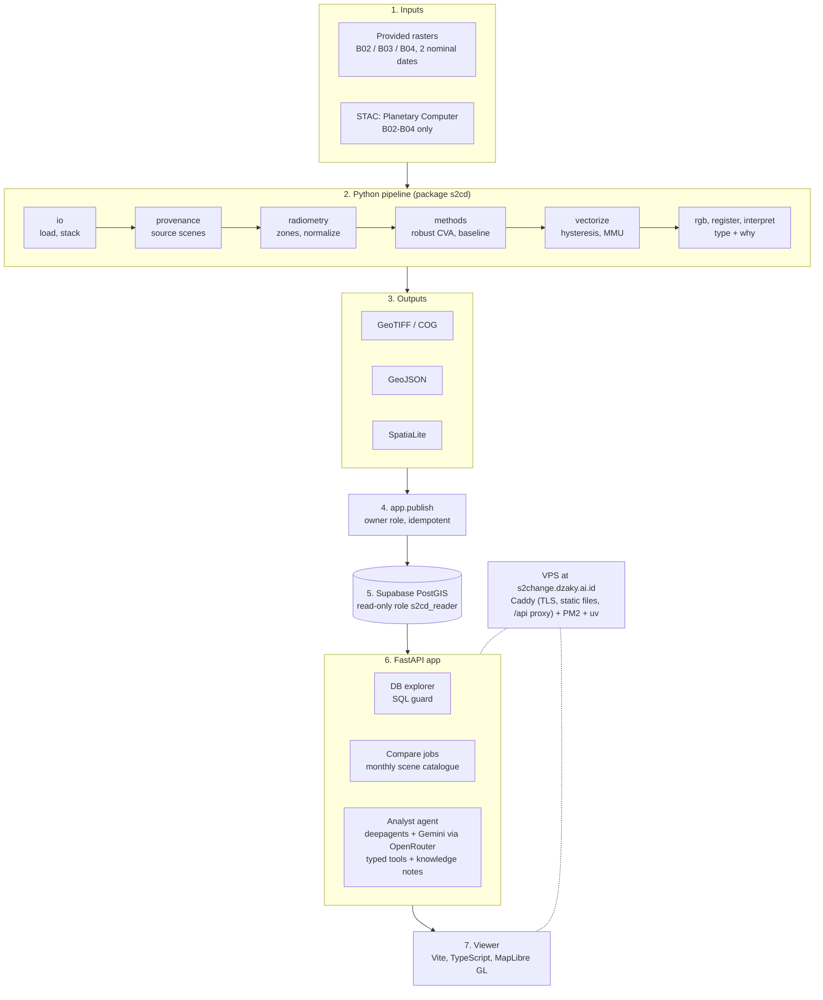
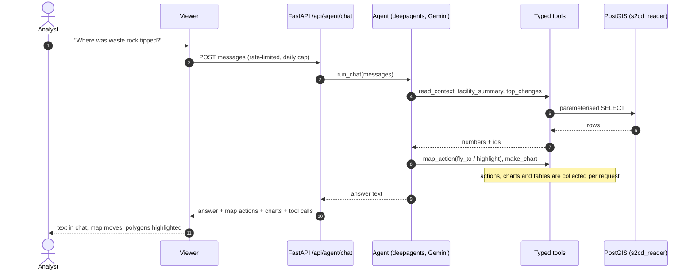

# Report: what changed at an open-pit copper mine in NW Zambia?

**Free satellite images, two dates, one copper mine: what changed, what it means, and who should act on it.** [Live app](https://s2change.dzaky.ai.id) · [Repository](https://github.com/dzakybd/s2change)

> [!NOTE]
> **RGB only.** The data is Sentinel-2 L2A B02, B03 and B04, the bands the brief provides. Nothing else is used: no NIR/SWIR, no scene classification layer, no elevation model. The AOI layout matches the Lumwana copper mine; the brief only says "an open-pit mining site in Zambia", so the name is an inference. Each date is a two-scene mosaic (section 0), so the true acquisitions are 2023-07-01/07-04 → 2023-08-25/09-02.

**Contents:** [In plain terms](#in-plain-terms) · [Technical summary](#technical-summary) · [0 Data finding](#0-the-data-finding-each-date-is-a-mosaic) · [1 Method](#1-method) · [2 Results](#2-results) · [3 Interpretation](#3-interpretation) · [4 Sensitivity](#4-sensitivity) · [5 System and stack](#5-system-and-stack) · [6 Limitations](#6-limitations-and-next-steps)

## In plain terms

| | |
|---|---|
| **What we looked at** | A 16 × 16 km area around an open-pit copper mine in north-west Zambia, seen by the free Sentinel-2 satellite in ordinary colour (red, green, blue), on two dates in the 2023 dry season. |
| **What happened** | The mine was **working normally**: 4.1 km² of ground changed, three quarters of it inside known mine facilities. Tailings (processing waste) were spread on the tailings dam, its wall was most likely raised, waste rock was dumped, pits were dug. **No new land was cleared outside the mine.** Every change comes with a plain sentence, e.g. *"Tailings dam wall likely raised, 0.39 km² in the south-east of the Tailings storage facility: green vegetation became bare ground; more rust-coloured, typical of freshly exposed rock. Check the dam-raise plan and inspect the embankment."* |
| **Over three years** | Comparing the same season each year, the mine is **growing**: waste rock moved rises from 5.7 to 20.2 km², and change outside the known facilities from 5.6 to 18.2 km². |
| **Why it matters** | A regulator can see where the mine spreads and check it against the licence. An investor or insurer gets an independent signal that the operation is running and expanding. ESG teams see clearing and water changes early. |
| **A trap we avoided** | The two images supplied are each stitched from two satellite passes. A standard method mistakes the stitching for change and reports **111 km², 27× the calibrated result**, mostly stitching and haze, which would send a client chasing false alarms. We detected it, proved it, and corrected for it. |
| **How much to trust it** | False alarms are measured at about 1 in 1,000 pixels, and the conclusions hold across 16 settings. The type of each change (e.g. "waste dumping") is a well-founded hypothesis to confirm, not a verdict. |
| **What it costs to run** | The images are free and arrive every 5 days; the analysis takes about 30 seconds per pair. Run monthly, it becomes an alert service: [the app](https://s2change.dzaky.ai.id) already shows every yearly comparison and answers questions in plain language. |

## Technical summary

| AOI | Data | Dates (nominal) | Method | Result |
|---|---|---|---|---|
| 25.79–25.94 °E, 12.18–12.32 °S; 16.7 × 16.0 km, EPSG:32735, 10 m | Sentinel-2 L2A **B02, B03, B04** | 2023-08-12 → 2023-09-02 | Per-zone normalization, robust CVA, calibrated thresholds | **4.13 km²** in 215 polygons (1.6 % of the AOI) |

> [!IMPORTANT]
> **The data has a trap.** Each provided "date" is a mosaic of two Sentinel-2 scenes from different orbits; I verified it pixel-exact against the STAC catalogue. Radiometry therefore steps along slanted seams, and the gap between the dates is 52–60 days, not 21. The provided Euclidean baseline mostly maps these seams and haze: **111.4 km²**, 42 % of the AOI.

- **Method:** normalize each source-scene zone on stable pixels, then run a robust change vector analysis with a **brightness-aware, empirically calibrated** noise model. The realised false-alarm rate is **0.10 %** at the 0.1 % target, measured on held-out stable pixels; the uncalibrated model gave 2.2 %.
- **Result:** **4.13 km² in 215 polygons** (1.6 % of the AOI). **74 %** of it lies inside the mine's named facilities.
- **Interpretation:** this is operational mining, not expansion.
  - Tailings deposition on the TSF: 1.85 km².
  - Waste dumping: 0.90 km².
  - Tailings dam wall likely raised along its south-east edge: 0.39 km² (fresh fill where vegetation was).
  - Pit-floor and bench activity: 0.26 km².
  - Seasonal vegetation or burning outside the mine: 0.36 km².
  - No new clearing beyond the mine footprint at the 2,000 m² scale.
- **So what:** over one to three years (same season) waste movement grows from 5.7 to 20.2 km² and change outside the named facilities from 5.6 to 18.2 km²: sustained development with a spreading footprint, the signal a regulator or investor would want (section 3).
- **How sure:** the conclusions hold over 16 threshold settings (sensitivity, section 4). The false-alarm rate is measured; omission and per-class accuracy are not, because there is no reference data (section 6).

## 0. The data finding: each "date" is a mosaic

What the before/after difference revealed, how it was tested, and what it changes.

*Source scene of each pixel for both nominal dates; the seams follow the swath edge of orbit R078.*

The before/after difference contains straight, parallel brightness steps at 12.6°. A model that is constant between the steps explains 56 % of the blue-band difference.

**Hypothesis.** My first reading was detector striping under haze.

**Test.** `s2cd provenance` searches Planetary Computer for the source items and compares every pixel.
- **Result:** B02, B03 and B04 match **100 % exactly** (2.65 M pixels per band). The hypothesis was wrong in an informative way.

| Nominal date | Source scenes (tile 35LLG, baseline N05.09) | Solar zenith / azimuth |
|---|---|---|
| 2023-08-12 | S2B 2023-07-04 R121 (W, 44 %) + S2B 2023-07-01 R078 (E, 56 %) | 42.5° / 34° and 44.1° / 37° |
| 2023-09-02 | S2B 2023-09-02 R121 (W, 39 %) + S2A 2023-08-25 R078 (E, 61 %) | 30.8° / 50° and 34.9° / 50° |

The steps are the seams along the swath edge of orbit R078. The detection uses three zones, each a single before→after scene pair: 07-04→09-02, 07-04→08-25 and 07-01→08-25. My blind, data-driven zone detection had put 99.3 % of its pixels inside one of these zones, so the method held up even though the first explanation did not.

**Consequences, all handled in the pipeline:**
1. Radiometry is normalized per zone.
2. Pixels within 90 m of a seam are excluded (2.4 % of the AOI).
3. Dates are labelled "nominal" everywhere, and the true acquisitions are stored in the outputs.
4. Sun angle differs by about 10° in zenith and 15° in azimuth between the dates. Pit walls and dump faces therefore change illumination, a known confounder (section 3).

## 1. Method

Normalize per source-scene zone, model the noise per brightness stratum, calibrate the thresholds on held-out stable pixels, then type each polygon.

| Step | What | Why |
|---|---|---|
| Load & check | Stack B02–B04 per date; assert identical CRS, transform and shape; nodata 0; DN → reflectance with the L2A −1000 offset (detected robustly, with a warning fallback) | Part 1 |
| Zones | Source-scene zones from STAC provenance (fallback: data-driven seam detection) | Different scenes have different radiometry |
| Normalization | Per zone and band, orthogonal regression `T1 = a + b·T2` on pseudo-invariant pixels, iterated with 2.5σ rejection (adapted from Canty & Nielsen 2008) | Both dates are noisy; haze lowers contrast on T2 (slopes 1.1–1.8) |
| Change statistic | Change vector `Δ = T2_norm − T1` (CVA, Malila 1980); squared Mahalanobis distance d² under a per-zone, **per-brightness-stratum** noise model fitted on stable pixels | Noise grows with brightness: one global model gave bright mine surfaces 10–25× too many false alarms |
| Calibration | Thresholds from the 99.9th / 99.999th percentiles of d² on **held-out** stable pixels, per stratum | The χ² assumption is off (heavy tails, spatial autocorrelation). Calibrated, the realised rate is 0.092–0.107 % in every stratum |
| Binary map | Hysteresis (Canny 1986): grow at 1e-3, seed at 1e-5; seam buffer; 1-px opening; minimum mapping unit 2,000 m² | Keeps coherent change and removes speckle |
| Polygons | 8-connected regions, made valid, stored as MultiPolygon EPSG:32735 with area, magnitude, −log10 p and direction | Part 3 |
| Interpretation | **Facility register** of 8 named facilities, outlined from the imagery; **change type** per polygon from RGB evidence + facility; one-line "why" | Part 5: from "pixels changed" to "what happened" |

The cleanup (1-px opening + 2,000 m² minimum mapping unit) deliberately drops features narrower than about 20 m or smaller than 2,000 m², such as haul-road edges and single noisy pixels.

*The provided baseline against the robust CVA of this work.*

| Method | Changed area | Why it behaves this way |
|---|---:|---|
| Provided Euclidean distance + Otsu | 111.4 km² (79 / 43 / 16 % per zone) | No radiometric model: it maps seams and haze |
| **Robust CVA, calibrated (this work)** | **4.13 km² (1.1 / 1.0 / 2.0 % per zone)** | Seam-free, mine-concentrated |

> [!TIP]
> **Why no machine learning:** there are no labels, only three bands and two dates. With labelled polygons, a Siamese U-Net or a change transformer on multi-date stacks would be the next step, and this pipeline would become its data and QA layer.

## 2. Results

Where the change is, and what kind it is.

*Change polygons by type and area per type: hypotheses from RGB evidence and facility context.*

**Per facility** (outlines from the data inside analyst-defined regions; `configs/facility_register.yaml`):

| Facility | Area | Changed | Mostly |
|---|---:|---:|---|
| Tailings storage facility (TSF) | 22.44 km² | **1.94 km² (9 %)** | tailings deposition |
| South pit complex | 20.09 km² | 0.38 km² (2 %) | pit / bench activity |
| Eastern waste dumps | 4.35 km² | 0.36 km² (8 %) | waste dumping |
| North-west pit complex | 11.17 km² | 0.34 km² (3 %) | waste dumping |
| Process plant | 1.95 km² | 0.05 km² | infrastructure |
| Settlement, camp, fresh-water dam | 18.15 km² | 0.004 km² | — |

*The facility register: outlines from the imagery and the change inside each facility.*

**Per change type** (mapped onto the brief's categories):

| Change type | Brief category | Polygons | Area |
|---|---|---:|---:|
| Tailings deposition | mining activity | 61 | 1.85 km² |
| Waste dumping | mining activity | 53 | 0.90 km² |
| Tailings dam wall raised | mining activity | 2 | 0.39 km² |
| Seasonal vegetation or burn | seasonal variation / vegetation | 18 | 0.36 km² |
| Pit excavation | mining activity | 26 | 0.26 km² |
| Water level change | water change | 8 | 0.18 km² |
| Noise or artifact | noise or artifacts | 27 | 0.09 km² |
| Infrastructure / settlement | urban expansion | 9 | 0.04 km² |
| Unexplained | — | 6 | 0.05 km² |
| Land clearing (incl. at the mine edge) | land clearing | 5 | 0.01 km² |

## 3. Interpretation

Each pattern is a hypothesis with its confounders and the evidence that would confirm it.

| Pattern | Most likely meaning | Confidence | Confounders (RGB-only) | How to confirm |
|---|---|---|---|---|
| Moving bright/dark patches on the TSF beaches | Tailings deposition: wet slurry moving between spigot points while dry beaches bleach | Medium–high | Surface drying with the season | Later dates: the TSF outline stays put while patches move |
| Brighter **and redder** faces at dumps and pit-complex edges | Fresh, oxidized waste rock tipped | Medium | Illumination change on slopes (sun 10° higher, 15° further north-east), dust | A later same-season date; very-high-resolution imagery |
| Bench-scale changes inside pits | Excavation and haulage | Low–medium | Shadow changes from sun geometry | Sun-matched pairs; elevation data (not in this brief) |
| Small water-edge changes | Pond and pit-lake level shifts | Medium | Haze lowers T2 brightness; water needs both-date evidence | The water rule on more dates |
| Darker or browner patches outside the mine | Dry-season grass senescence or burning | Medium | Burnt vegetation vs. wetness cannot be separated in RGB | Fire records; recovery after the rains |
| Polygons on or near seams | Artifacts | High | — | The source-scene map |

**What happened, in one paragraph.** Between early July and late August / early September 2023, the measurable change is operational. Tailings were deposited across the TSF (1.94 km² changed, 9 % of the facility). Waste rock was tipped at the eastern dumps and at the edges of both pit complexes (0.90 km² labelled waste dumping), and the tailings dam wall was most likely raised along its south-east edge (0.39 km² of fresh, rust-coloured fill where there was vegetation), which is the change a dam-safety team would want to know about first. Activity continued inside the pits. Outside the mine, change is small and seasonal. **I see no evidence of mine expansion into new ground at the 2,000 m² / 20 m detection limit**: only 0.01 km² qualifies as clearing. Each polygon carries its "why".

> [!WARNING]
> **Confidence is not accuracy.** "Confidence" here is a change-magnitude score, and every label is a hypothesis built from RGB evidence and facility context. There is no reference data, so accuracy is not assessed (section 6).

### What it means, and who acts on it

> [!TIP]
> **Business reading.** Over two months the mine is *operating* (tailings deposited, waste tipped, pits worked) and not spreading. Over one to three years, using the same dry season each time, the picture changes: **waste movement keeps growing (5.7 → 14.5 → 20.2 km²)** and **more and more change sits outside the eight named facilities (5.6 → 12.9 → 18.2 km²)**. That points to a mine in sustained development whose footprint is spreading, which is exactly what a regulator or investor would want flagged.

*Change from the provided before date (nominal 2023-08-12) to later August scenes from the app's monthly catalogue, so the season matches. Outside = not in any of the 8 register facilities. Area of change is not new disturbed area: re-worked ground counts too. The before date is a two-scene mosaic and the later ones are single scenes; thresholds are calibrated per pair.*

| Who | Their question | What this gives them | What it cannot say |
|---|---|---|---|
| Government / regulator (the users ShigenAI targets) | Is the mine operating within its licence? | Footprint growth outside known facilities, located and sized monthly at no data cost (Sentinel-2 is free, 5-day revisit) | Legality: no licence boundaries here |
| Tailings / dam-safety oversight | Is the tailings facility managed as planned? | Where deposition and ponding move on the facility (5.8–8.8 km² of its 22.4 km² changed between yearly dates) | Stability, freeboard, seepage |
| Investors, lenders, insurers | Is the operation running and growing? | Independent activity indicators: waste movement, tailings deposition, pit work | Production, grade or tonnes |
| ESG and community teams | Is clearing or water change spreading? | Clearing and water change outside the register; settlement growth | Social or health impacts |
| The operator | Does the record match the plan? | A consistent, queryable change record in PostGIS | Survey-grade volumes (no elevation) |

**As a service:** one clear scene a month, compared with the previous month and the same month a year earlier; change outside registered facilities or above a size threshold raises an alert with the polygon, its type and its "why", which an analyst confirms on very-high-resolution imagery. The database is already keyed by run, so each comparison is one more run. In the app, the analyst answers these questions ("what does this mean for a regulator?") and the date picker shows every yearly pair.

## 4. Sensitivity

Does the answer depend on one threshold choice?

*Total change shrinks smoothly as the test gets stricter, while the share inside the mine stays high.*

I re-ran the binary rule over per-pixel false-alarm rates from 1e-2 to 1e-5 and minimum mapping units from 1,000 to 10,000 m² (16 settings):
- **Changed area** ranges over **2.10–6.82 km²**, versus 111.4 km² for the baseline.
- **Share inside the mine's facilities** stays between **61 % and 77 %**, and rises as the test gets stricter: the strongest changes are the mining ones.

The conclusions do not depend on one threshold choice.

## 5. System and stack

The analysis is one Python package (`s2cd`); everything else exists so a reader can check it without installing anything. The pipeline writes files, `app.publish` loads them into PostGIS, a read-only API sits in front of the database, and a static viewer talks to that API.

*Where each piece runs. The pipeline writes files, `app.publish` loads them into PostGIS under an owner role, and the API reads them through the `s2cd_reader` role. Source: `docs/architecture.mmd` (Mermaid, rendered with the Iconify *logos* pack).*

Pipeline and services in detail (flowchart)

One analyst question, end to end. Every number comes from a typed tool that runs as the read-only role (its `readonly_sql` tool goes through the same SQL guard as the Database tab), and map changes are returned as data for the viewer to apply.

| Layer | Technology | Why |
|---|---|---|
| Environment and quality |  Python 3.12,  uv,  ruff,  pytest | One lockfile, one command to run, one linter; tests run in CI |
| Raster and numerics | rasterio,  numpy,  scipy, scikit-image | Windowed GeoTIFF/COG I/O, the robust covariance and statistics, hysteresis and morphology |
| Vector |  geopandas, shapely, pyogrio, pyproj | Polygons, validity repair, EPSG:32735 areas in m² |
| Source scenes | pystac-client, odc-stac, planetary-computer | Optional extra: recovers the true acquisitions behind each mosaic, B02-B04 only |
| Storage |  PostGIS 16 with a GiST index,  Supabase,  SpatiaLite,  SQLAlchemy, GeoAlchemy2, psycopg | A geospatial DB as the brief asks; the app reads through a `SELECT`-only role |
| API |  FastAPI, uvicorn, slowapi, sqlglot | Typed endpoints, per-route rate limits, SQL parsed and checked before it runs |
| Analyst |  LangChain deepagents,  langchain-google-genai,  langchain-openai (OpenRouter) | An agent restricted to typed tools plus knowledge notes, on Gemini (directly or via OpenRouter) |
| Viewer |  Vite,  TypeScript,  MapLibre GL, marked, DOMPurify,  Mermaid | Static bundle, no server rendering; this report is rendered in the app from the same markdown |
| Delivery |  Caddy,  PM2,  GitHub Actions,  Docker Compose, Dockerfile | TLS and static files from one binary; CI runs ruff, pytest, the viewer build and the image; Compose gives a local PostGIS |

### Security

The public site is read-only by construction; the few features that cost compute or LLM budget sit behind an access code.

| Control | What it does |
|---|---|
| Read-only database role | The API and the agent connect as `s2cd_reader`: `SELECT` on five relations, `default_transaction_read_only`, 5 s statement timeout. Writes fail in the database itself, whatever the application does |
| SQL guard | The console and the agent's `readonly_sql` tool pass the same sqlglot check: one `SELECT`, an allow-list of tables, no DDL/DML, no `pg_*`/`dblink`/`set_config` functions, `LIMIT` forced |
| Rate limits and caps | Per client IP (the proxy-appended address): chat 6/min, SQL 30/min, comparisons 10/min, login 5/min. Whole-service daily caps: 300 chat calls, 12 new comparisons; at most 5 jobs queued |
| Access code | Chat, SQL console and new (uncached) comparisons need a code. It is checked against a salted PBKDF2-SHA256 hash and earns a signed `HttpOnly; Secure; SameSite=Strict` session cookie (7 days). Overview, map, report, downloads and every cached comparison stay public |
| Secrets | API keys, database passwords, the code hash and the cookie-signing secret live only in the server's `.env`, never in git; error responses are generic and details go to the server log |
| Transport and headers | TLS at Caddy, plus HSTS, a Content-Security-Policy limited to this site, the Esri tile host and the logo CDN, `nosniff`, `X-Frame-Options: DENY`, a strict referrer policy, and no `Server` banner. API request bodies are capped at 64 KB |
| LLM hardening | The model sees only 11 typed tools; deepagents' built-in planning, file, shell and sub-agent tools are switched off; the prompt tells it to treat user and tool text as data; no tool writes anything, so an injection can at worst yield a wrong read-only answer |
| CORS and input limits | CORS allows only the site origin and the local dev server. Chat messages 2,000 characters, 20 turns kept; SQL 5,000 characters, 500 rows; comparison dates are parsed strictly and must be catalogue dates; result files come from a fixed name list |

## 6. Limitations and next steps

What this analysis cannot tell, and what would close each gap.

> [!WARNING]
> **No accuracy assessment.** There is no reference data. The false-alarm rate is calibrated and measured on held-out stable pixels, but missed change and the correctness of the change types are not. The next step is a stratified random sample labelled on very-high-resolution imagery (Olofsson et al. 2014), with strata from this map and the baseline so both get scored.

- **RGB only.** No vegetation-health, burn-severity or mineral indices. Water, shadow and dark wet soil can be confused, so the water rule requires both dates. The thresholds in `rgb.py` are tuned to this AOI.
- **Two mosaicked dates.** Sun and view geometry differ between orbits (BRDF). Normalization removes a per-zone linear difference but not cover-specific angular effects. Measured co-registration error is small: ≤ 0.05 px mean shift per zone, ≤ 0.25 px in any window.
- **No elevation.** Pits and dumps cannot be separated reliably, and no volumes can be computed. Stereo VHR imagery or LiDAR would be the next data for that.
- **Facility register.** The regions are analyst-defined boxes (human-in-the-loop); outlines come from the imagery. For production, use licence boundaries or a maintained facility database.
- **For production monitoring:** carry per-pixel acquisition provenance instead of nominal mosaic dates; use same-season pairs; calibrate thresholds per scene pair as done here; validate with VHR samples; store per-pair runs in PostGIS (the schema is already run-keyed).

References

Malila (1980) change vector analysis; Otsu (1979); Canny (1986) hysteresis; Canty & Nielsen (2008) *Remote Sens. Environ.* 112:1025 (automatic radiometric normalization); Richardson et al. (2007) / Sonnentag et al. (2012) green chromatic coordinate (here on BOA reflectance, not camera DN); Olofsson et al. (2014) *Remote Sens. Environ.* 148:42.

