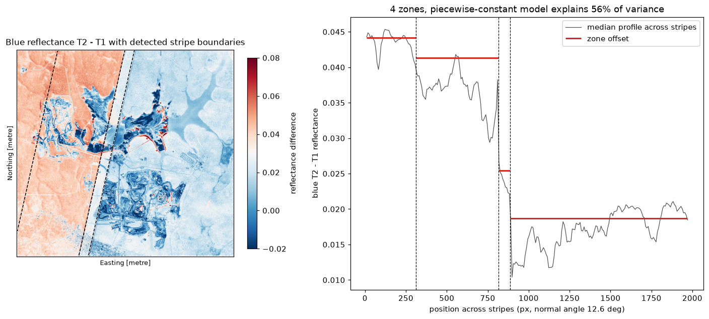
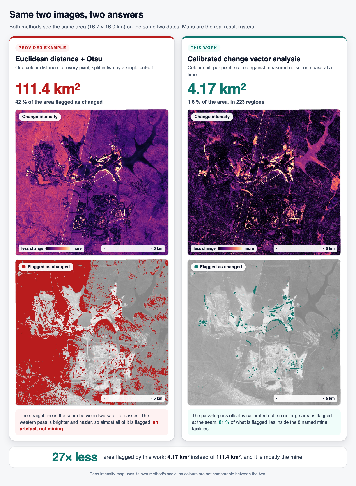
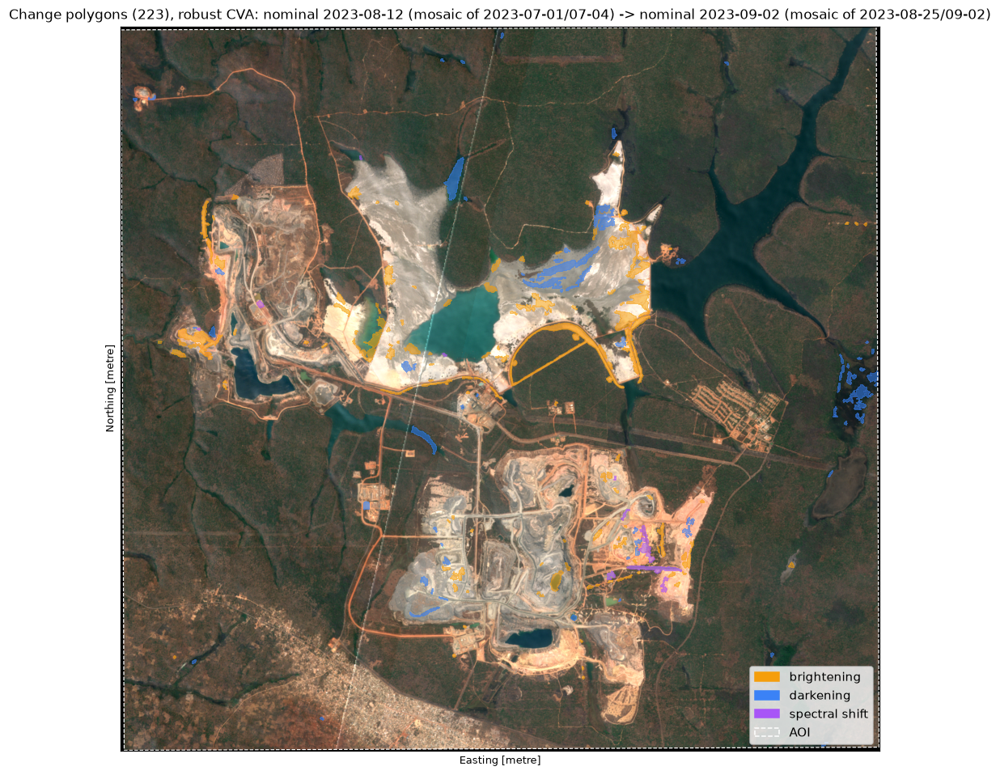

# Report: Sentinel-2 change analysis, open-pit copper mine, NW Zambia

**AOI:** 25.79–25.94 °E, 12.18–12.32 °S, 16.7 × 16.0 km. From its location and layout this looks like the Lumwana copper mine in North-Western Province, with two pit complexes, a tailings storage facility and a fresh-water dam. That identification is my inference; the assignment only says "open-pit mining site in Zambia".
**Dates:** 2023-08-12 (T1) → 2023-09-02 (T2), 21 days, mid dry season.
**Data:** Sentinel-2 L2A, B02/B03/B04, 10 m, EPSG:32735.

## 0. Data quality finding: haze and detector stripes in T2

Before any change detection, the T2 − T1 difference shows **straight, parallel brightness steps at 12.6°** (left of the figure). That geometry is the signature of the Sentinel-2 MSI **detector footprints**: 12 staggered detectors whose ground tracks are slanted parallelograms, with odd and even detectors viewing at different angles.

On a clear day the footprints are invisible. Under haze, path radiance depends on viewing geometry, so each footprint gets a different additive brightening. The evidence:

- Dark-object reflectance in blue (1st percentile) rises from 0.030 (T1) to 0.050 (T2). This is additive path radiance, which is strongest in blue.
- The blue T2 − T1 offset is a step function across the stripes: +0.044 / +0.041 / +0.025 / +0.019 for the four zones. A model that is constant within each stripe explains 56 % of the variance of the difference image.
- The per-zone calibration slopes are 1.1–1.8. T2 has lost contrast, which is what haze does (reduced transmittance plus added path radiance).
- (With enrichment) TODO: AOT per zone and STAC metadata.

**Why it matters:** any method that assumes one global radiometric relation between the dates reads stripe edges and haze as land change. The provided baseline flags **94 %** of the haziest zone. Handling this was the main design decision.

## 1. Method

**Chosen algorithm: stripe-aware relative normalization, then robust change vector analysis (CVA) with a statistical noise model.**

1. **Stripe zones.** On the blue T2 − T1 difference (8 × 8 block medians, outliers clipped), a grid search finds the orientation whose 1-D profile explains the most variance. Weighted binary segmentation then splits that profile into zones (minimum step 0.006 reflectance, minimum width 40 px). If no orientation explains at least 5 % of the variance, there is a single zone, so clean scene pairs pass through unchanged.
2. **Relative radiometric normalization per zone.** For each band, an orthogonal-regression line `T1 = a + b·T2` is fitted and refitted 5 times, each time rejecting pixels whose residual exceeds 2.5 robust σ in any band. The survivors are pseudo-invariant features (PIFs, 86 % of pixels). Orthogonal rather than ordinary least squares is used because both dates are noisy. This is the automatic radiometric normalization idea of Canty & Nielsen, applied separately in each footprint.
3. **Change statistic.** `Δ = T2_norm − T1`. In each zone the PIF change vectors define "no change": mean μ and covariance Σ, which cover sensor noise, sub-pixel misregistration and small phenology. Each pixel's squared Mahalanobis distance `d² = (Δ−μ)ᵀ Σ⁻¹ (Δ−μ)` is χ²(3)-distributed under no change. This gives a change probability `chi2.cdf(d²)` and thresholds with a meaning (false-alarm rate). The Q-Q plot confirms the fit on the PIFs, though that is in-sample, so it is a consistency check rather than validation.
4. **Binary map.** Hysteresis thresholding: regions grow at FAR 1e-3 (d² > 16.3), and a region is kept only if it contains a seed at FAR 1e-5 (d² > 25.9). This suppresses isolated noise without eroding real change. The cleanup then removes 2 px around stripe seams (overlap artefacts), applies a 1 px opening, a minimum mapping unit of 0.2 ha, and hole filling.
5. **Polygons.** Change regions are vectorized with 8-connectivity. Each polygon gets area, perimeter, compactness, a confidence score, Δ per band, direction (brightening / darkening / spectral shift, with ±2σ_noise on Δbrightness), and `in_disturbed_area`. That flag is a heuristic mine/industrial footprint: bright bare surfaces at T1, Otsu threshold, closed and buffered by 100 m.

**Why this method rather than the alternatives:**

| Method | Changed area | Changed share per stripe zone | Verdict |
|---|---:|---|---|
| Provided Euclidean distance + Otsu | 11,078 ha | 94 % / 75 % / 41 % / 16 % | Measures the haze gradient, not land change |
| Zone-wise IR-MAD (Nielsen 2007) | 10,623 ha | 34 % / 32 % / 36 % / 46 % | Stripe-free, but over-detects (below) |
| **Robust CVA (this work)** | **1,345 ha** | **3.0 % / 3.7 % / 2.7 % / 6.3 %** | Stripe-free and spatially coherent |

- **The Euclidean baseline** is run unchanged from `inputs/example_change_detection.py`. It has no radiometric model, so its output follows the haze, and min-max normalization makes the scale depend on a handful of extreme pixels.
- **IR-MAD** is invariant to affine radiometric differences, so running it per zone removes the stripes. With only three highly correlated visible bands, though, its reweighting converges on the dominant land cover (savanna woodland, canonical correlations ρ ≈ 0.99). The no-change variance `2(1−ρ)` then becomes tiny, and every surface whose date-to-date relation differs from the woodland's is flagged: bright tailings, water, roads, grassland. It would suit more bands (NIR/SWIR) or a smaller, more homogeneous AOI better.
- **CVA after normalization** keeps the physical meaning of Δ (direction and magnitude in reflectance), which the interpretation step needs. Learning the noise model from PIFs per zone makes the threshold adapt to each footprint's noise level.
- **Not used:** NDVI (no NIR band was provided; see enrichment), supervised ML (no labels, and three weeks of change is not a training set), and log-ratio (meant for SAR speckle; for additive haze on dark targets it amplifies noise).

## 2. Results

- **538 change polygons, 1,345 ha** (5.0 % of the valid AOI). The median polygon is 0.48 ha and the largest is 114 ha.
- **70 % of the changed area (945 ha) lies inside the mine's disturbed footprint**, which covers 31 % of the AOI. Change is about 2.3× more concentrated there than it would be if spread uniformly.
- By direction:

| Direction | Inside disturbed area | Outside | Typical location |
|---|---:|---:|---|
| Brightening | 627 ha | 41 ha | Tailings beaches, dam crest and haul roads, waste-dump faces, pit benches |
| Darkening | 231 ha | 358 ha | Wet tailings deposition (inside); water body, drainage lines and dambos (outside) |
| Spectral shift | 87 ha | 1 ha | Waste dumps and stockpiles E of the southern pit, where colour changes but brightness does not |

Spatial pattern:
- **Tailings storage facility (north-centre):** the largest and most confident cluster. It is a mosaic of brightening (drying, bleaching beach) and darkening (fresh wet slurry) patches, plus a continuous brightening arc along the embankment crest.
- **Pit complexes (NW and S):** bench-scale brightening and darkening at pit edges and ramps, consistent with excavation fronts.
- **Waste dumps east of the southern pit:** brightening with a strong red increase (Δred +0.11). Fresh, iron-stained material is being tipped onto areas that were darker at T1.
- **Freshwater dam (NE) and drainage lines:** the largest single polygon (114 ha) is the dam surface darkening (reflectance 0.058 → 0.020). Elongated darkening patches follow the dambo (seasonal wetland) network.
- **Settlement (SW):** only 20 small polygons (10.6 ha) survive the 0.2 ha MMU. The speckle there comes from sub-pixel misregistration of small roofs, and most of it is filtered, as intended.

## 3. Interpretation

| Pattern | Most likely explanation | Confidence | How to confirm |
|---|---|---|---|
| Patchy bright/dark mosaic on the tailings facility | **Operational tailings deposition**: spigotting moves the wet beach around, and dry beaches bleach | High | Deposition records; multi-date sequence (beaches cycle) |
| Brightening arc on the TSF embankment | **Embankment raise or crest road works**: new compacted fill is brighter | Medium | VHR imagery; dam-raise schedule |
| Red-shifted brightening on waste dumps | **Active dumping of fresh, oxidized waste rock** | High | Trend over more dates; DEM differencing |
| Bench-scale changes in pits | **Excavation and haulage**, plus shadow differences from a ~3-week solar-angle change | Medium | Sun-angle-matched pairs; SAR coherence |
| Water body darkening | **Water quality, depth or glint change** (lower turbidity or algae, or lower sun-glint), not an extent change | Medium | MNDWI / SWIR from enrichment; shoreline position |
| Darkening along dambos and drainage outside the mine | **Dry-season burning** (Aug–Sep is the peak fire season in Zambian miombo) or wetting, not mining | Medium | dNBR from SWIR (enrichment), MODIS/VIIRS active fires |
| Residual small polygons along roads and field edges | Sub-pixel misregistration and noise | n/a | Already filtered by the 0.2 ha MMU; tighten FAR if needed |

In short, mining operations drive most of the real change in these three weeks. The change sits on the tailings facility, the waste dumps and the pit benches, all inside the disturbed footprint. Most change outside the footprint is seasonal (fire, dambos, water) rather than an expansion of the mine. I see **no evidence of new land clearing or footprint expansion** at the 0.2 ha scale in this period. The largest brightening outside the footprint is only 41 ha in total, made of scattered small patches.

TODO: enrichment results (dNBR, dMNDWI, AOT per zone, likely_cause areas).

## 4. Limitations and next steps

- **Three visible bands and two dates** cannot separate burning from wetting, or turbidity from depth. Even a third date would separate persistent change from transient change.
- **No reference data:** confidence is a magnitude score, not accuracy. Next step: label a stratified random sample (about 100 polygons, plus about 100 points in the no-change stratum) on VHR imagery and report precision, recall and area-adjusted accuracy (Olofsson et al. 2014). `solafune_tools.metrics` already has the IoU and F1 utilities needed.
- **Shadows:** pit walls are sun-angle dependent. Pairing scenes with similar solar geometry (or using a DEM shadow mask) would remove some bench "changes".
- **For production monitoring**, which is what ShigenAI-style products need:
  - Run on every clear Sentinel-2 L2A scene from Planetary Computer, with an SCL mask.
  - Keep the stripe-aware normalization as a QA gate. Detector-footprint metadata (`MSK_DETFOO`) would replace estimating the zones from the data.
  - Add Sentinel-1 coherence so cloudy-season monitoring keeps working.
  - Store results per scene pair in PostGIS (the schema is already run- and date-keyed) and serve them through a tile/feature API to the viewer.
