# What changed at an open-pit copper mine in NW Zambia?

**Two free satellite images of one copper mine: what changed, what it most likely is, and who should act on it.** [Open the map](https://s2change.dzaky.ai.id/#/map) · [Ask the agent](https://s2change.dzaky.ai.id/#/map?agent=1) · [Explore the database](https://s2change.dzaky.ai.id/#/database) · [Downloads](https://s2change.dzaky.ai.id/#/downloads) · [Repository](https://github.com/dzakybd/s2change) · [Video](https://youtu.be/MBTmg62P2ew)

<a href="https://youtu.be/MBTmg62P2ew">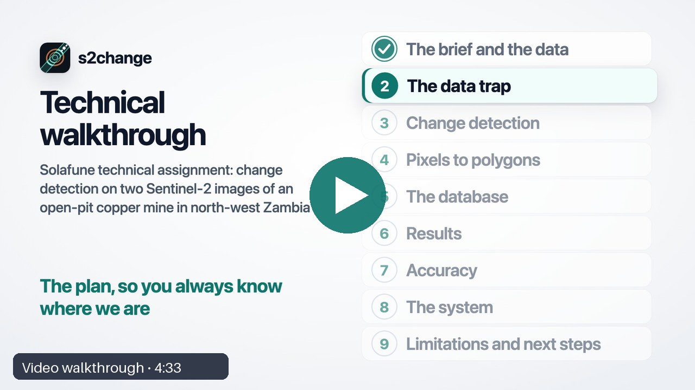</a>

*Prefer watching? A 4.5-minute [technical walkthrough](https://youtu.be/MBTmg62P2ew): the data, the data trap, the method, the database, results, accuracy and the system.*

> [!NOTE]
> **RGB only.** The brief provides Sentinel-2 L2A bands B02, B03 and B04, and nothing else is used: no NIR or SWIR, no cloud mask, no elevation. The layout matches the Lumwana copper mine; the brief only says "an open-pit mining site in Zambia", so the name is an inference.

The report follows the brief: **[1. Method](#-1-method)** (which algorithm, and why), **[2. Results](#-2-results)** (where change occurs, and its pattern) and **[3. Interpretation](#-3-interpretation)** (what the changes most likely represent). Limitations follow in section 4.

## ⚡ The answer on one page

<table class="kpi">
<tr>
<td align="center"><b>4.13 km²</b> 🛰️ changed in 215 polygons</td>
<td align="center"><b>82 %</b> 🏭 inside the mine in the 8 named facilities</td>
<td align="center"><b>27× less</b> 🪤 than the provided method which maps seams as change</td>
<td align="center"><b>0.67</b> 🎯 precision on 200 random points</td>
</tr>
</table>

- ⛏️ **The mine was working, not spreading.** Tailings spread, waste tipped, pits worked; outside the mine only 0.02 km² is clearing.
- 🧱 **Fresh fill on the tailings dam's south-east wall, likely a wall raise:** 0.39 km² where vegetation was, made between 4 Jul and 8 Aug. The first thing a dam-safety team would want to see.
- 🪤 **The data had a trap.** Each supplied "date" is two satellite passes stitched together; the provided method maps the stitch as change (111 km²). Found, proved and corrected ([the data trap](#the-data-trap-each-date-is-two-passes)).
- 🎯 **Precise but conservative.** Right 2 times in 3 when it says "changed" (the provided method: 1 in 8), but it finds only about a fifth of all real change ([how accurate](#how-accurate-is-it)).
- 📈 **Over three years the footprint grows** (exploratory): change outside the named facilities rises from 3.3 to 14.3 km².

## ⚙️ 1. Method

**Algorithm.** Two methods on the same stacks, stored in the same database:

- **The provided example, unchanged:** Euclidean distance across the three bands, plus an Otsu threshold for its binary map (`change_map_baseline.tif`, `change_binary_baseline.tif`).
- **This work: a calibrated change vector analysis** (Malila 1980). How far did each pixel's colour move, compared with how far colour moves on ground that did not change? (`change_map.tif`, `change_binary.tif`)

**Why this method.** The example fails on this data in three ways, and each has a fix:

| | Problem with the example | Measured | Fix here |
|---|---|---|---|
| 🧩 | **The images are mosaics**: brightness jumps at the seams read as change | 111 km², 42 % of the area | Correct each seam-bounded zone on its own ([the data trap](#the-data-trap-each-date-is-two-passes)) |
| 🌗 | **Noise is not the same everywhere**: bright mine ground varies more than dark forest | one noise level: 22× too many false alarms, 66× on the brightest ground | Measure noise per zone and per brightness level |
| 🎚️ | **Its threshold has no meaning**: with no labels, a cut-off must say how often noise passes it | — | "Noise may pass 1 pixel in 1,000"; held-out stable pixels give 0.09–0.11 % |

The 1-in-1,000 rate is per pixel on ground screened as unchanged, the design target; how often a flagged polygon is real is measured separately ([how accurate](#how-accurate-is-it)). Co-registration was checked per zone (phase correlation, 8 windows): shifts are at most 0.05 px, so nothing is resampled. A full run takes 13.6 s on a laptop.

*Both methods on the same input. The maps are the real data: source pass per pixel, the three zones, and each method's change mask. Editable source: [`docs/figures/04_method_overview.drawio`](docs/figures/04_method_overview.drawio).*

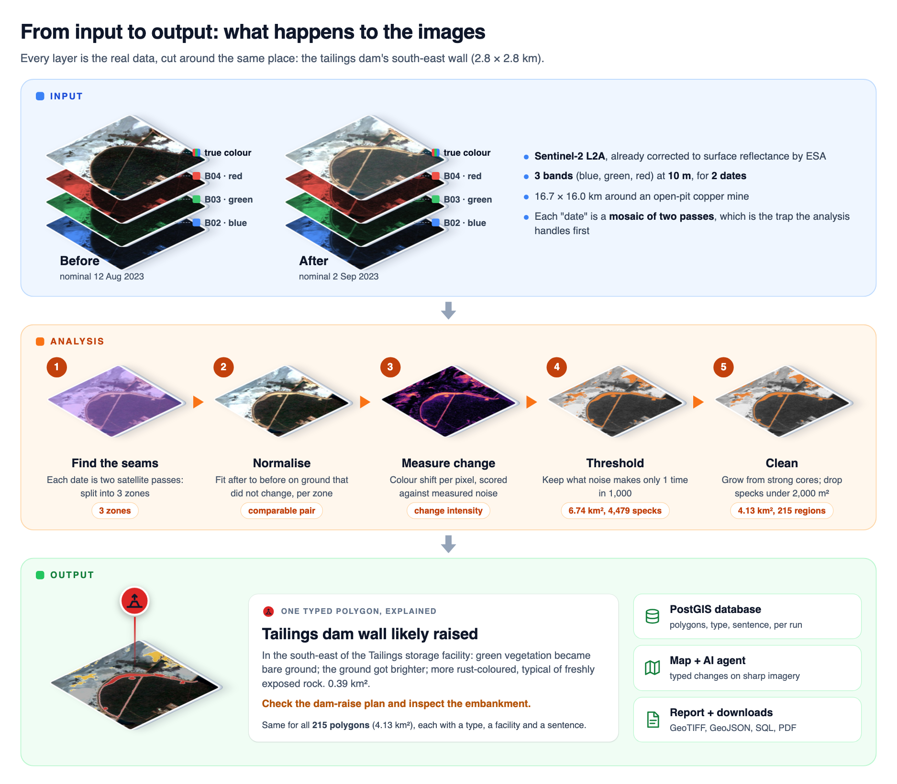

*Every layer is the real data around the same place, the tailings dam's south-east wall. The output is a typed polygon with a plain sentence, stored and shown on the [map](https://s2change.dzaky.ai.id/#/map).*

**Each step, close-up and whole site:**

| Step | Close-up: the tailings dam wall | Whole site | What we do, and why |
|---|---|---|---|
| 📥 Input **Before** | 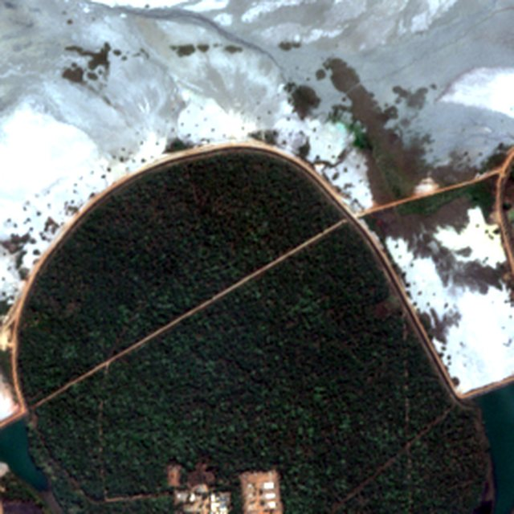 |  | The provided image for the nominal **12 Aug 2023**, as true colour (bands B04, B03, B02). Pixel numbers are turned into reflectance with the L2A scale and offset. |
| 📥 Input **After, as delivered** | 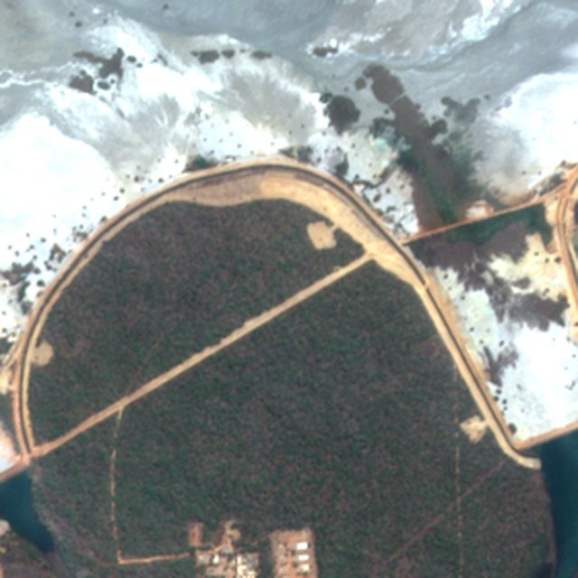 | 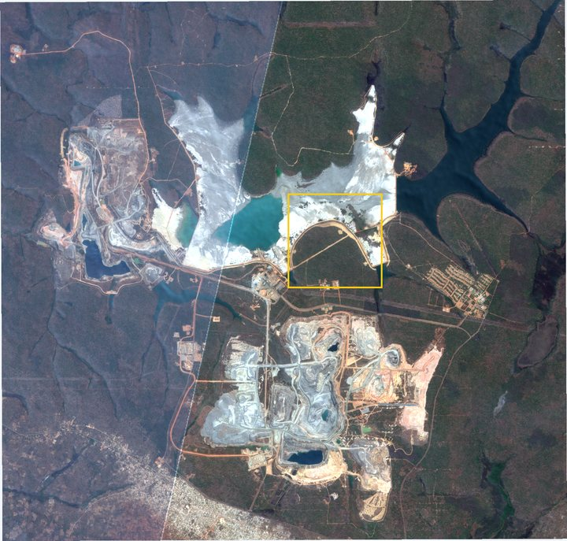 | The provided image for **2 Sep 2023**. It looks brighter and hazier, partly because it is stitched from different satellite passes than the before image. |
| 🔬 Analysis **1. Find the seams** |  |  | Each date is stitched from two passes. Matching each pixel to its source scene splits the site into **3 zones** (tinted), with a seam strip between them. Each zone is then corrected on its own ([the data trap](#the-data-trap-each-date-is-two-passes), [on the map](https://s2change.dzaky.ai.id/#/map?layer=baseline&oblique=0)). |
| 🔬 Analysis **2. Normalise** | 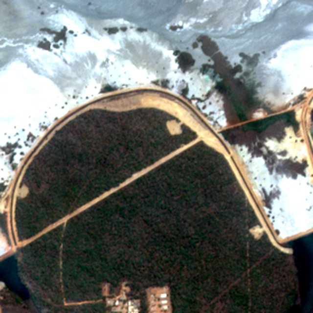 |  | In each zone and band, the after image is fitted to the before image on ground that did not change, ignoring outliers (after Canty & Nielsen 2008). Haze and brightness differences go; real change stays. |
| 🔬 Analysis **3. Measure change** |  | 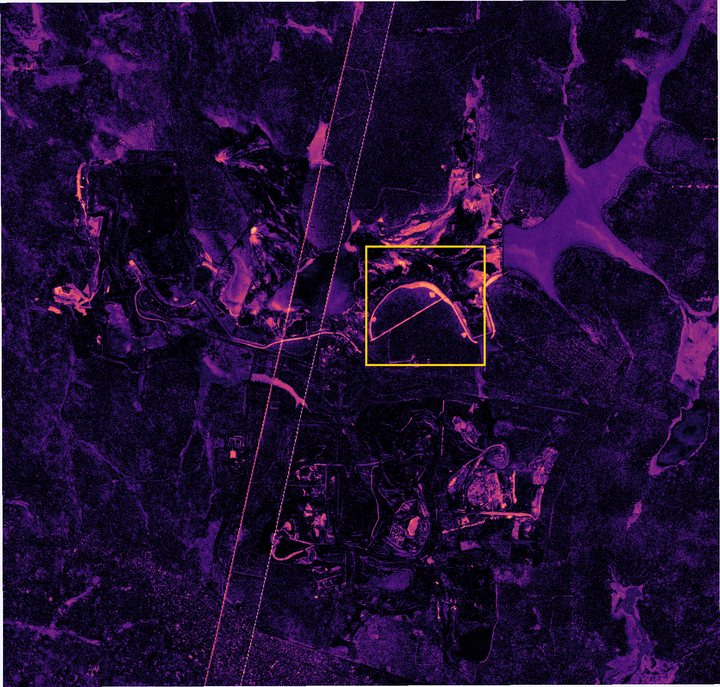 | For each pixel, measure how much its colour changed, then compare that with how much colour changes on stable ground in the same zone and at the same brightness. Brighter means less likely to be noise. [Change intensity on the map](https://s2change.dzaky.ai.id/#/map?layer=intensity) |
| 🔬 Analysis **4. Threshold** |  | 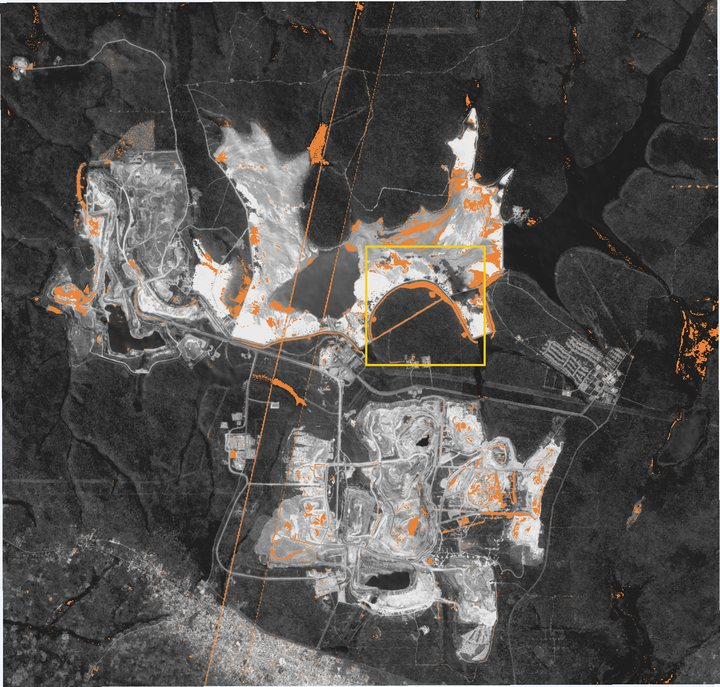 | Keep the pixels that noise would produce only **1 time in 1,000**, with the threshold calibrated on held-out stable pixels. Result: 6.74 km² in 4,479 specks, including thin lines along the seams. |
| 🔬 Analysis **5. Clean** |  |  | Keep a region only if part of it is very strong (noise would produce it 1 time in 100,000), so faint seam lines drop out (hysteresis, Canny 1986). Then smooth edges by one pixel and drop regions under 2,000 m². Result: **4.13 km² in 215 regions**. |
| 📤 Output **Outline, type and explain** |  | 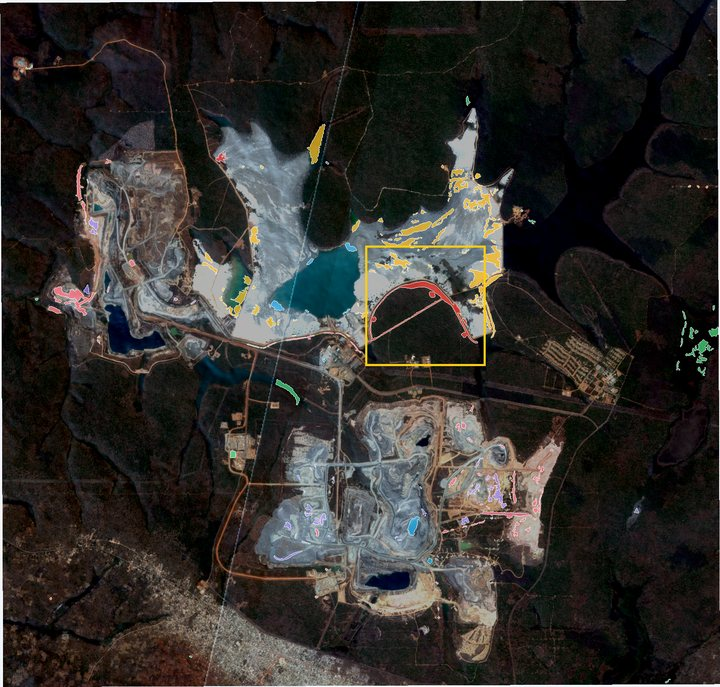 | Each region becomes a polygon. Its type comes from the colour change and the facility it sits in, and it gets one plain sentence. Here: **Tailings dam wall likely raised**, 0.39 km² in the south-east of the tailings storage facility, where green vegetation became bright, rust-coloured bare ground. *Check the dam-raise plan and inspect the embankment.* |

*The provided example (Euclidean distance + Otsu) maps 111.4 km², mostly seams and haze. The calibrated method maps 4.13 km², concentrated in the mine.*

### The data trap: each "date" is two passes

> **Claim.** Neither supplied "date" is one image. Each file is stitched from two Sentinel-2 passes taken days apart, so the pair holds brightness jumps that are not on the ground, and before and after are really 52–60 days apart, not 21.

<table class="kpi">
<tr>
<td align="center"><b>0</b> scenes on 12 Aug 2023 passes on 8, 10 and 13 Aug only</td>
<td align="center"><b>2</b> passes in each file joined at a straight 12.6° seam</td>
<td align="center"><b>100 %</b> identical to one pass, west of the seam and 0 % east of it</td>
<td align="center"><b>52–60</b> days between the real passes in three zones, not 21</td>
</tr>
</table>

**Proof 1. One side is a known pass, the other is not.** With no 12 Aug scene to compare against, each file was set beside the single pass that covers the whole site and is found inside it: before with 4 Jul, after with 2 Sep. West of the seam every pixel is identical in all three bands; east of it, none is. The brightness steps exactly at the seam (e), through bush, roads and the tailings pond alike: an orbit edge, not the ground.

*Before with before, after with after: identical on one side of the yellow line, different on the other (`scripts/fig_trap_proof.py`).*

**Proof 2. Every pixel traced to its scene.** All 55–56 catalogue scenes of the site in the 75 days before each date were read onto the same grid and matched on exact stored values (`s2cd provenance`). Two scenes per date reproduce every pixel, bit for bit; their catalogue records give the true dates. The two files switch pass at slightly different lines, so laid over each other they cut the site into **three zones**, each one real before → after pair:

*The seams follow the swath edge of orbit 78, which covers only the east of the site.*

**What the pipeline does with it.** Each zone is normalised on its own, so pass-to-pass haze and brightness do not read as change, and the 90 m around each seam is left out (2.4 % of the area). [See the trap on the map](https://s2change.dzaky.ai.id/#/map?layer=baseline&oblique=0): the provided method flags the western pass almost entirely.

**Proof 3. True single passes change the answer.** The same pipeline re-run on single passes that cover the whole site (`scripts/real_dates.py`; on the map: Result → "Ours, true passes"; scenes in Downloads):

| Pair | Provided method | This method | Dam-wall fill |
|---|---:|---:|---:|
| The provided mosaics (nominal 12 Aug → 2 Sep) | 111 km² | 4.13 km² | 0.44 km² |
| Single pass, 8 Aug → 2 Sep 2023 (the clear dates closest to the nominal ones) | 194 km² | 2.25 km² | 0.10 km² |
| Single pass, 4 Jul → 8 Aug 2023 | 4.6 km² | 12.1 km² | 0.44 km² |

- Without seams the provided method gets *worse* (194 km²): its real weakness is the haze and brightness difference between dates, which the normalisation removes.
- The dam-wall fill happened **between 4 Jul and 8 Aug**, before the nominal before date; the mosaics catch it only because their "12 Aug" is really early July. The provided pair stays the main result, because it is what the brief supplies.

**Was the data already corrected?** Yes:

- **ESA Level-2A, bit for bit** (the pixel match above): calibrated, orthorectified, atmospherically corrected.
- No level tag in the files; the −1000 offset in the darkest pixels agrees. Reflectance = `(DN − 1000) / 10000`.

| Correction | In the supplied data | Added here |
|---|---|---|
| Calibration, orthorectification, atmosphere | Done by ESA | Nothing redone; L2A scale and offset applied |
| Haze and scene-to-scene differences, seams | **Not corrected** | Per-zone normalisation on stable pixels, seam buffer |
| Sun and view angle (BRDF) | Not corrected | Treated as a confounder on slopes |

### Does it depend on one threshold?

No. Across 16 settings (false-alarm rates 1 in 100 to 1 in 100,000; minimum areas 1,000–10,000 m²) the changed area stays within **2.1–6.8 km²** and the share inside the 5 mining facilities within **68–88 %**, highest at the stricter settings: the strongest changes are the mining ones.

## 📍 2. Results

<table class="kpi">
<tr>
<td align="center"><b>53 %</b> on the tailings facility 2.19 of 4.13 km²</td>
<td align="center"><b>3.4 km²</b> mining activity tailings, dumps, pits, dam wall</td>
<td align="center"><b>0.39 km²</b> fresh fill on the dam wall likely a wall raise</td>
<td align="center"><b>0.02 km²</b> clearing outside the mine no urban expansion</td>
</tr>
</table>

**Where.** Change concentrates in the mine: 82 % lies inside the eight named facilities, more than half on the tailings storage facility. Outside, change is scattered and small.

**Pattern.** Patches moving on the tailings facility, brighter and redder faces at dumps and pit edges, bench changes in the pits, and a long strip of fresh fill on the dam's south-east wall. No straight seam lines are left.

*Change polygons by type, and the area of each type.*

| | Change type | Brief category | Polygons | Area | What we see |
|---|---|---|---:|---:|---|
|  | Tailings deposition | mining activity | 63 | 1.86 km² | Wet slurry and drying beaches moving on the tailings facility |
|  | Waste dumping | mining activity | 47 | 0.75 km² | Brighter, redder faces at dumps and pit edges: fresh oxidised rock |
|  | Tailings dam wall raised | mining activity | 4 | 0.44 km² | Fresh fill on the embankment where vegetation was |
|  | Seasonal vegetation or burn | seasonal / vegetation | 18 | 0.36 km² | Dry-season browning or burn scars outside the mine |
|  | Pit excavation | mining activity | 33 | 0.40 km² | Bench and pit-floor changes |
|  | Water level change | water change | 8 | 0.18 km² | Pond and pit-lake edges moving |
|  | Noise, unexplained, infrastructure, clearing | other | 42 | 0.15 km² | Seams, haze, small builds; 0.02 km² of clearing |

**Per facility.** The last row combines the three facilities with almost no change.

| Before → after (change in yellow) | Facility | Area | Changed | Mostly |
|---|---|---:|---:|---|
|  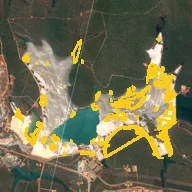 |  Tailings storage facility (TSF) | 21.84 km² | **2.19 km² (10 %)** | tailings deposition, dam-wall fill |
| 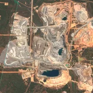 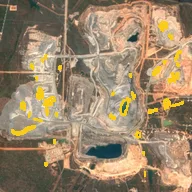 |  South pit complex | 24.84 km² | 0.55 km² (2 %) | pit / bench activity |
| 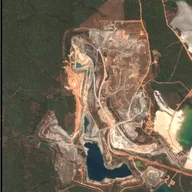 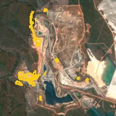 |  North-west pit complex | 13.16 km² | 0.41 km² (3 %) | waste dumping |
| 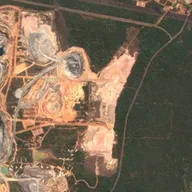 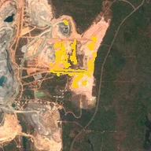 |  Eastern waste dumps | 3.30 km² | 0.21 km² (6 %) | waste dumping |
| 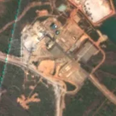 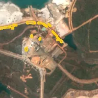 |  Process plant | 0.95 km² | 0.01 km² | infrastructure |
| 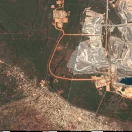  |  Settlement, camp, fresh-water dam | 15.24 km² | 0 km² | — |

Facility outlines are analyst-drawn on very-high-resolution imagery, checked against the 2023 image, and do not overlap (`configs/facility_register.yaml`; [on the map](https://s2change.dzaky.ai.id/#/map?layer=facilities)).

**Land cover before → after**, a check without the register: simple RGB rules sort changed pixels into water, bright surface, bare ground and vegetation. Vegetation → bare ground (0.62 km², 15 %) is the new disturbance, much of it along the dam wall; most of the rest is bare ground re-worked (30 %) or turned to bright tailings (18 %).

**Over three years (exploratory, not validated).** The supplied before date against later August scenes, so the season matches. Beyond the brief; no accuracy check.

*"Outside" means outside all 8 register facilities. Area of change counts re-worked ground too, so it is not all new disturbance.*

Compare in the app: [Aug 2023 → Aug 2024](https://s2change.dzaky.ai.id/#/map?before=provided-before&after=2024-08-27) · [→ Aug 2025](https://s2change.dzaky.ai.id/#/map?before=provided-before&after=2025-08-07) · [→ Aug 2026](https://s2change.dzaky.ai.id/#/map?before=provided-before&after=2026-08-14)

### How accurate is it?

<table class="kpi">
<tr>
<td align="center"><b>0.67</b> precision right 2 times in 3 when it says "changed"</td>
<td align="center"><b>0.17</b> recall finds about a fifth of real change</td>
<td align="center"><b>0.94</b> overall accuracy provided method: 0.62</td>
<td align="center"><b>16.6 km²</b> estimated real change ± 10.9; the 4.13 km² is its core</td>
</tr>
</table>

200 random points, 50 in each of four groups (both maps say change, only this map, only the provided method, neither), so one sample scores both maps without bias (Olofsson et al. 2014).

**How the points were labelled:**

- **Two independent AI vision labellers**, from before/after image chips, blind to both maps.
- Agreement 80 % (Cohen's κ 0.46, moderate); the 40 disagreements settled by a third look with a wider view.
- Visual labels from the same 10 m imagery, not field truth (`scripts/validation.py`, `data/validation/`).

| 95 % intervals | This method | Provided method |
|---|---:|---:|
| Pixels labelled correctly (overall accuracy) | **0.94 ± 0.04** | 0.62 ± 0.04 |
| When it says "changed", it is right (precision) | **0.67 ± 0.11** | 0.12 ± 0.08 |
| Share of all real change it finds (recall) | 0.17 ± 0.11 | 0.80 ± 0.31 |

**What this means.** Precise but conservative. Where both maps agree, 72 % of points really changed; 16 of the 21 real extra detections of this map are fresh burn scars the provided method misses. What it misses is subtle: tailings beaches wetting and drying, burn edges, small waste tips. Recall intervals are wide because real change is rare in the large "no change" groups; more points there would tighten them.

## 🧭 3. Interpretation

**What the changes represent**, in the brief's categories: the mine is operating normally.

| Category | Area | What it is |
|---|---:|---|
| ⛏️ Mining activity | **3.4 km²** | Tailings deposition, waste dumping, pit work, a likely dam-wall raise |
| 🌾 Seasonal vegetation | 0.36 km² | Dry-season browning or burns outside the mine |
| 🪓 Land clearing | 0.02 km² | Outside the mine; no urban expansion |
| 〰️ Noise and artifacts | 0.15 km² | Mostly removed by the seam correction; the rest labelled, with unexplained and small builds |

Over three years, in the same dry season, the mine grows and more of the change sits outside the named facilities.

**How to read each pattern.** Every type is a hypothesis, with what could fake it in RGB and what would confirm it:

| Pattern | Likely meaning | Could also be | Confirm with |
|---|---|---|---|
| Bright/dark patches moving on the TSF | Tailings deposition | Beaches drying with the season | Later dates: outline stays, patches move |
| Brighter and redder faces at dumps | Fresh waste rock | Sun 10° higher on slopes, dust | A same-season date; very-high-resolution imagery |
| Bench changes inside pits | Excavation | Shadows shifting with the sun | Sun-matched pairs; elevation data |
| Browner patches outside the mine | Grass drying or burning | Wet ground (RGB cannot separate them) | Fire records; recovery after rain |

> [!WARNING]
> **Confidence is not accuracy.** "Confidence" is a change-magnitude score. Precision and recall are measured on a random sample ([how accurate](#how-accurate-is-it)); a polygon's confidence is not its probability of being right.

**Who acts on it.**

| Who | Their question | What this gives them | What it cannot say |
|---|---|---|---|
| 🏛️ Regulator | Is the mine within its licence? | Footprint growth outside known facilities, located and sized monthly at no data cost | Legality: there are no licence boundaries here |
| 🛡️ Dam-safety oversight | Is the tailings facility run as planned? | Where deposition, ponding and wall raises happen | Stability, freeboard, seepage |
| 💼 Investors, lenders, insurers | Is the operation running and growing? | Independent activity signals: waste moved, tailings deposited, pits worked | Production, grade or tonnes |
| 🌱 ESG and community teams | Is clearing or water change spreading? | Clearing and water change outside the register | Social or health impacts |

**As a service**, the pipeline runs monthly on a new clear scene, against last month and the same month last year; changes outside a facility or above a size limit become alerts for an analyst. Each comparison is one more run in the database, already keyed by run.

## 🚧 4. Limitations and next steps

> [!WARNING]
> **The map misses most subtle change.** Recall is 0.17 ± 0.11: it is built to avoid false alarms, so faint tailings and burn changes fall below the threshold.

**Next validation step.** A human analyst relabels the 200 points, plus about 200 more in the "no change" groups, on very-high-resolution imagery from the same weeks (Planet or Esri Wayback). That tightens recall, replaces AI labels, and gives the first training set for a learned model; a per-type threshold would recover the missed tailings changes.

| | Gap | Why it matters | Next step |
|---|---|---|---|
| 🎨 | RGB only | Water, shadow and dark wet soil look alike; burns look like wet ground | Add NIR (B08) for NDVI at the same 10 m, and the L2A cloud and shadow mask |
| ⛰️ | No elevation | No volumes; pits versus dumps rest on context | Stereo very-high-resolution imagery or LiDAR |
| ✏️ | Hand-drawn facility regions | Facility edges are an analyst's call | Licence boundaries or a maintained facility database |
| 🔍 | Super-resolution | Models like SEN2SR invent detail that differs between dates, creating false change | Display only: the map's 2.5 m layer is SEN2SR on the analysed dates; detection stays on the 10 m bands |
| 📆 | Two mosaicked dates | Sun angle and pass mixes differ | Per-pixel acquisition dates, same-season pairs, per-pair calibration (as here) |

### ✅ The brief, covered

| # | Task | Done | See it |
|---|---|---|---|
| 1 ✅ | Data preparation | B02–B04 loaded, CRS, transform and shape checked, stacked | `src/s2cd/io.py` → `data/processed/sentinel2_*_stack.tif` |
| 2 ✅ | Change detection | The provided example, unchanged, and a calibrated change vector analysis | [Section 1](#-1-method) · [Change intensity map](https://s2change.dzaky.ai.id/#/map?layer=intensity) |
| 3 ✅ | Store in a geospatial DB | SpatiaLite file in the repo; PostGIS with spatial indexes, explorer, SQL dump, API | `data/change_detection.sqlite` · [Database](https://s2change.dzaky.ai.id/#/database) · [Example queries](sql/queries_postgis.sql) |
| 4 ✅ | Visualise | Static figures here; interactive map with swipe, types and facilities | [Map](https://s2change.dzaky.ai.id/#/map) |
| 5 ✅ | Interpret | Typed polygons with a sentence each, facility register, confounders | [Section 2](#-2-results) · [Section 3](#-3-interpretation) |

The app's system, stack and security are described separately in [docs/system.md](docs/system.md).

### References

Malila (1980) change vector analysis; Otsu (1979); Canny (1986) hysteresis; Canty & Nielsen (2008) *Remote Sens. Environ.* 112:1025 (automatic radiometric normalization); Olofsson et al. (2014) *Remote Sens. Environ.* 148:42.

---

*Contains modified Copernicus Sentinel-2 data (2023–2026). Map imagery in the app: the analysed scenes super-resolved with SEN2SR (ESA OpenSR, display only), over Esri World Imagery and Bing Aerial basemaps. Built by Dzaky Zakiyal Fawwaz for the Solafune geospatial take-home.*
