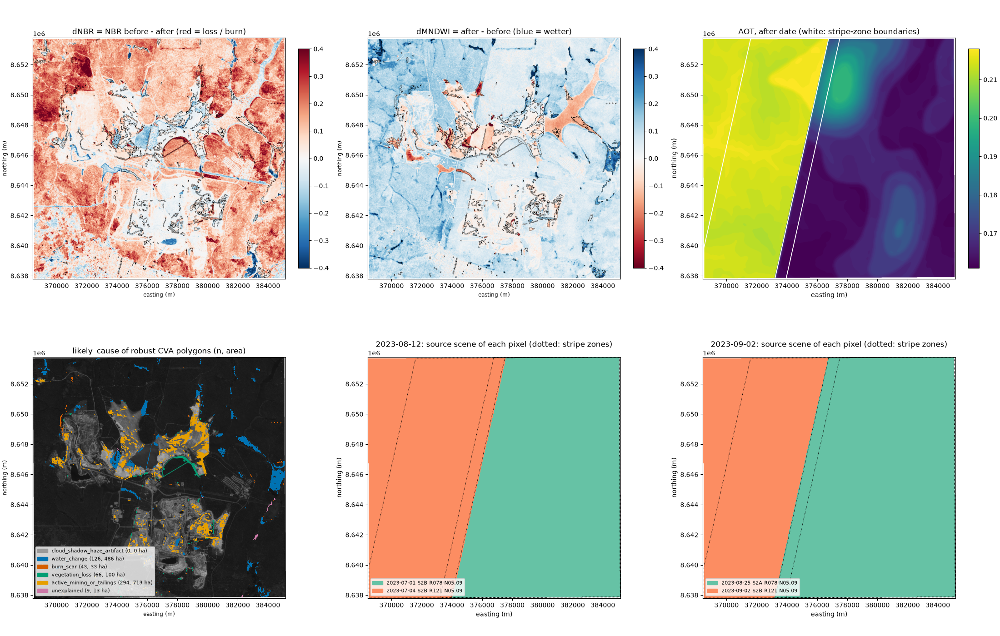
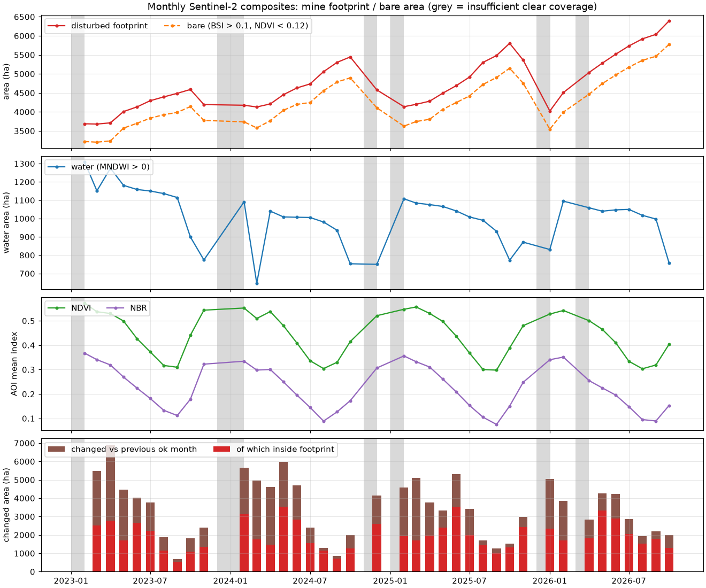

# Report: Sentinel-2 change analysis, open-pit copper mine, NW Zambia

**AOI:** 25.79–25.94 °E, 12.18–12.32 °S, 16.7 × 16.0 km. From its location and layout this looks like the Lumwana copper mine in North-Western Province, with two pit complexes, a tailings storage facility and a fresh-water dam. That identification is my inference; the assignment only says "open-pit mining site in Zambia".
**Nominal dates:** 2023-08-12 (T1) → 2023-09-02 (T2). As section 0 shows, each "date" is really a two-scene mosaic, and the effective intervals are 52–60 days in the dry season.
**Data:** Sentinel-2 L2A, B02/B03/B04, 10 m, EPSG:32735.

## TL;DR

- **Data:** each provided "date" is a mosaic of two Sentinel-2 scenes (verified pixel-exact against STAC), so radiometry steps along slanted seams and the effective gap is 52–60 days, not 21.
- **Method:** detect the seam zones from the data, normalize each zone on pseudo-invariant pixels, then score change with a robust change vector analysis (Mahalanobis d² under a χ² noise model). Thresholds are false-alarm rates (1e-3 / 1e-5), not tuned constants.
- **Result:** 1,345 ha in 538 polygons, against 11,078 ha for the provided Euclidean baseline, which mostly maps the seams and haze. 70 % of the change lies in the mine footprint: the tailings facility, waste dumps and pit benches.
- **Interpretation:** mostly operational mining (tailings deposition, dumping, excavation). Change outside the mine is seasonal wetland/water dynamics, plus a little burning. No footprint expansion is visible at the 0.2 ha scale in this pair.
- **Not proven:** there is no reference data, so confidence is a magnitude score, not an accuracy (section 4).

## 0. Data finding: each "date" is a mosaic of two acquisitions

**What the data showed.** Before any change detection, the T2 − T1 difference contains **straight, parallel radiometric steps at 12.6°**. A model that is constant within each zone explains 56 % of the difference image's variance, with blue offsets of +0.044 / +0.041 / +0.025 / +0.019 across four zones. The dark-object blue reflectance (1st percentile) rises from 0.030 to 0.050, which indicates a hazier T2.

**First hypothesis, then the test.** My first reading was Sentinel-2 detector-footprint striping made visible by haze. I tested it against provenance: `s2cd enrich` searches Planetary Computer's STAC catalogue and compares every pixel. Every provided pixel matches a Planetary Computer L2A item exactly: **100 % identical DN on all 2.65 M valid pixels, in all three bands**. The hypothesis was wrong in an informative way:

| Provided "date" | Source scene (tile 35LLG, baseline N05.09) | Share of AOI |
|---|---|---|
| 2023-08-12 | S2B 2023-07-04, relative orbit 121 | 44 % (W) |
| | S2B 2023-07-01, relative orbit 78 | 56 % (E) |
| 2023-09-02 | S2B 2023-09-02, relative orbit 121 | 39 % (W) |
| | S2A 2023-08-25, relative orbit 78 | 61 % (E) |

There is no clear acquisition on 2023-08-12 itself; the nearest item, 08-13, is 40 % cloudy and does not match.

The steps are **seams along the slanted swath edge of orbit 78**. The two dates have different seam positions, which creates a narrow strip where the scene pairing differs. The blind, data-driven zone detection recovered those seams: **99.2–100 % of each zone's pixels come from a single source-scene pair** (`enrichment_summary.json`). The effective comparison is therefore piecewise:

| Zone | Pixels | Before → after | Interval |
|---|---:|---|---:|
| 0–1 (west) | 39 % | 07-04 → 09-02 | 60 d |
| 2 (strip between seams) | 4 % | 07-04 → 08-25 | 52 d |
| 3 (east) | 56 % | 07-01 → 08-25 | 55 d |

The fourth boundary, between zones 0 and 1, lies inside a single scene pair and probably reflects a haze gradient. L2A aerosol optical thickness (AOT) averages 0.103 before and 0.186 after, so the after date is hazier in every zone, but AOT is too smooth to resolve a step there.

**Why it matters.** Any method that assumes one radiometric relation between the "dates" reads mosaic seams, different sun angles and different haze as land change. The provided baseline flags **94 %** of the westernmost zone. Treating radiometry as piecewise by zone was the key design decision, and it holds whatever the cause of the steps. In production, the source-scene map from STAC (or `MSK_DETFOO` for real detector stripes) would replace estimating the zones from the data.

## 1. Method

**Chosen algorithm: zone-aware relative normalization, then robust change vector analysis (CVA) with a statistical noise model.**

1. **Radiometric zones.** On the blue T2 − T1 difference (8 × 8 block medians, outliers clipped), a grid search finds the orientation whose 1-D profile explains the most variance. Weighted binary segmentation then splits that profile into zones (minimum step 0.006 reflectance, minimum width 40 px). If no orientation explains at least 5 % of the variance, there is a single zone, so clean scene pairs pass through unchanged.
2. **Relative radiometric normalization per zone.** For each band, an orthogonal-regression line `T1 = a + b·T2` is fitted and refitted 5 times, each time rejecting pixels whose residual exceeds 2.5 robust σ in any band. The survivors are pseudo-invariant features (PIFs, 86 % of pixels). Orthogonal rather than ordinary least squares is used because both dates are noisy. This is the automatic radiometric normalization idea of Canty & Nielsen, applied separately in each zone.
3. **Change statistic.** `Δ = T2_norm − T1`. In each zone the PIF change vectors define "no change": mean μ and covariance Σ, which cover sensor noise, sub-pixel misregistration and small phenology. Each pixel's squared Mahalanobis distance `d² = (Δ−μ)ᵀ Σ⁻¹ (Δ−μ)` is χ²(3)-distributed under no change. This gives a change probability `chi2.cdf(d²)` and thresholds with a meaning (false-alarm rate). The Q-Q plot confirms the fit on the PIFs, though that is in-sample, so it is a consistency check rather than validation.
4. **Binary map.** Hysteresis thresholding: regions grow at FAR 1e-3 (d² > 16.3), and a region is kept only if it contains a seed at FAR 1e-5 (d² > 25.9). This suppresses isolated noise without eroding real change. The cleanup then removes 2 px around zone seams (mosaic edge artefacts), applies a 1 px opening, a minimum mapping unit of 0.2 ha, and hole filling.
5. **Polygons.** Change regions are vectorized with 8-connectivity. Each polygon gets area, perimeter, compactness, a confidence score, Δ per band, direction (brightening / darkening / spectral shift, with ±2σ_noise on Δbrightness), and `in_disturbed_area`. That flag is a heuristic mine/industrial footprint: bright bare surfaces at T1, Otsu threshold, closed and buffered by 100 m.

**Why this method rather than the alternatives:**

| Method | Changed area | Changed share per zone (0/1/2/3) | Verdict |
|---|---:|---|---|
| Provided Euclidean distance + Otsu | 11,078 ha | 94 % / 75 % / 41 % / 16 % | Measures mosaic seams and haze, not land change |
| Zone-wise IR-MAD (Nielsen 2007) | 10,623 ha | 34 % / 32 % / 36 % / 46 % | Stripe-free, but over-detects (below) |
| **Robust CVA (this work)** | **1,345 ha** | **3.0 % / 3.7 % / 2.7 % / 6.3 %** | Stripe-free and spatially coherent |

- **The Euclidean baseline** is run unchanged from `inputs/example_change_detection.py`. It has no radiometric model, so its output follows the seams and haze, and min-max normalization makes the scale depend on a handful of extreme pixels.
- **IR-MAD** is invariant to affine radiometric differences, so running it per zone removes the seams. With only three highly correlated visible bands, though, its reweighting converges on the dominant land cover (savanna woodland, canonical correlations ρ ≈ 0.99). The no-change variance `2(1−ρ)` then becomes tiny, and every surface whose date-to-date relation differs from the woodland's is flagged: bright tailings, water, roads, grassland. It would suit more bands (NIR/SWIR) or a smaller, more homogeneous AOI better.
- **CVA after normalization** keeps the physical meaning of Δ (direction and magnitude in reflectance), which the interpretation step needs. Learning the noise model from PIFs per zone makes the threshold adapt to each zone's noise level.
- **Not used:** NDVI (no NIR band was provided; see enrichment), supervised ML (no labels, and one scene pair is not a training set), and log-ratio (meant for SAR speckle; for additive haze on dark targets it amplifies noise).

## 2. Results

- **538 change polygons, 1,345 ha** (5.0 % of the valid AOI). The median polygon is 0.48 ha and the largest is 114 ha.
- **70 % of the changed area (945 ha) lies inside the mine's disturbed footprint**, which covers 31 % of the AOI. Change is about 2.3× more concentrated there than it would be if spread uniformly.
- By direction:

| Direction | Inside disturbed area | Outside | Typical location |
|---|---:|---:|---|
| Brightening | 627 ha | 41 ha | Tailings beaches, dam crest and haul roads, waste-dump faces, pit benches |
| Darkening | 231 ha | 358 ha | Wet tailings deposition (inside); water body, drainage lines and dambos (outside) |
| Spectral shift | 87 ha | 1 ha | Waste dumps and stockpiles E of the southern pit, where colour changes but brightness does not |

Spatial pattern:
- **Tailings storage facility (north-centre):** the largest and most confident cluster. It is a mosaic of brightening (drying, bleaching beach) and darkening (fresh wet slurry) patches, plus a continuous brightening arc along the embankment crest.
- **Pit complexes (NW and S):** bench-scale brightening and darkening at pit edges and ramps, consistent with excavation fronts.
- **Waste dumps east of the southern pit:** brightening with a strong red increase (Δred +0.11). Fresh, iron-stained material is being tipped onto areas that were darker at T1.
- **Freshwater dam (NE) and drainage lines:** the largest single polygon (114 ha) is the dam surface darkening (reflectance 0.058 → 0.020). Elongated darkening patches follow the dambo (seasonal wetland) network.
- **Settlement (SW):** only 20 small polygons (10.6 ha) survive the 0.2 ha MMU. The speckle there comes from sub-pixel misregistration of small roofs, and most of it is filtered, as intended.

## 3. Interpretation

| Pattern | Most likely explanation | My confidence (judgement, no ground truth) | How to confirm |
|---|---|---|---|
| Patchy bright/dark mosaic on the tailings facility | **Operational tailings deposition**: spigotting moves the wet beach around, and dry beaches bleach | High | Deposition records; multi-date sequence (beaches cycle) |
| Brightening arc on the TSF embankment | **Vegetation stripped from the embankment face** (enrichment: `vegetation_loss`, NDVI −0.30, dNBR +0.22 on the 51 ha arc), consistent with preparing a raise or crest works | Medium | VHR imagery; dam-raise schedule |
| Red-shifted brightening on waste dumps | **Active dumping of fresh, oxidized waste rock** | High | Trend over more dates; DEM differencing |
| Bench-scale changes in pits | **Excavation and haulage**, plus shadow differences: solar zenith goes from about 43° (early July) to about 31–35° (late Aug / early Sep) | Medium | Sun-angle-matched pairs; SAR coherence |
| Dam / wetland surface darkening (largest polygon, 114 ha) | **More open water, less floating or emergent vegetation.** Enrichment shows MNDWI +0.27 and NDVI −0.15, but SCL classified it as water on neither date, so it is a vegetated wetland surface becoming wetter. It is not turbidity or glint alone | Medium | Shoreline position on more dates; field or VHR check |
| Darkening along dambos and drainage outside the mine | **Seasonal wetland dynamics plus some burning, not mining.** Enrichment labels most of it `water_change`; only 33 ha meet the burn-scar rule | Medium | VIIRS active fires; more dates |
| Residual small polygons along roads and field edges | Sub-pixel misregistration and noise | n/a | Already filtered by the 0.2 ha MMU; tighten FAR if needed |

In short, mining operations drive most of the real change between early July and late August / early September 2023. The change sits on the tailings facility, the waste dumps and the pit benches, all inside the disturbed footprint. Most change outside the footprint is seasonal (fire, dambos, water) rather than an expansion of the mine. I see **no evidence of new land clearing or footprint expansion** at the 0.2 ha scale in this period. The largest brightening outside the footprint is only 41 ha in total, made of scattered small patches.

## 4. Limitations and next steps

- **Three visible bands and two dates** cannot separate burning from wetting, or turbidity from depth. The enrichment and the timeline add SWIR/NIR and many dates as a check, but the core answer uses only what the brief provided.
- **No reference data:** confidence is a magnitude score, not accuracy. Next step: label a stratified random sample (about 100 polygons, plus about 100 points in the no-change stratum) on VHR imagery and report precision, recall and area-adjusted accuracy (Olofsson et al. 2014). `solafune_tools.metrics` already has the IoU and F1 utilities needed.
- **Shadows:** pit walls are sun-angle dependent. Pairing scenes with similar solar geometry (or using a DEM shadow mask) would remove some bench "changes".
- **For production monitoring**, which is what ShigenAI-style products need:
  - Run on every clear Sentinel-2 L2A scene from Planetary Computer, with an SCL mask.
  - Never compare mosaics blindly. Carry per-pixel source-scene provenance (as `s2cd enrich` reconstructs it) and compare scene to scene, or use per-pixel composites with recorded dates. Keep the data-driven zone check as a QA gate.
  - Add Sentinel-1 coherence so cloudy-season monitoring keeps working.
  - Store results per scene pair in PostGIS (the schema is already run- and date-keyed) and serve them through a tile/feature API to the viewer.

## Appendix: optional extensions beyond the brief

These use extra Planetary Computer data (SWIR/NIR, SCL, more dates) to check the interpretation above. The required answer in sections 1–3 uses only the three provided bands.

### A. Checking the interpretation with SWIR/NIR (`s2cd enrich`)

The assignment gives only visible bands. To test the readings above, I pulled B08, B11, B12, SCL and AOT for the *same source scenes, pixel by pixel* (section 0) from Planetary Computer. From these I computed dNDVI, dNBR and dMNDWI, and assigned every polygon a `likely_cause` with transparent rules (first match wins, thresholds in `enrichment_summary.json`):

| likely_cause | Polygons | Area | Rule (simplified) |
|---|---:|---:|---|
| active_mining_or_tailings | 294 | 713 ha | Inside the disturbed footprint, no other rule fired |
| water_change | 126 | 486 ha | |dMNDWI| > 0.2, an MNDWI sign change, or SCL water |
| vegetation_loss | 66 | 100 ha | dNDVI < −0.1 |
| burn_scar | 43 | 33 ha | dNBR > 0.1 with an NBR drop, outside the footprint |
| unexplained | 9 | 13 ha | none of the above |
| cloud / shadow / haze artifact | 0 | 0 ha | SCL cloud/shadow/cirrus > 30 % |

Caveats I would raise myself:
- **dNBR is mostly seasonal.** AOI-mean NBR falls steadily from 0.25 to 0.09 between June and early September (`docs/figures/07_timeline.png`). A fixed dNBR threshold over a 55–60 day dry-season interval therefore over-calls burns, which is why `burn_scar` also requires being outside the footprint.
- **MNDWI also shows the mosaic seam** (vertical step in the dMNDWI panel). `water_change` is a candidate list, not a verdict.
- **23 polygons (52 ha) straddle a source-scene seam.** They are flagged in `change_context.seam_mix` and should be treated as suspect.

### B. Multi-year context: monthly composites, Jan 2023 – Oct 2026 (`python -m s2cd.timeline`)

One scene pair cannot tell persistent mining from seasonal change. So I built 46 monthly composites from Planetary Computer: SCL cloud/shadow masking, then a per-pixel median. 39 months have at least 90 % clear coverage; the 7 that don't are mostly Dec–Jan and are kept as gaps, not filled. The same zone-aware CVA then runs between consecutive good months.

- **The mine footprint grows.** The footprint is bare surface (BSI > 0.1, NDVI < 0.12, not water), closed, with patches over 1 ha. It also swings 20–40 % with the dry season, so I compare the same month across years:

| Month | 2023 | 2024 | 2025 | 2026 |
|---|---:|---:|---:|---:|
| February | 3,687 ha | 4,174 ha | 4,136 ha | 4,508 ha |
| October | 4,588 ha | 5,444 ha | 5,803 ha | 6,392 ha |

  October to October, that is +1,800 ha in three years (≈ +13 % per year). This is the KPI a mine-monitoring product should report. It also puts the assignment pair in context: Aug–Sep 2023 sits on the normal dry-season rise, and I see no step change there.
- **Water** (MNDWI > 0) bottoms out each Oct–Nov and recovers in Jan–Feb. The 2024-03 low (647 ha) is a one-month anomaly that I have not investigated.
- **The month-to-month "changed area" is mostly phenology.** It peaks at the Mar–May green-up, at up to 7,000 ha. Even inside the footprint it is a magnitude index, not a count of mining events. This is the main reason a production system should model seasonality, for example by comparing against the same month of the previous year or fitting a harmonic baseline, rather than thresholding consecutive months.
- **Caveats:** month areas count only observed pixels (no gap filling). Wet-season composites with 2–3 clear looks per pixel keep a few patches of cloud shadow. The footprint thresholds are heuristic and documented in `timeline.Rules`.

Timelapse: `docs/web/monthly/timelapse.mp4`; interactive in the viewer's *Timeline* tab.
