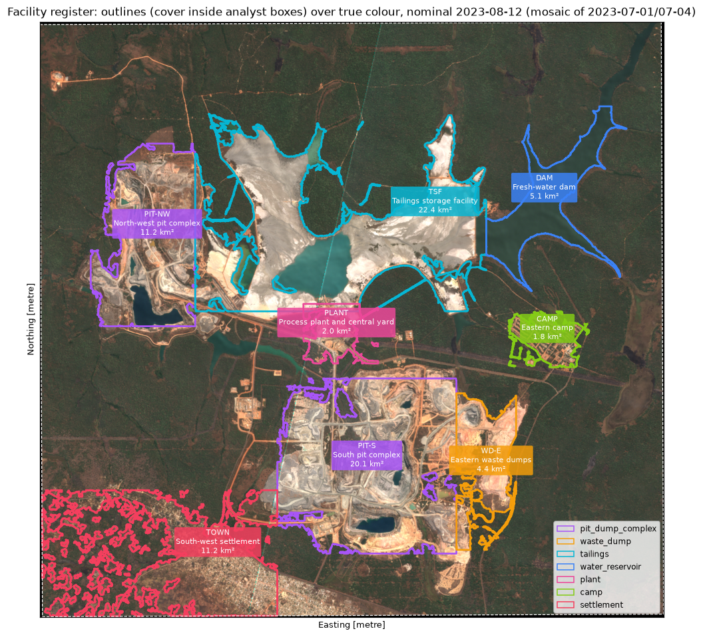

# Report: what changed at an open-pit copper mine in NW Zambia?

**AOI:** 25.79–25.94 °E, 12.18–12.32 °S (16.7 × 16.0 km, EPSG:32735, 10 m). Its layout matches the Lumwana copper mine; the brief only says "an open-pit mining site in Zambia", so the name is an inference.
**Data:** Sentinel-2 L2A **B02, B03, B04 only**, the bands the brief provides. Nothing else is used: no NIR/SWIR, no scene classification layer, no elevation model.
**Dates:** nominal 2023-08-12 → 2023-09-02. Each is a two-scene mosaic (section 0), so the true acquisitions are 2023-07-01/07-04 → 2023-08-25/09-02.

## TL;DR

- **The data has a trap.** Each provided "date" is a mosaic of two Sentinel-2 scenes from different orbits; I verified it pixel-exact against the STAC catalogue. Radiometry therefore steps along slanted seams, and the gap between the dates is 52–60 days, not 21. The provided Euclidean baseline mostly maps these seams and haze: **11,143 ha**, 42 % of the AOI.
- **Method:** normalize each source-scene zone on stable pixels, then run a robust change vector analysis with a **brightness-aware, empirically calibrated** noise model. The realised false-alarm rate is **0.10 %** at the 0.1 % target, measured on held-out stable pixels; the uncalibrated model gave 2.2 %.
- **Result:** **413 ha in 215 polygons** (1.6 % of the AOI). **74 %** of it lies inside the mine's named facilities.
- **Interpretation:** this is operational mining, not expansion.
  - Tailings deposition on the TSF: 185 ha.
  - Waste dumping: 129 ha.
  - Pit-floor and bench activity: 26 ha.
  - Seasonal vegetation or burning outside the mine: 36 ha.
  - No new clearing beyond the mine footprint at the 0.2 ha scale.
- **How sure:** the conclusions hold over 16 threshold settings (sensitivity, section 4). The false-alarm rate is measured; omission and per-class accuracy are not, because there is no reference data (section 5).

## 0. The data finding: each "date" is a mosaic

The before/after difference contains straight, parallel brightness steps at 12.6°. A model that is constant between the steps explains 56 % of the blue-band difference.

**Hypothesis.** My first reading was detector striping under haze.

**Test.** `s2cd provenance` searches Planetary Computer for the source items and compares every pixel.
- **Result:** B02, B03 and B04 match **100 % exactly** (2.65 M pixels per band). The hypothesis was wrong in an informative way.

| Nominal date | Source scenes (tile 35LLG, baseline N05.09) | Solar zenith / azimuth |
|---|---|---|
| 2023-08-12 | S2B 2023-07-04 R121 (W, 44 %) + S2B 2023-07-01 R078 (E, 56 %) | 42.5° / 34° and 44.1° / 37° |
| 2023-09-02 | S2B 2023-09-02 R121 (W, 39 %) + S2A 2023-08-25 R078 (E, 61 %) | 30.8° / 50° and 34.9° / 50° |

The steps are the seams along the swath edge of orbit R078. The detection uses three zones, each a single before→after scene pair: 07-04→09-02, 07-04→08-25 and 07-01→08-25. My blind, data-driven zone detection had put 99.3 % of its pixels inside one of these zones, so the method held up even though the first explanation did not.

**Consequences, all handled in the pipeline:**
1. Radiometry is normalized per zone.
2. Pixels within 90 m of a seam are excluded (2.4 % of the AOI).
3. Dates are labelled "nominal" everywhere, and the true acquisitions are stored in the outputs.
4. Sun angle differs by about 10° in zenith and 15° in azimuth between the dates. Pit walls and dump faces therefore change illumination, a known confounder (section 3).

## 1. Method

| Step | What | Why |
|---|---|---|
| Load & check | Stack B02–B04 per date; assert identical CRS, transform and shape; nodata 0; DN → reflectance with the L2A −1000 offset (detected robustly, with a warning fallback) | Part 1 |
| Zones | Source-scene zones from STAC provenance (fallback: data-driven seam detection) | Different scenes have different radiometry |
| Normalization | Per zone and band, orthogonal regression `T1 = a + b·T2` on pseudo-invariant pixels, iterated with 2.5σ rejection (adapted from Canty & Nielsen 2008) | Both dates are noisy; haze lowers contrast on T2 (slopes 1.1–1.8) |
| Change statistic | Change vector `Δ = T2_norm − T1` (CVA, Malila 1980); squared Mahalanobis distance d² under a per-zone, **per-brightness-stratum** noise model fitted on stable pixels | Noise grows with brightness: one global model gave bright mine surfaces 10–25× too many false alarms |
| Calibration | Thresholds from the 99.9th / 99.999th percentiles of d² on **held-out** stable pixels, per stratum | The χ² assumption is off (heavy tails, spatial autocorrelation). Calibrated, the realised rate is 0.092–0.107 % in every stratum |
| Binary map | Hysteresis (Canny 1986): grow at 1e-3, seed at 1e-5; seam buffer; 1-px opening; minimum mapping unit 0.2 ha | Keeps coherent change and removes speckle |
| Polygons | 8-connected regions, made valid, stored as MultiPolygon EPSG:32735 with area, magnitude, −log10 p and direction | Part 3 |
| Interpretation | **Facility register** of 8 named facilities, outlined from the imagery; **change type** per polygon from RGB evidence + facility; one-line "why" | Part 5: from "pixels changed" to "what happened" |

The cleanup (1-px opening + 0.2 ha minimum mapping unit) deliberately drops features narrower than about 20 m or smaller than 0.2 ha, such as haul-road edges and single noisy pixels.

| Method | Changed area | Why it behaves this way |
|---|---:|---|
| Provided Euclidean distance + Otsu | 11,143 ha (79 / 43 / 16 % per zone) | No radiometric model: it maps seams and haze |
| Zone-wise IR-MAD (Nielsen 2007) | 10,824 ha | It converges on woodland (ρ ≈ 0.99). With only three correlated visible bands, every other cover then looks "changed" |
| **Robust CVA, calibrated (this work)** | **413 ha (1.1 / 1.0 / 2.0 % per zone)** | Seam-free, mine-concentrated |

Why no machine learning: there are no labels, only three bands and two dates. With labelled polygons, a Siamese U-Net or a change transformer on multi-date stacks would be the next step, and this pipeline would become its data and QA layer.

## 2. Results

**Per facility** (outlines from the data inside analyst-defined regions; `configs/facility_register.yaml`):

| Facility | Area | Changed | Mostly |
|---|---:|---:|---|
| Tailings storage facility (TSF) | 2,244 ha | **194 ha (9 %)** | tailings deposition |
| South pit complex | 2,009 ha | 38 ha (2 %) | pit / bench activity |
| Eastern waste dumps | 435 ha | 36 ha (8 %) | waste dumping |
| North-west pit complex | 1,117 ha | 34 ha (3 %) | waste dumping |
| Process plant | 195 ha | 5 ha | infrastructure |
| Settlement, camp, fresh-water dam | 1,815 ha | 0.4 ha | — |

**Per change type** (mapped onto the brief's categories):

| Change type | Brief category | Polygons | Area |
|---|---|---:|---:|
| Tailings deposition | mining activity | 61 | 185 ha |
| Waste dumping | mining activity | 55 | 129 ha |
| Seasonal vegetation or burn | seasonal variation / vegetation | 18 | 36 ha |
| Pit excavation | mining activity | 26 | 26 ha |
| Water level change | water change | 8 | 18 ha |
| Noise or artifact | noise or artifacts | 27 | 9 ha |
| Infrastructure / settlement | urban expansion | 9 | 4 ha |
| Unexplained | — | 6 | 5 ha |
| Land clearing (incl. at the mine edge) | land clearing | 5 | 1 ha |

## 3. Interpretation

| Pattern | Most likely meaning | Confidence | Confounders (RGB-only) | How to confirm |
|---|---|---|---|---|
| Moving bright/dark patches on the TSF beaches | Tailings deposition: wet slurry moving between spigot points while dry beaches bleach | Medium–high | Surface drying with the season | Later dates: the TSF outline stays put while patches move |
| Brighter **and redder** faces at dumps and pit-complex edges | Fresh, oxidized waste rock tipped | Medium | Illumination change on slopes (sun 10° higher, 15° further north-east), dust | A later same-season date; very-high-resolution imagery |
| Bench-scale changes inside pits | Excavation and haulage | Low–medium | Shadow changes from sun geometry | Sun-matched pairs; elevation data (not in this brief) |
| Small water-edge changes | Pond and pit-lake level shifts | Medium | Haze lowers T2 brightness; water needs both-date evidence | The water rule on more dates |
| Darker or browner patches outside the mine | Dry-season grass senescence or burning | Medium | Burnt vegetation vs. wetness cannot be separated in RGB | Fire records; recovery after the rains |
| Polygons on or near seams | Artifacts | High | — | The source-scene map |

**What happened, in one paragraph.** Between early July and late August / early September 2023, the measurable change is operational. Tailings were deposited across the TSF (194 ha changed, 9 % of the facility). Waste rock was tipped at the eastern dumps and at the edges of both pit complexes (129 ha labelled waste dumping). Activity continued inside the pits. Outside the mine, change is small and seasonal. **I see no evidence of mine expansion into new ground at the 0.2 ha / 20 m detection limit**: only 1 ha qualifies as clearing. Every label is a hypothesis built from RGB evidence and facility context, and each polygon carries its "why".

## 4. Sensitivity

I re-ran the binary rule over per-pixel false-alarm rates from 1e-2 to 1e-5 and minimum mapping units from 0.1 to 1 ha (16 settings):
- **Changed area** ranges over **210–682 ha**, versus 11,143 ha for the baseline.
- **Share inside the mine's facilities** stays between **61 % and 77 %**, and rises as the test gets stricter: the strongest changes are the mining ones.

The conclusions do not depend on one threshold choice.

## 5. Limitations and next steps

- **No accuracy assessment.** There is no reference data. The false-alarm rate is calibrated and measured on held-out stable pixels, but missed change and the correctness of the change types are not. The next step is a stratified random sample labelled on very-high-resolution imagery (Olofsson et al. 2014), with strata from this map and the baseline so both get scored.

- **RGB only.** No vegetation-health, burn-severity or mineral indices. Water, shadow and dark wet soil can be confused, so the water rule requires both dates. The thresholds in `rgb.py` are tuned to this AOI.
- **Two mosaicked dates.** Sun and view geometry differ between orbits (BRDF). Normalization removes a per-zone linear difference but not cover-specific angular effects. Measured co-registration error is small: ≤ 0.05 px mean shift per zone, ≤ 0.25 px in any window.
- **No elevation.** Pits and dumps cannot be separated reliably, and no volumes can be computed. Stereo VHR imagery or LiDAR would be the next data for that.
- **Facility register.** The regions are analyst-defined boxes (human-in-the-loop); outlines come from the imagery. For production, use licence boundaries or a maintained facility database.
- **For production monitoring:** carry per-pixel acquisition provenance instead of nominal mosaic dates; use same-season pairs; calibrate thresholds per scene pair as done here; validate with VHR samples; store per-pair runs in PostGIS (the schema is already run-keyed).

**References.** Malila (1980) change vector analysis; Otsu (1979); Canny (1986) hysteresis; Nielsen (2007) IR-MAD; Canty & Nielsen (2008) *Remote Sens. Environ.* 112:1025 (automatic radiometric normalization); Richardson et al. (2007) / Sonnentag et al. (2012) green chromatic coordinate (here on BOA reflectance, not camera DN); Olofsson et al. (2014) *Remote Sens. Environ.* 148:42.
